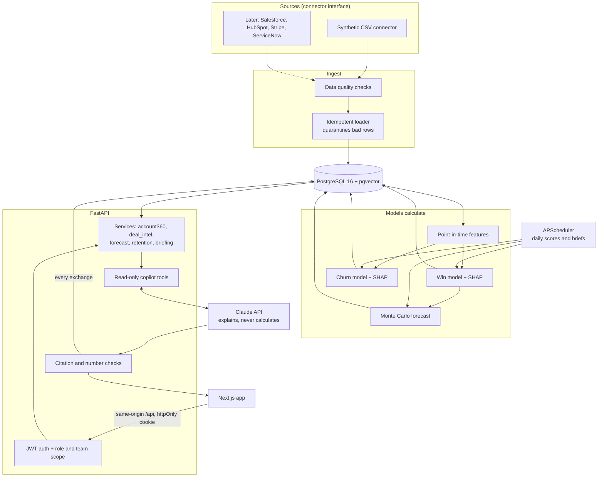

# Architecture

## Data flow

1. **Ingest.** A connector returns rows in canonical table shape. Data-quality checks run on the raw rows, then the loader upserts them and quarantines anything that breaks a foreign key.
2. **Model.** Features are built as of a date, using only facts known then. The win and churn models are trained with time-based splits, and each stores scores and plain-language reasons in `predictions`.
3. **Forecast.** Open deals expected in the quarter are simulated 5,000 times, using win probability and a learned in-quarter rate. Weekly snapshots feed the variance explainer.
4. **Serve.** Every API call resolves the user's scope, and every query applies it.
5. **Explain.** The copilot sends the question to Claude with seven read-only tools. Tool results return as marked, untrusted data. The final answer is checked for valid citations and grounded numbers, then saved to the audit log.

## Boundaries worth noticing

| Boundary | Enforced by |
|---|---|
| Who can see what | `Scope` in `backend/app/services/scope.py`, used by every service and copilot tool |
| What the LLM can do | The fixed read-only list in `backend/app/copilot/tools.py` |
| What the LLM can claim | `check_answer` in `backend/app/copilot/guardrails.py` |
| What models can see | `deal_features` and `churn_features` in `backend/app/ml/features.py` |
| What the rest of the app knows about sources | `Connector` in `backend/app/connectors/base.py` |

## Scaling notes

This is sized for one API process and a few hundred accounts. These would change first with real volume:

- The rate limiter is in memory, so several replicas need Redis.
- The scheduler runs in the API process, so several replicas need one dedicated worker.
- Feature building uses pandas in memory, so large data needs a warehouse or feature store.
- Vector search is an exact scan, so millions of rows need an approximate index with iterative scans.
