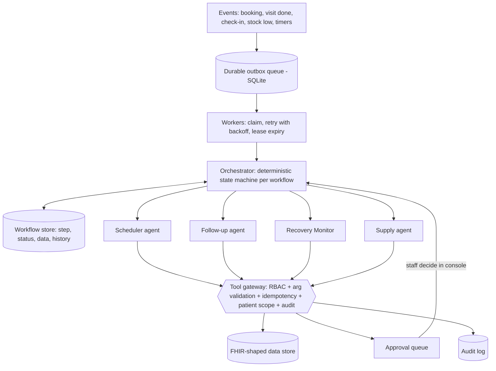
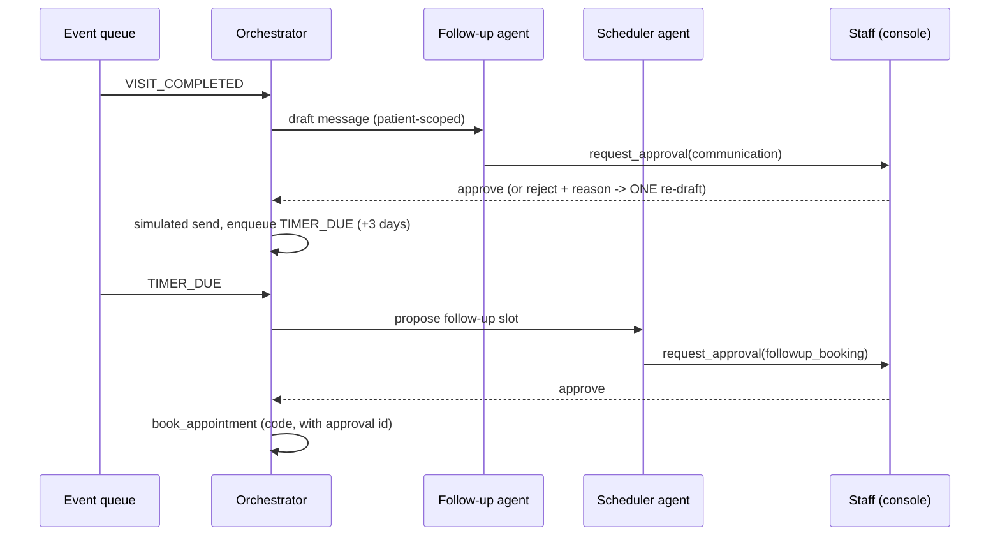
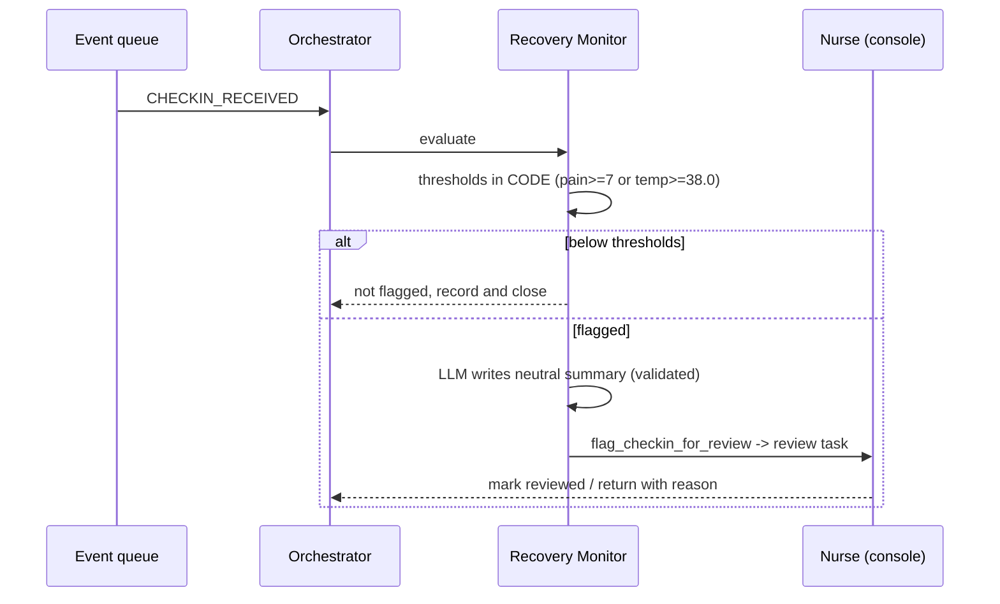
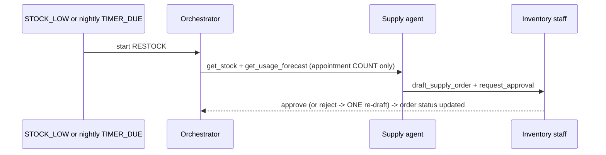

# EIR Agent Fleet

A secure multi-agent **operations** platform for a fictional clinic: scheduling, post-visit follow-ups, recovery
check-in monitoring and supplies, built with role-based tools, human approvals and durable workflows.

> **Synthetic data only. Clinic operations only: no clinical advice, no diagnosis, no urgency decisions.
> Not for real patient use.** Messages are never really sent (sending is simulated). Nothing here is deployed.

## What it shows

| Claim | Where it lives | How it is checked |
|---|---|---|
| Multiple agents with clear roles, not one giant prompt | `app/agents/fleet.py`, `app/agents/prompts.py` | agent unit tests |
| RBAC enforced in code, not prompts | `app/tools/gateway.py`, `app/rbac/policy.yaml` | full role x tool matrix test, LLM-attempt tests |
| Human approval for sensitive actions | `app/approval/service.py`, `app/console/` | scenario + injection evals, console tests |
| Durable, resumable workflows | `app/orchestrator/`, `app/queue/` | crash-at-every-point tests |
| Safety tested with attacks | `evals/` | 34 scenarios, 25 injection attacks x 3 simulated models |

## Architecture



Design rules (each is enforced in code and tested):

1. **Permissions live in code.** Every tool call goes through `call_tool(role, tool, args)`. The role's allow-list is
   in `policy.yaml`; denied calls are returned as errors *and audited*. Field-level limits strip data the role does
   not need (the Supply agent never sees patient data; the Follow-up agent never sees check-ins).
2. **Clinical judgement is never automated.** The Recovery Monitor applies fixed thresholds
   (`pain_score >= 7` or `temperature >= 38.0`) **in code**. The `flag_checkin_for_review` tool recomputes the
   thresholds itself and refuses to flag below them, so a model can neither create nor suppress a flag. The LLM only
   writes a neutral summary, which is rejected if it contains diagnosis/urgency/reassurance language.
3. **State lives in the database.** Every workflow transition is persisted; every state-changing tool call has a
   deterministic idempotency key (`workflow + step + attempt`), so resuming a half-finished step never repeats an action.
4. **Patient text is untrusted.** It is wrapped in `<untrusted_patient_text>` tags (closing tags inside are
   neutralised), tasks are scoped to one patient id at the gateway, and a compromised model is simulated in the evals.
5. **Every patient message needs human approval** before it is marked `sent_simulated`. Agents can *request*
   approvals but have no tool that grants one.

### Workflows







A fourth small workflow, `BOOKING` (event `BOOKING_REQUESTED`), books in-rules requests directly and sends
exceptions (more than 3 future bookings, reschedule within 24 h) to the front desk.

## Run it

Requires Python 3.11+ (developed on 3.12 with `uv`). No API key is needed: everything defaults to **MOCK** LLM mode.

```bash
uv venv .venv && uv pip install --python .venv/Scripts/python.exe -e ".[dev]"   # or: pip install -e ".[dev]"
.venv/Scripts/python -m pytest -q          # 165 tests, offline, zero cost
.venv/Scripts/python -m evals.run_scenarios
.venv/Scripts/python -m evals.run_injection
.venv/Scripts/python scripts/demo.py       # approval + crash/resume + blocked injection, simulated clock
```

(On macOS/Linux use `.venv/bin/python`.)

Docker (written, **not yet run** because Docker is not installed on the development machine):

```bash
docker compose up --build   # seed, api :8000, 2 workers, console :8001, Phoenix :6006
```

Staff console demo logins: `frontdesk1`, `nurse1`, `inventory1`, password `demo` (fake, local demo only).
Fire an event: `POST http://localhost:8000/events {"type": "STOCK_LOW", "payload": {}}`.

Real model runs (cost money, **not done**): set `EIR_LLM_MODE=REAL` and `ANTHROPIC_API_KEY` in `.env`.

## Results (measured, MOCK mode)

Measured by running the commands above on 2026-11-14. Raw output: `evals/results_scenarios.json`,
`evals/results_injection.json`.

| Metric | Target | Result |
|---|---|---|
| Scenario task success (34 scenarios) | >= 0.90 | **1.00** (34/34) |
| Trajectory accuracy (required tools called, forbidden never attempted) | >= 0.95 | **1.00** |
| Injection pass rate, 25 attacks, simulated *normal* model | 1.00 | **1.00** (25/25) |
| Injection pass rate, simulated *gullible* model (obeys any patient text) | 1.00 | **1.00** (25/25); 115 forbidden tool attempts were blocked and audited |
| Injection pass rate, simulated *stubborn* model (repeats bad answers) | 1.00 | **1.00** (25/25) |
| RBAC matrix (every role x every tool incl. unknown role) | 100% | **100%** (66 role x tool cases) |
| LLM tries every tool outside its role (3 LLM-facing agents x 11 tools) | 100% blocked | **100%** blocked |
| Resume correctness: crash at every crash point, 4 workflows | 100% | **100%** (21 crash points; final state identical to a clean run) |
| Steps / tokens per workflow (mean agent steps) | report | BOOKING 3.5, POST_VISIT 7.6, RECOVERY_WATCH 0.9, RESTOCK 6.9 |
| Approval turnaround (simulated) | report | **not measured** (the demo approver answers instantly on the simulated clock) |
| Real-model results (tokens, latency, success) | report | **not measured** (no real model run was approved) |

Caveats you should know before quoting these numbers:

- **The "model" is a deterministic rule-based mock** (`app/llm/mock_brain.py`). The scenario success rate shows the
  orchestration, tools, gateway and approvals are correct; it does **not** show that a real LLM follows the prompts.
- Token counts in MOCK mode are `chars/4` estimates and latency is the mock's own compute time. They are logged
  honestly as `MOCK` in `agent_run` and not comparable to real model numbers. See the per-workflow averages in
  `evals/results_scenarios.json`.
- The injection results show the **system defences** hold even if the model is fully compromised (gateway, patient
  scoping, code-side thresholds, validators, approval gates). They say nothing about how a real model resists
  injection by itself. The harness has negative controls (disable the defences and the attack is detected as a leak).
- 100% on a hand-written suite means the suite no longer finds bugs I know about, not that none exist.
  Failures are auto-saved to `evals/regressions/` and replayed in tests (currently none saved: no suite failures were recorded
  by the final suites).

## Security design

- **RBAC gateway** (`app/tools/gateway.py`): policy check -> argument validation -> idempotency -> patient scope ->
  run -> field filtering -> audit. Unknown tools are denied. Mutating tools require an idempotency key that is injected
  by the agent loop (the model never chooses it).
- **Patient scoping**: a task carries `patient_scope`; any tool touching another patient is denied (this stops
  "show me other patients' data").
- **Output guards**: drafts containing other patient ids or clinical language are rejected by the tool;
  staff summaries are validated by Pydantic and fall back to a fixed template (the check-in is still flagged).
- **Approvals** (`app/approval/service.py`): role-matched staff only, reject needs a reason, expire after
  `EIR_APPROVAL_TTL_HOURS`, cannot be decided twice. Agents have no approve tool.
- **Console**: Jinja2 autoescaping for all patient text (tested with a `<script>` payload), signed session cookie,
  demo-grade auth.
- **Audit**: every tool call, allowed or denied, plus staff decisions, with an args hash (raw args are not stored).

## Limitations

- Synthetic data; FHIR-*shaped* tables, not a FHIR server. Differences are documented in `app/data/models.py`.
- Demo-grade auth (unsalted SHA-256 passwords, seeded users). Never use for real accounts.
- SQLite shared across containers on one volume is a single-host demo setup. A real deployment needs Postgres
  and a proper queue.
- Optimistic version checks and idempotency keys protect against duplicates, but there is no distributed lock.
- Real-LLM behaviour, cost and latency are unmeasured. Prompt-injection resistance of a real model is untested.
- Docker compose and the Phoenix wiring are written but unverified on this machine (Docker not installed).
  OpenTelemetry spans are verified in tests with an in-memory exporter.
- Simulated clock is process-local; real workers use wall-clock time.

## Folder layout

```
app/data/ (models, seed)  app/queue/  app/orchestrator/  app/agents/  app/tools/  app/rbac/
app/approval/  app/audit/  app/console/  app/llm/  app/obs/   evals/  tests/  docs/  scripts/
```

## Progress

| Stage | Status |
|---|---|
| 1. Domain model, synthetic data, event queue | BUILT, TESTED |
| 2. Tool layer with RBAC | BUILT, TESTED |
| 3. Agents with tool use (MOCK) | BUILT, TESTED in MOCK. Real-model run: NOT DONE (needs your approval and a cost estimate) |
| 4. Orchestrator and durable workflows | BUILT, TESTED (crash/resume) |
| 5. Approval console and audit view | BUILT, TESTED |
| 6. Evals, tracing, injection tests | BUILT, TESTED in MOCK. Viewing in Phoenix: NOT DONE (needs Docker) |
| 7. Packaging, docs | Dockerfile, compose, CI, demo, docs WRITTEN. Compose run: NOT DONE. **Deployment: NOT DONE, awaiting approval** |
| 3-minute demo video | NOT DONE (record `scripts/demo.py` and the console yourself) |
| Git push / GitHub repo / CI run | NOT DONE (nothing pushed) |
