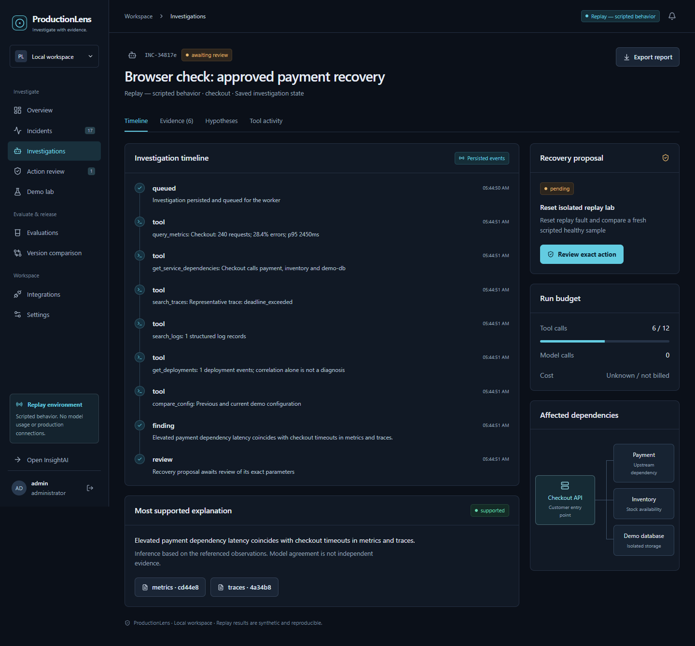

# ProductionLens

An evidence-centered production investigation and agent evaluation application. This first local release includes a working replay investigation/review workflow, a 48-case scripted benchmark, and a separately instrumented checkout demo.

**Replay means scripted behavior.** It requires no model key and is not evidence of LLM reasoning. Live-provider and container integration work is explicitly tracked in [build status](docs/BUILD_STATUS.md).



## Start locally

Tested environment: Windows, Node 22.17.1, Python 3.11.15, uv 0.11.20, installed Chrome. Commands below run from this repository's root in PowerShell.

```powershell
npm ci
npm run bootstrap
npm run dev
```

Open [ProductionLens](http://127.0.0.1:3000). Sign in as `admin` using the unique password generated at `.productionlens/admin-password.txt`. The password is deliberately not printed in the console. Bootstrap preserves existing credentials and records.

`npm run dev` starts the frontend, FastAPI on port 8000 and a separate worker. Use Ctrl+C to stop the launcher. State persists in `.productionlens/platform.db`; graph checkpoints are in `.productionlens/checkpoints.db`. Existing InsightAI remains at [/insight](http://127.0.0.1:3000/insight).

## Try the application

1. Open an incident and select **Start investigation**, or choose **New investigation** and a replay fixture.
2. Watch the timeline, inspect **Evidence**, and review hypotheses and tool activity.
3. Select **Review exact action**. Reject the proposal or approve its exact hash-bound parameters.
4. Inspect the fresh scripted recovery measurements and export the incident report.
5. Open **Evaluations**, select `script-regression`, and run the benchmark. Inspect its pool-pressure regressions and version comparison.
6. Try **Incomplete evidence** to see an honest inconclusive finding. Test the unconfigured provider in Integrations to see an explicit error.

## Commands

```powershell
npm test                              # isolated unit/API/worker tests
npm run typecheck
npm run lint
npm run build                         # production web build
npm run test:browser                  # requires the local stack and Chrome
npm run eval:replay                   # fixed script vs deliberately regressed script
uv run --locked python -m packages.evaluation.cli --candidate script-v1
```

Browser verification creates clearly named test incidents in the local workspace. Reports and screenshots are written under `docs/evidence`. Benchmark results include actual counts, latencies and explicit missing evidence. A scripted pass never authorizes a live-agent release.

## Real instrumented demo

In a separate terminal:

```powershell
uv run --locked python -m demo.cli up
```

Then:

```powershell
uv run --locked python -m demo.cli traffic --count 60
uv run --locked python -m demo.cli fault --fault payment_delay --seconds 30
uv run --locked python -m demo.cli traffic --count 60
uv run --locked python -m demo.cli reset
```

Other bounded faults: `config_regression`, `pool_exhaustion`, `cpu_saturation`. They affect only demo processes and expire after at most 120 seconds. The demo uses its own database. Its controller secret is generated separately and is not an agent tool. UI Demo lab controls currently operate replay fixtures; this CLI generates real HTTP traffic.

## Operating modes and configuration

Replay uses synthetic versioned telemetry and a fixed diagnostic program. Live mode uses server-side `MODEL_API_KEY`, `MODEL_ID`, an allowed `MODEL_BASE_URL`, and configured telemetry endpoints. It never silently substitutes replay data. Read [integrations](docs/INTEGRATIONS.md) before configuring it. No saved provider secrets are returned to the browser.

The repository retains the existing Next.js frontend rather than introducing Vite. FastAPI, SQLAlchemy and LangGraph power the backend. SQLite is the tested local profile. Compose prepares PostgreSQL, Redis/RQ, Prometheus, Jaeger, an OpenTelemetry Collector and resource-limited demo services; this profile still needs runtime verification on a functioning Docker Linux engine.

## Documentation

- [Build status and continuation](docs/BUILD_STATUS.md)
- [Architecture and API](docs/ARCHITECTURE.md)
- [Agent design](docs/AGENT_DESIGN.md)
- [Evaluation methodology](docs/EVALUATION_METHODOLOGY.md)
- [Threat model](docs/THREAT_MODEL.md)
- [Deployment and backups](docs/DEPLOYMENT.md)
- [Five-minute demo](docs/DEMO_SCRIPT.md)
- [Known limitations](docs/KNOWN_LIMITATIONS.md)
- [Measured portfolio evidence](docs/PORTFOLIO_EVIDENCE.md)

This is a local first release, not a hardened public service. Nothing has been pushed, published or deployed to an external system.
