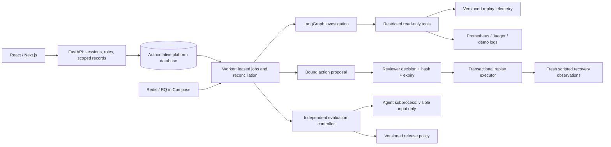

# Architecture

ProductionLens is an implemented local development platform, with a tested SQLite replay profile and a prepared PostgreSQL/Redis container profile. It is not a validated production deployment.

## Repository boundaries

- `app`, `lib/productionlens`: React UI, same-origin API proxy, reusable components. Next.js is retained from the existing repository instead of Vite. `app/insight` preserves the original InsightAI app.
- `services/api`: authentication, records, validated mutations, review APIs, exports and OpenAPI.
- `services/worker`: durable job claims, graph execution, replay executor and optional Redis/RQ dispatch.
- `packages/agent`: typed evidence and diagnosis contracts, fixed diagnostic baseline, live tool-selection loop and version metadata.
- `packages/connectors`: explicit replay and live adapters, provider destination policy.
- `packages/evaluation`: controller-owned expected outcomes, isolated trials, lifecycle tests and release policy.
- `demo`: three real instrumented services, bounded faults, controller CLI, real traffic generator.
- `infra`: Compose, container builds, collector/scraper configuration and migrations.

## Persistence and recovery

SQLAlchemy stores users, hashed server sessions, incidents, runs, run events, evidence, action proposals with reviewer decisions, deduplicated action executions, jobs, evaluation runs, case results, settings and audit events. Hypotheses, tool activity and version metadata are immutable snapshots inside run JSON. This is a pragmatic initial schema; a normalized enterprise schema and future migration strategy need further work.

API transactions persist a job before returning. Local workers poll the database; Compose additionally dispatches RQ jobs. Database compare-and-set claims prevent simultaneous ownership. Jobs have renewable leases. Expired claims are eligible for reconciliation. Graph checkpoints use SQLite locally and PostgreSQL in the container profile. Recorded tool results avoid duplicating already committed reads on resume.

The replay executor commits its state change, execution record and recovery evidence together. A unique action execution constraint and a guarded status transition prevent duplicate mutations. No live recovery executor is exposed yet.

## API contracts

OpenAPI is available from the backend at `/docs` and `/openapi.json`. All `/api` records require a session, except login. Roles apply to one explicitly shared organization; object scoping additionally binds evidence to its run. POST requests need a CSRF header.

Core resources: `/api/incidents`, `/api/investigations`, `/api/investigations/{id}`, `/api/investigations/{id}/events`, `/api/investigations/{id}/evidence/{evidence_id}`, `/api/actions/{id}/approve`, `/api/actions/{id}/reject`, `/api/evaluations`, `/api/evaluations/{id}`, `/api/demo`, `/api/integrations`. Reports use the relevant `/{id}/export` endpoint. The UI reconnects to saved state and deduplicated event IDs.

## Official references checked

[FastAPI security](https://fastapi.tiangolo.com/tutorial/security/), [SQLAlchemy ORM](https://docs.sqlalchemy.org/en/20/orm/quickstart.html), [LangGraph persistence](https://docs.langchain.com/oss/python/langgraph/persistence), [Next.js rewrites](https://nextjs.org/docs/app/api-reference/config/next-config-js/rewrites), [Prometheus query API](https://prometheus.io/docs/prometheus/latest/querying/api/), [OpenTelemetry Python](https://opentelemetry.io/docs/languages/python/instrumentation/), [OpenAI function calling](https://developers.openai.com/api/docs/guides/function-calling).
