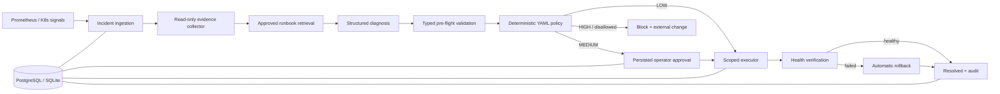

# Self-Healing Remediation Agent

A safe, evidence-grounded AIOps POC that detects certified sandbox incidents, retrieves approved runbooks, proposes typed remediation, applies deterministic policy, pauses for risk-based approval, executes only allowlisted tools, verifies recovery, and automatically restores captured state when verification fails.

The default `memory` sandbox is intentionally complete: it needs no cluster or model credentials and drives the UI, tests, seeded demo, and 56-case benchmark. A typed Kubernetes adapter, kind cluster, dedicated namespace, and split diagnostic/execution RBAC demonstrate the real sandbox boundary.



## Quick start

Prerequisites: Docker Desktop with Compose. From this project directory:

```powershell
Copy-Item .env.example .env
docker compose up --build
```

Open:

- operator console: <http://localhost:3002>
- API/OpenAPI: <http://localhost:8002/docs>
- Prometheus: <http://localhost:9092>

The stack starts PostgreSQL, seeds all seven incident classes, and leaves one medium-risk incident awaiting approval. Unique project ports are web `3002`, API `8002`, PostgreSQL `54322`, and Prometheus `9092`.

### Native development

Python 3.11+ and Node 22+:

```powershell
py -3.13 -m venv .venv
.\.venv\Scripts\python.exe -m pip install -e ".[test]"
Set-Location apps\web
npm install
Set-Location ..\..
.\.venv\Scripts\python.exe -m uvicorn app.main:app --reload --port 8002
```

In a second terminal:

```powershell
Set-Location apps\web
npm run dev
```

SQLite is used by default at `./selfheal.db`; Compose uses PostgreSQL. Delete the local DB or call the authenticated seed endpoint to reset demo data.

## Demo identity and security headers

Local-only credentials are deliberately obvious and must never be used outside a developer machine:

| Role | Bearer token | CSRF token |
|---|---|---|
| operator | `demo-operator-token` | `demo-csrf-token` |
| viewer | `demo-viewer-token` | not permitted to mutate |

The browser UI supplies the operator values for the credential-free local POC. Production must use OIDC, server-issued CSRF tokens, TLS, and a secrets manager.

## Certified incidents

| Scenario | Signal | Action | Risk/default | Recovery |
|---|---|---|---|---|
| CrashLoopBackOff | waiting reason | restart named pod | LOW / automatic | replacement Ready twice |
| unhealthy pod | Ready=0 | restart named pod | LOW / automatic | readiness succeeds |
| excessive latency | p95=1850ms | clear synthetic cache | LOW / automatic | p95 below 500ms |
| replica shortage | available=1/3 | scale named deployment to 3 | LOW / automatic | 3 Ready |
| bad deployment | error rate=42% | rollback named deployment | MEDIUM / approval | prior revision healthy |
| failing scheduled job | failed=1 | rerun named job once | LOW / automatic | replacement completes |
| no safe remediation | suspected volume corruption | `delete_namespace` rejected | HIGH / blocked | external change process |

Select “Force health-check failure” in the UI to demonstrate automatic rollback after a successful reversible action.

## Commands

```powershell
# core tests
.\.venv\Scripts\python.exe -m pytest -q

# measured 56-case benchmark; writes JSON and Markdown
.\.venv\Scripts\python.exe -m app.evaluation --output reports/evaluation.json --markdown reports/evaluation.md

# frontend build
Set-Location apps\web; npm run build

# Playwright critical flows (install the browser once)
npx playwright install chromium
npm run test:e2e

# validate container configuration
docker compose config -q
```

Make targets: `setup`, `dev`, `test`, `eval`, `seed`, `lint`, `web-build`, `compose-check`, `sandbox`, and `sandbox-destroy`.

## kind sandbox

Install `kind` and ensure `kubectl` points to a disposable context:

```powershell
.\scripts\create-sandbox.ps1
# start the API separately, then inject a repeatable cluster fault + matching incident
.\scripts\inject-fault.ps1 -Scenario crashloop
.\scripts\inject-fault.ps1 -Scenario excessive_latency -ForceVerificationFailure
.\scripts\destroy-sandbox.ps1
```

The bootstrap creates only cluster `selfheal-02` and namespace `selfheal-demo`. Diagnosis and execution ServiceAccounts have separate Roles. The agent has no method that accepts model-generated shell commands.

## API examples

```bash
curl http://localhost:8002/api/dashboard -H "Authorization: Bearer demo-viewer-token"
curl -X POST http://localhost:8002/api/incidents -H "Authorization: Bearer demo-operator-token" -H "X-CSRF-Token: demo-csrf-token" -H "Content-Type: application/json" -d '{"scenario":"bad_deployment"}'
curl -X POST http://localhost:8002/api/incidents/INCIDENT_ID/approval -H "Authorization: Bearer demo-operator-token" -H "X-CSRF-Token: demo-csrf-token" -H "Content-Type: application/json" -d '{"decision":"APPROVED","comment":"Evidence and rollback reviewed"}'
```

Further reading: [architecture](docs/ARCHITECTURE.md), [threat model](docs/THREAT_MODEL.md), [evaluation](docs/EVALUATION.md), [demo script](docs/DEMO_SCRIPT.md), [API](docs/API.md), and [production gaps](docs/PRODUCTION_GAPS.md).

