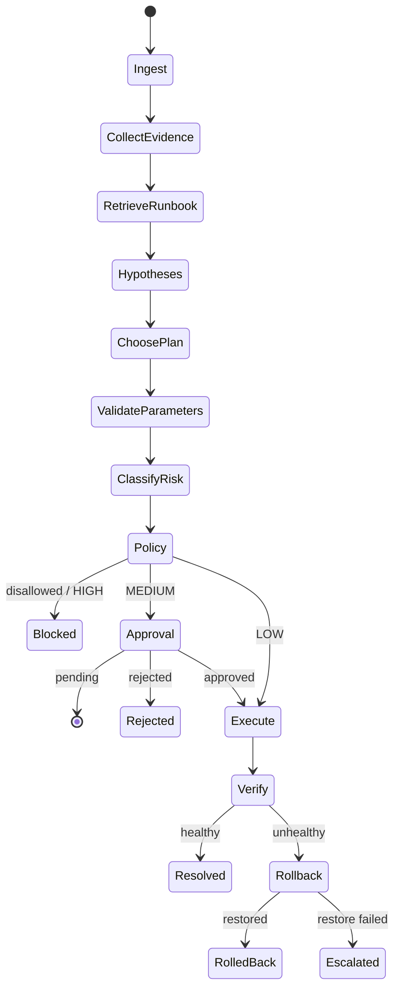

# Architecture

## Trust boundaries

The FastAPI control plane receives normalized certified incident types. The diagnostic reader can collect events, metrics, and logs but cannot mutate. Approved runbooks and evidence references feed the deterministic test diagnostic model (an external LLM adapter can be substituted). The model's candidate never directly authorizes an action.

`PolicyEngine` reloads explicit YAML policy on process startup and decides namespace, resource kind, action, parameter bounds, maintenance window, risk, and approval. `MemorySandbox` and `KubernetesSandbox` expose typed methods only. The Kubernetes implementation scopes every API call to `selfheal-demo`; there is no string-command or shell tool.

## LangGraph state machine

Pending approval is a terminal graph checkpoint for that invocation. The database retains the incident snapshot and decision. A subsequent invocation reconstructs evidence and checks the latest persisted approval before execution. Each execution uses `incident:action:resource` as a unique idempotency key. Terminal incidents cannot be rerun, and global action/resource cooldown prevents repeated successful actions across incidents.

## Data and observability

The initial migration creates all required records: incidents, signals, evidence, runbooks, hypotheses, remediation plans, policy decisions, approvals, executions, verification results, rollback records, audit events, and model usage. SQLite supports one-process native demos/tests; Compose uses PostgreSQL with the same SQLAlchemy repository.

`/metrics` publishes Prometheus text metrics. Responses include request ID and latency headers. Each operational fact is tied to a `prometheus://`, `kubernetes://`, or `runbook://` source. The UI shows safe operational traces, never hidden model reasoning.

