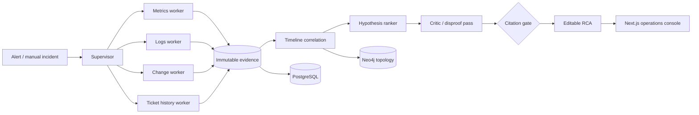

# Multi-Agent Incident RCA

A locally runnable, production-style incident investigation POC. A supervisor coordinates four read-only evidence workers, builds a cross-source timeline, ranks multiple causal hypotheses, asks a critic to disprove the leader, and emits an editable postmortem whose factual claims are rejected unless they cite immutable evidence IDs.

## Quick start

Requirements: Docker Desktop with Compose v2.

```bash
copy .env.example .env   # `cp` on macOS/Linux; optional defaults are also in Compose
docker compose up --build
```

- Operations console: <http://localhost:3003>
- API and interactive docs: <http://localhost:8003/docs>
- Prometheus: <http://localhost:9093>
- Neo4j Browser: <http://localhost:7477>

The stack seeds six incidents automatically. Open an incident, select **Investigate now**, then inspect worker execution, evidence, timeline, graph, hypotheses, the critic finding, and final RCA.

## Local development

```bash
make setup
make dev       # API on 8003
# in a second terminal: cd frontend && npm run dev
```

The default local backend uses SQLite when `DATABASE_URL` is absent. Docker Compose uses PostgreSQL and persists the dependency topology to Neo4j. `LLM_MODE=deterministic` is credential-free and reproducible; the provider boundary is intentionally deterministic for tests and evaluation.

Useful commands:

```bash
make seed
make incident
make test
make eval
make lint
make test-e2e   # requires the running stack and Playwright Chromium
```

`make eval` runs all 60 ground-truth replay cases. It exits non-zero when exact RCA accuracy, citation coverage, or unsupported-claim rules fail and writes JSON and Markdown reports to `evaluation/reports/`.

## What is included

- Five synthetic HTTP services with Prometheus metrics and structured JSON logs.
- Six scenario families, including the deliberately misleading correlated signal.
- Specialized metrics, logs, deployment/change, and ticket/history workers.
- Typed, read-only telemetry tools with no arbitrary query or shell surface.
- Content-addressed `EV-XXXXXXXXXXXX` evidence and an immutable evidence store.
- PostgreSQL incidents/investigations/audit data and Neo4j service relationships.
- RBAC, structured audit records, secret redaction, length bounds, and injection neutralization.
- Root-cause/category accuracy, evidence coverage, unsupported claims, duration, worker latency, cost/tokens, critic overturns, and per-category accuracy.
- Pytest and three Playwright user journeys.

## Architecture



See [architecture](docs/architecture.md), [API guide](docs/api.md), [security model](docs/security.md), and [demo runbook](docs/demo.md).

## Evidence and reasoning contract

Agents receive only typed tool observations. Untrusted log/ticket text is sanitized and treated as data. The UI exposes concise rationales and cited observations; hidden chain-of-thought is neither stored nor displayed. The composer creates structured claims first, then renders Markdown from those claims. The citation gate verifies every claim has known evidence IDs and that those IDs remain in the rendered document.

## Project isolation

This application is self-contained in `03-multi-agent-incident-rca`: its environments, Compose project, ports, network, volumes, migrations, seeds, tests, and generated artifacts are independent of every sibling project.

