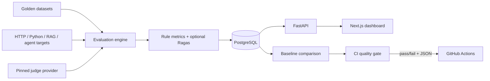

# Agent Evaluation + CI Regression Harness

A locally runnable developer platform for measuring RAG and agent quality before deployment. It manages versioned golden cases, evaluates HTTP/Python/demo targets, records sample-level evidence, compares candidates with a baseline, and fails CI on quality, safety, latency, or cost regressions. The default path is deterministic and requires no paid model.

## Architecture



The engine is provider-neutral. Deterministic metrics and the pinned mock judge are the CI default; Ragas or another judge can be added without changing run, sample, or gate schemas.

## Start the full stack

Requirements: Docker with Compose. Ports are isolated for project 04: web `3004`, API `8004`, demo target `8104`, and PostgreSQL `5444`.

```powershell
Copy-Item .env.example .env
docker compose up --build
```

Open:

- Dashboard: <http://localhost:3004>
- OpenAPI: <http://localhost:8004/docs>
- Health/readiness: <http://localhost:8004/health>, <http://localhost:8004/ready>

The API initializes the schema and seeds one project plus the 200-case dataset on first start.

## Local deterministic workflow

Python 3.12 is the container/runtime target; the code is also testable on Python 3.11.

```powershell
python -m venv .venv
.\.venv\Scripts\Activate.ps1
python -m pip install -e ".[dev]"
evalharness seed
evalharness run --mode good --output reports/baseline.json --baseline
evalharness run --mode bad --output reports/candidate.json
evalharness compare --candidate reports/candidate.json --baseline reports/baseline.json
evalharness gate --candidate reports/candidate.json --baseline reports/baseline.json --config config/gates.yml
```

The final gate intentionally exits non-zero. Restore `--mode good` to see it pass. Useful aliases are `make setup`, `make test`, `make eval`, `make seed`, `make lint`, and `make gate`.

## CLI

```text
evalharness dataset import cases.jsonl --id support-v2 --name "Support v2"
evalharness dataset export-demo data/demo-200.jsonl
evalharness run --http-url http://localhost:8104/evaluate --output reports/http.json
evalharness run --python-callable examples.demo_agent.plugin:evaluate
evalharness compare --candidate candidate.json --baseline baseline.json
evalharness report --run candidate.json --output report.html
evalharness gate --candidate candidate.json --baseline baseline.json
```

## API examples

```bash
curl http://localhost:8004/api/datasets
curl -X POST http://localhost:8004/api/runs -H "content-type: application/json" -d '{"mode":"good"}'
curl -X POST http://localhost:8004/api/runs/RUN_ID/baseline
curl "http://localhost:8004/api/compare?candidate_id=RUN_ID"
curl -X POST http://localhost:8004/api/gates -H "content-type: application/json" -d '{"candidate_id":"RUN_ID","config":{"absolute_thresholds":{"task_success":0.9}}}'
```

Run details include input, expected/actual answers, contexts, citations, tool trace, every metric, judge metadata, costs, and violations. No hidden reasoning is stored or displayed.

## Tests

```powershell
pytest
ruff check apps tests examples
cd apps/web; npm install; npm run build
```

With the Compose stack running, install Playwright and run `npx playwright test`. The three browser scenarios cover the seeded dashboard, a full evaluation-to-detail flow, and API availability.

## Documentation

- [Architecture](docs/ARCHITECTURE.md)
- [Metric definitions](docs/METRICS.md)
- [Dataset schema](docs/DATASET_SCHEMA.md)
- [Target adapters](docs/TARGET_ADAPTERS.md)
- [CI guide](docs/CI_GUIDE.md)
- [Judge policy](docs/JUDGE_POLICY.md)
- [Example reports](docs/EXAMPLE_REPORT.md)
- [Production gaps](docs/PRODUCTION_GAPS.md)

## Demo credentials and secrets

No credentials are required and no secrets are committed. The PostgreSQL values in `.env.example` are local-only Compose defaults. Use a secret manager and rotated credentials outside local development.

