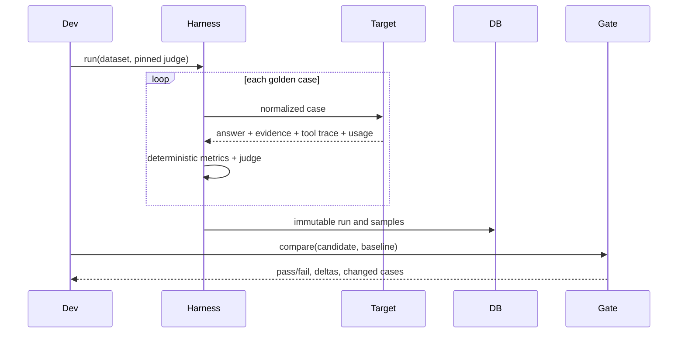

# Architecture

The evaluation engine is a synchronous, deterministic domain layer. A target adapter converts an HTTP response, Python callable, RAG response, or agent response/tool trace to one `TargetResponse`. Rule metrics run for every sample; a pinned judge may add metrics. Aggregation produces per-category values, p50/p95, costs, and deterministic bootstrap intervals.

FastAPI and the CLI call the same engine. PostgreSQL stores projects, datasets, cases, experiments, runs, samples, metrics, baselines, judge configs, costs, gate configs, and gate results. SQLite is an explicit lightweight test/local fallback. A run is immutable; marking a new baseline changes only the baseline pointer.

The Next.js dashboard reads the REST API. Run detail is the failure explorer: safe operational inputs/outputs, contexts, citations, tools, scores, and violations. It never displays chain-of-thought.

### Execution sequence

Background workers are a production scaling option; the POC executes inline so deterministic tests and the complete local demo have no extra queue dependency.

