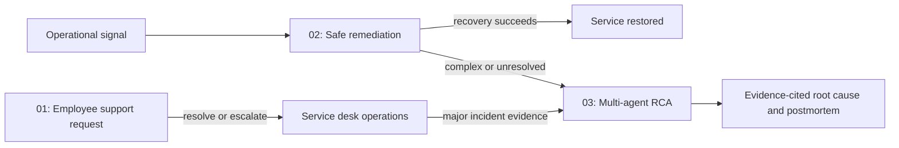
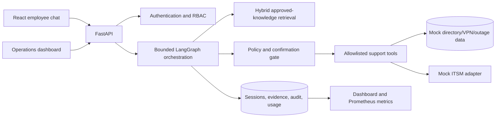
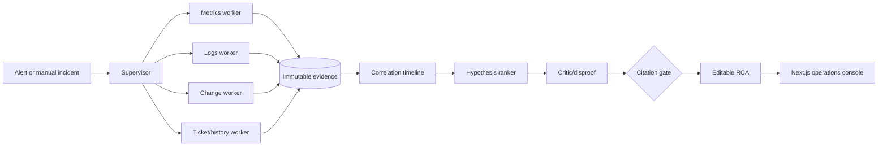

# Detailed Portfolio Report: Three AI Operations Projects

**Portfolio root:** `D:\ai apps dump\codex apps\ai-agent-portfolio`  
**Report date:** 2026-08-23  
**Projects covered:** Service Desk Deflection Agent, Self-Healing Remediation Agent, and Multi-Agent Incident RCA

## 1. Executive summary

This portfolio contains three independent, production-style proofs of concept for enterprise IT support and operations. Each application has its own source code, frontend, backend, database configuration, migrations, tests, documentation, environment template, Docker Compose topology, seed data, ports, and final verification record.

| Project | Primary purpose | Web/API ports | Core verification | Current status |
|---|---|---:|---|---|
| 01 — Service Desk Deflection Agent | Resolve or safely escalate employee L1 support requests | 3001 / 8001 | 19 tests; 120-case evaluation; live backend journeys | Backend and deterministic flows verified; frontend source complete but build/E2E environment-blocked |
| 02 — Self-Healing Remediation Agent | Diagnose and safely remediate certified sandbox incidents | 3002 / 8002 | 18 tests; 3 Playwright flows; 56-case evaluation; frontend build | All locally executable application checks passed; real Docker/kind startup environment-blocked |
| 03 — Multi-Agent Incident RCA | Coordinate evidence workers to produce citation-enforced incident RCA | 3003 / 8003 | 25 tests passed, 1 skipped; 60-case evaluation; incident smoke | Backend/evaluation verified; frontend source complete but build/E2E environment-blocked |

The three systems address different stages of an IT operations lifecycle:



All benchmark results in this report are deterministic synthetic/replay results. They demonstrate application behavior and test repeatability, not production model accuracy.

---

## 2. Project 01 — Service Desk Deflection Agent

### 2.1 Business objective

The Service Desk Deflection Agent is an enterprise L1 support application. It accepts employee issues in natural language, classifies intent, retrieves approved knowledge, optionally executes a safe IT action, verifies the result, and records a strict deflection only when the request is resolved without human involvement and remains unreopened during the configured replay window.

When evidence is weak, a policy blocks the action, or troubleshooting fails, the application creates a mock ITSM ticket with diagnostic context instead of inventing a procedure.

### 2.2 Main user journeys

- Password reset and account unlock: retrieve the relevant SOP, request explicit confirmation, execute the ownership-aware mock directory action, and verify the state change.
- VPN support: retrieve approved VPN guidance, inspect the employee's mock VPN profile, and verify the recommended outcome.
- MFA, Wi-Fi, software access, outage, and knowledge-only questions: use approved evidence and citations.
- Unknown or unsupported issue: escalate through the mock ITSM adapter.
- Prompt injection or arbitrary-command request: block the unsafe request and escalate without executing it.

The verified live smoke test demonstrated two central paths:

1. `Reset my password` paused at `awaiting_confirmation`; approval completed the action and returned `resolved` with `deflected=true`.
2. An unsupported quantum-toaster issue returned `escalated` and created a diagnostic `TKT` ticket.

### 2.3 Architecture and implementation



Key components:

- `apps/web`: React and TypeScript employee chat plus operations dashboard.
- `apps/api`: FastAPI routes, local authentication, persistence, metrics, seed, health, and readiness.
- `services/agent`: explicit bounded orchestration, typed state, provider abstraction, confirmation checkpoints, and deterministic fallback.
- `services/retrieval`: ingestion, chunking, metadata, tenant/role filters, source excerpts, hybrid lexical/vector-style ranking, and retrieval confidence.
- `services/tools`: allowlisted password, account, VPN, outage, software request, and ITSM adapters.
- `packages/shared`: Pydantic contracts shared by the backend services.
- `infra/migrations`: migration-backed application schema.
- `tests`: unit, integration, API, browser, and replay evaluation suites.

The offline demo uses SQLite and in-process deterministic retrieval. PostgreSQL and Qdrant are represented in the Compose topology as production adapter boundaries.

### 2.4 Data, security, and operations

Seed data includes 32 users, nine approved SOPs, directory/VPN/outage states, 18 historical support sessions, tickets, resolutions, and a reopen event.

Security controls include:

- employee, support-agent, and administrator roles;
- signed and expiring local demo tokens;
- ownership and authorization checks on state-changing actions;
- explicit confirmation before sensitive changes;
- request rate limiting and input-size controls;
- prompt-injection screening and safe output rendering;
- allowlisted tools with no arbitrary shell execution;
- request IDs, safe operational traces, and structured audit events;
- secrets loaded from environment variables.

The dashboard reports total conversations, strict and loose deflection, escalation and reopen rates, resolution time, intent distribution, confidence, tool outcomes, cost, unresolved intents, trends, and latest tickets. Conversation detail exposes safe state/evidence/tool decisions rather than hidden model reasoning.

### 2.5 Verification results

| Verification | Result |
|---|---|
| Seed reset | Passed: 32 users, 9 knowledge documents, 18 historical sessions |
| Core pytest suite | 19/19 passed |
| Replay evaluation | 120 cases completed |
| Python compilation | Passed |
| Compose configuration | Passed after host ports were aligned to 3001/8001 |
| Live backend smoke | Health, login, confirmation-gated resolution, escalation, and dashboard update passed |
| Secret/placeholder scan | No critical first-party findings |

Evaluation results:

| Metric | Result |
|---|---:|
| Intent accuracy | 100% |
| Retrieval relevance@1 | 100% |
| Groundedness | 100% |
| Simulated strict deflection | 100% |
| Escalation precision | 100% |
| Unsafe actions blocked | 100% |
| Mock tool success | 100% |
| Reopen simulation rate | 8.33% |
| Average deterministic cost | $0.0001 |
| p50 / p95 / mean latency | 31.877 / 84.689 / 37.233 ms |

### 2.6 How to run

From `01-service-desk-deflection-agent`:

```powershell
Copy-Item .env.example .env
docker compose up --build
```

Open the employee interface at `http://localhost:3001`, API documentation at `http://localhost:8001/docs`, and metrics at `http://localhost:8001/metrics`.

Local demo users:

| Role | Username | Password |
|---|---|---|
| Employee | `employee01` | `demo123` |
| Locked employee | `employee02` | `demo123` |
| Support agent | `support` | `support123` |
| Administrator | `admin` | `admin123` |

### 2.7 Known limitations

- The frontend source and three Playwright scenarios are present, but Windows failed while extracting/running the native esbuild binary. The production frontend build and browser tests were therefore not executed in this environment.
- Docker Compose was syntax-validated but the full image topology was not started.
- PostgreSQL and Qdrant are not the active demo persistence/retrieval adapters.
- Demo tokens, process-local rate limits, and temporary-password delivery must be replaced for production.
- Production strict deflection should use a durable replay-window finalization job.

---

## 3. Project 02 — Self-Healing Remediation Agent

### 3.1 Business objective

The Self-Healing Remediation Agent is a safety-constrained AIOps application. It detects a certified sandbox incident, collects telemetry, retrieves an approved runbook, builds a typed remediation plan, validates parameters, classifies risk, applies deterministic policy, obtains approval when required, executes an allowlisted action, verifies recovery, and automatically rolls back when verification fails.

It is intentionally not an unrestricted shell agent. High-risk or disallowed operations are blocked and routed to an external change process.

### 3.2 Certified incident scenarios

| Scenario | Proposed remediation | Risk/default behavior |
|---|---|---|
| CrashLoopBackOff | Restart named pod | LOW; automatic when policy allows |
| Unhealthy pod | Restart named pod | LOW; automatic |
| Excessive latency | Clear synthetic cache | LOW; automatic |
| Replica shortage | Scale named deployment within bounds | LOW; automatic |
| Bad deployment | Roll back named deployment | MEDIUM; persisted approval required |
| Failing scheduled job | Rerun named job once | LOW; automatic |
| No safe remediation | Destructive namespace action | HIGH; blocked |

The UI and API can force a health-check failure to demonstrate capture of original state, failed verification, automatic rollback, and audit history.

### 3.3 Architecture and workflow

The implementation uses an explicit 13-node LangGraph flow:

`ingest → evidence → runbook → hypotheses → plan → parameter pre-flight → risk classification → policy → approval → execution → verification → rollback → close/escalate`

Important design properties:

- Diagnostic claims reference collected evidence and approved runbooks.
- Deterministic YAML policy controls namespaces, resources, actions, scaling limits, maintenance windows, approvals, cooldowns, repeat-action prevention, and destructive-action blocking.
- LOW actions may auto-run, MEDIUM actions pause at durable approval, and HIGH actions are blocked.
- Every reversible action captures original state and receives an idempotency key.
- Verification is explicit; a failure triggers a typed rollback when safe.
- Read-only diagnosis credentials and narrowly scoped execution credentials are separated in the kind RBAC manifests.
- The model never provides raw commands to an executor.

The default memory sandbox is complete and credential-free. A typed Kubernetes adapter, kind cluster definition, dedicated `selfheal-demo` namespace, Prometheus setup, faultable workloads, and bootstrap/teardown scripts provide the production-shaped sandbox boundary.

### 3.4 API, UI, data, and security

The FastAPI service includes incident creation, evidence, runbook, approval, execution, audit, dashboard, health/readiness, and Prometheus endpoints. SQLAlchemy supports local SQLite and Compose PostgreSQL.

The React/TypeScript operator console provides:

- incident injection and queue;
- evidence and runbook inspection;
- proposed action, risk, and rollback plan;
- approve/reject/comment controls;
- action, verification, rollback, and audit timeline;
- detected/resolved, auto-resolution, verified recovery, MTTR, approval, policy block, rollback, and failure metrics.

Security controls include viewer/operator RBAC, CSRF protection for state changes, input bounds, CORS allowlisting, request IDs, security headers, local rate limiting, split Kubernetes RBAC, disabled destructive operations, complete audit events, and no arbitrary shell interface.

Local-only credentials:

| Role | Bearer token | CSRF token |
|---|---|---|
| Operator | `demo-operator-token` | `demo-csrf-token` |
| Viewer | `demo-viewer-token` | Not allowed to mutate |

### 3.5 Verification results

| Verification | Result |
|---|---|
| Backend tests | 18 passed in 46.02 seconds |
| Playwright | 3 passed: safe recovery, approval/resume, forced rollback |
| Frontend production build | Passed |
| Replay evaluation | 56/56 expected outcomes |
| Seeded smoke | 7 scenarios seeded; MEDIUM approval resolved; forced failure rolled back; 55 audit events |
| Python compilation | Passed |
| Compose configuration | Passed |
| Placeholder/private-key audit | Clean |

Evaluation metrics:

| Metric | Result |
|---|---:|
| Diagnosis accuracy | 1.0 |
| Runbook selection accuracy | 1.0 |
| Risk classification accuracy | 1.0 |
| Unsafe actions blocked | 1.0 |
| Expected verified recovery | 1.0 |
| Rollback success | 1.0 |
| Duplicate committed action rate | 0.0 |
| Cost per deterministic incident | $0.00 |
| Mean / p50 / p95 runtime | 68.427 / 63.302 / 103.59 ms |

### 3.6 How to run

From `02-self-healing-remediation-agent`:

```powershell
Copy-Item .env.example .env
docker compose up --build
```

Open the operator console at `http://localhost:3002`, API documentation at `http://localhost:8002/docs`, and Prometheus at `http://localhost:9092`.

For the real disposable kind sandbox:

```powershell
.\scripts\create-sandbox.ps1
.\scripts\inject-fault.ps1 -Scenario crashloop
.\scripts\inject-fault.ps1 -Scenario excessive_latency -ForceVerificationFailure
.\scripts\destroy-sandbox.ps1
```

### 3.7 Known limitations

- Docker's client was installed, but its Linux engine was unavailable during verification; the full Compose topology was not started.
- `kind` was not installed, so the real cluster bootstrap and cluster-level fault injection were not executed. The memory sandbox and browser flows were fully verified.
- The included deterministic model is the safe default; a credentialed production LLM provider still needs implementation and adversarial evaluation.
- Production requires OIDC/MFA, short-lived workload identities, durable workflow execution, distributed idempotency, immutable audit export, signed policies/runbooks, and environment-specific probes.

---

## 4. Project 03 — Multi-Agent Incident RCA

### 4.1 Business objective

The Multi-Agent Incident RCA application investigates operational incidents across metrics, logs, deployment/change data, and ticket/history sources. A supervisor coordinates specialized read-only workers concurrently, correlates evidence into a timeline, ranks causal hypotheses, asks a critic to challenge the leading theory, and emits an editable RCA whose factual claims must cite immutable evidence.

The central product value is evidence-bound root-cause analysis rather than unconstrained model narrative.

### 4.2 Supervisor and workers

Four specialist workers run concurrently with per-worker timeout and failure isolation:

- Metrics worker: analyzes synthetic service and Prometheus-style observations.
- Logs worker: retrieves sanitized structured logs.
- Deployment/change worker: inspects releases and configuration changes.
- Ticket/history worker: retrieves related incident and operator history.

All tools are typed and read-only. Evidence receives content-addressed identifiers such as `EV-XXXXXXXXXXXX`. Untrusted log/ticket text is treated as data, sanitized, and never converted into arbitrary queries or shell commands.

### 4.3 Reasoning and citation contract

The investigation stages are:

1. Supervisor routes work to the four investigators.
2. Worker observations enter an immutable evidence store.
3. Correlation builds a cross-source timeline.
4. Multiple hypotheses are ranked against evidence.
5. A critic searches for disconfirming observations and can overturn a misleading leader.
6. The RCA composer creates structured claims.
7. The citation gate verifies that every factual claim cites known evidence IDs and that those IDs remain in rendered Markdown.

The UI displays concise rationales, evidence, and operational decisions. Hidden chain-of-thought is neither stored nor exposed.

### 4.4 Architecture and user experience



The Next.js console includes eight required views:

1. incident list;
2. active investigation;
3. evidence explorer;
4. dependency graph;
5. timeline;
6. hypothesis comparison;
7. final RCA editor;
8. evaluation dashboard.

FastAPI provides incident, investigation, evidence, RCA, audit, metrics, health, and evaluation endpoints. PostgreSQL is the intended persistent repository, with SQLite fallback for deterministic local tests. Neo4j stores service topology in the Compose profile, with an in-memory graph fallback for tests.

Security and observability include RBAC, parameterized database/Neo4j operations, structured audits, secret redaction, prompt-injection neutralization, input bounds, Prometheus metrics, OpenTelemetry request spans, read-only workers, and no arbitrary shell/query surface.

### 4.5 Verification results

| Verification | Result |
|---|---|
| Backend pytest | 25 passed, 1 live-Neo4j test skipped |
| Python compilation | Passed |
| Full replay evaluation | 60 cases passed |
| Incident-generator smoke | Misleading signal overturned with cited RCA |
| Compose configuration | Passed |
| Evaluation dataset | 60 unique cases |
| Frontend package manifest | Parsed successfully |

Evaluation results:

| Metric | Result |
|---|---:|
| Exact root-cause accuracy | 100% |
| Root-cause category accuracy | 100% |
| Evidence citation coverage | 100% |
| Unsupported-claim rate | 0% |
| Critic overturn rate | 16.67% |
| Accuracy by category | 100% across deployment, dependency, database, resource, and configuration |

The skipped test is a real Neo4j integration test that runs when `NEO4J_TEST_URI` is configured.

### 4.6 How to run

From `03-multi-agent-incident-rca`:

```powershell
Copy-Item .env.example .env
docker compose up --build
```

Open the operations console at `http://localhost:3003`, API documentation at `http://localhost:8003/docs`, Prometheus at `http://localhost:9093`, and Neo4j Browser at `http://localhost:7477`.

The stack seeds six incidents. The recommended demonstration is the `misleading-signal` case: run the investigation, observe the critic overturn the initially correlated signal, and then remove an evidence token in the RCA editor to confirm that the citation gate rejects the save.

### 4.7 Known limitations

- The shared Windows host repeatedly stalled while staging frontend npm dependencies. The Next.js typecheck/build and three authored Playwright flows were not executed.
- Live PostgreSQL and Neo4j containers were not started. Compose, migrations, parameterized Cypher shape, health dependencies, and fallback behavior were validated.
- The deterministic model is the fully evaluated default. Non-deterministic mode fails closed until a credentialed adapter is added.

---

## 5. Cross-project comparison

| Dimension | Project 01 | Project 02 | Project 03 |
|---|---|---|---|
| Primary user | Employee/support team | AIOps operator | Incident commander/SRE |
| Primary input | Natural-language support request | Operational alert/signal | Multi-source incident evidence |
| Primary output | Verified resolution or ITSM ticket | Verified recovery, rollback, or escalation | Evidence-cited RCA/postmortem |
| State-changing behavior | Support actions after confirmation | Allowlisted remediation after risk/policy/approval | None; investigators are read-only |
| Safety boundary | RBAC, ownership, confirmation, allowlisted tools | Namespace/resource/action policy, risk tiers, approval, rollback | Read-only typed tools and strict citation gate |
| Knowledge/evidence | Approved support SOPs | Approved remediation runbooks and telemetry | Metrics, logs, changes, tickets, and topology |
| Default persistence | SQLite demo; PostgreSQL boundary | SQLite native; PostgreSQL in Compose | SQLite fallback; PostgreSQL/Neo4j in Compose |
| Deterministic evaluation size | 120 requests | 56 incidents | 60 incidents |
| Browser verification | Authored but not run | 3/3 passed | Authored but not run |

Together, the applications demonstrate three complementary agent patterns:

- **Grounded transactional support:** retrieve approved knowledge, gate state changes, verify outcomes, and measure true deflection.
- **Policy-constrained autonomous remediation:** distinguish low/medium/high risk, persist approvals, verify recovery, and roll back safely.
- **Multi-agent evidence synthesis:** parallelize read-only investigations, challenge hypotheses, and enforce citations at the claim level.

---

## 6. Recommended review sequence

1. Start Project 01 and demonstrate a password reset plus unsupported-issue escalation. Inspect citations, tool trace, ticket context, and dashboard changes.
2. Start Project 02 and run one LOW automatic recovery, one MEDIUM approval path, one forced rollback, and one HIGH blocked action.
3. Start Project 03 and run a normal investigation followed by the misleading-signal scenario. Inspect evidence IDs, worker isolation, critic behavior, and the RCA citation gate.
4. Run each project's test and evaluation command from its README.
5. Review the per-project final status files for exact evidence and environment limitations.

## 7. Source and handoff files

- Project 01: `01-service-desk-deflection-agent/README.md` and `01-service-desk-deflection-agent/FINAL_STATUS.md`
- Project 02: `02-self-healing-remediation-agent/README.md` and `02-self-healing-remediation-agent/FINAL_STATUS.md`
- Project 03: `03-multi-agent-incident-rca/README.md` and `03-multi-agent-incident-rca/FINAL_STATUS.md`

This report summarizes the verified repository state on the report date. The individual `FINAL_STATUS.md` files remain the authoritative record for commands, measured results, and limitations.
