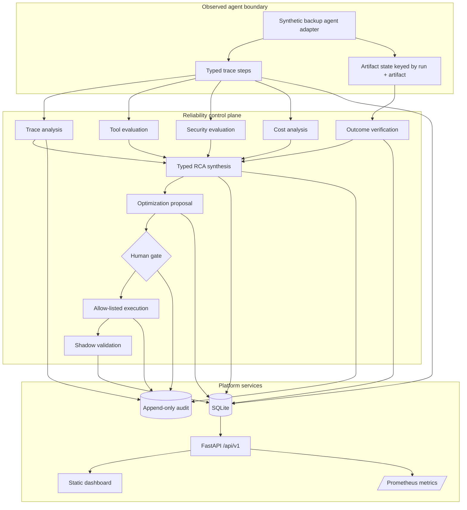
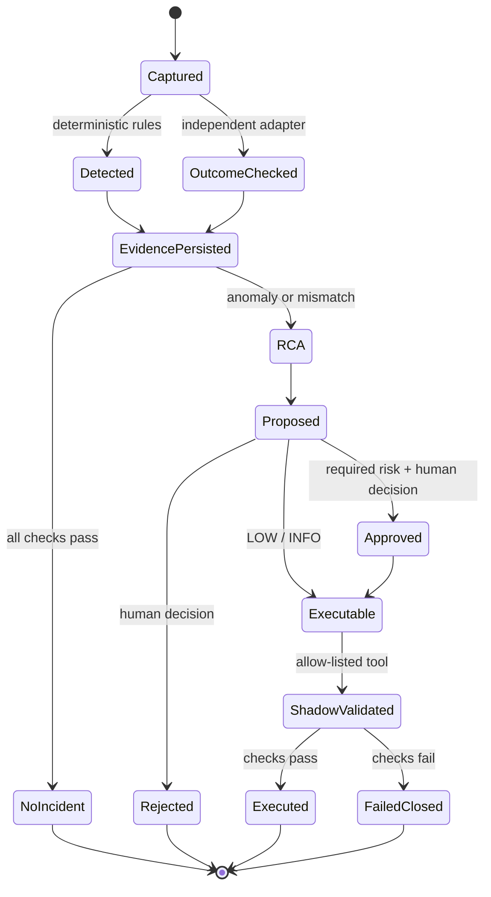
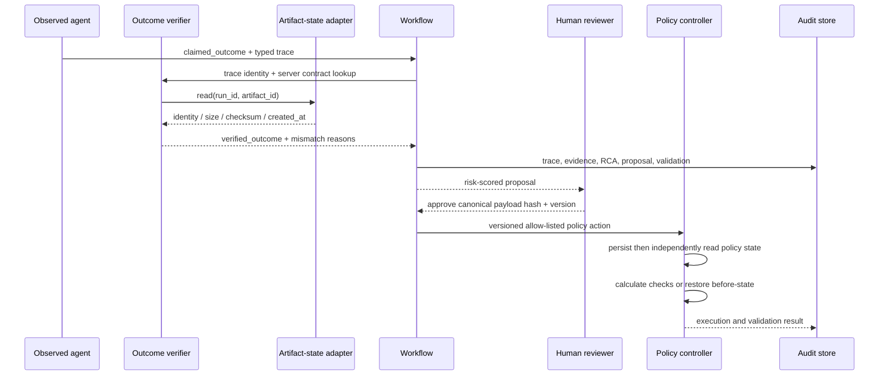

# Architecture

## System architecture

The trace and artifact state have separate interfaces. The workflow records the server-observed run start and deadline, the verifier creates the expected contract from those persisted timestamps, then reads provider state by run and artifact identity and checks every required field, checksum, size, and freshness. Trace-carried external state, start time, and deadline cannot expand the verification window.

## Agent investigation workflow

## Validation workflow

## Components

| Component | Design choice |
|---|---|
| Synthetic adapter | deterministic trace plus separately observable artifact state |
| Detector | pure typed rules with explicit thresholds and evidence step references |
| Verifier | checks a server-owned contract against a keyed read-only provider, never trace claims |
| Reasoner | provider protocol; deterministic evidence-only implementation by default |
| Workflow | sequential orchestrator with replaceable components, no framework lock-in |
| Action controller | immutable payload binding, catalog validation, three-tool allow-list, persistent policy readback, rollback, and separate authoritative post-rollback readback |
| Persistence | project-local SQLite, migration table, foreign keys, WAL mode |
| Audit | append-only-by-trigger event rows, secrets redacted before serialization |
| API | FastAPI `/api/v1`, strict request models, OpenAPI |
| Dashboard | zero-build static assets, versioned API client |

## Persisted model

- `agent_runs`: typed trace JSON plus queryable version, scenario, latency, cost, status, server-observed start, and verification deadline.
- `incidents`: detection set and complete typed RCA.
- `evidence`: one immutable fact-oriented record per finding.
- `actions`: risk-scored proposal, canonical payload hash/version, and current lifecycle status.
- `approvals`: append-only reviewer decision, reason, and the approved payload hash/version.
- `policy_state`: action-specific synthetic policy values and versions.
- `policy_executions`: observed before/after state and rollback result.
- `validations`: outcome or post-action check results.
- `evaluations`: detector benchmark and release-gate results.
- `audit_events`: immutable-style lifecycle history.

Schema versions 1 through 4 are applied in order from `backend/app/migrations/` and recorded in `schema_migrations`. Version 3 invalidates legacy unbound approvals as `REAPPROVAL_REQUIRED` and canonicalizes the existing action payload. Version 4 makes `APPROVED` and `REAPPROVAL_REQUIRED` attestations immutable; fresh review appends a new row.

## Failure handling

- Database readiness is checked independently and returns HTTP 503 if unavailable.
- Malformed API inputs stop at Pydantic validation.
- Unknown tools fail closed at the allow-list.
- Missing approval returns HTTP 403 and cannot advance action status.
- Any payload/hash/version/catalog/incident/risk mismatch fails before execution; approved payload fields are database-immutable.
- A failed or mismatched policy readback restores the prior state and persists a failed validation.
- Unknown benchmark versions return HTTP 422.
- Any runner not created and registered by the local server blocks before invocation. Failed, incomplete, wrong-version, wrong-dataset, wrong-artifact, missing, duplicate, relabelled, nonce-mismatched, or digest-mismatched benchmark evidence also blocks the release gate.
- A failed change is reported `ROLLED_BACK` only after an independent provider re-reads the exact baseline; a lying/no-op rollback is `ROLLBACK_FAILED`.
- Workflow exceptions are audited by type and exposed only as a safe generic error.
- A future LLM provider must return the `RCAResult` contract; the deterministic provider remains the fallback.
