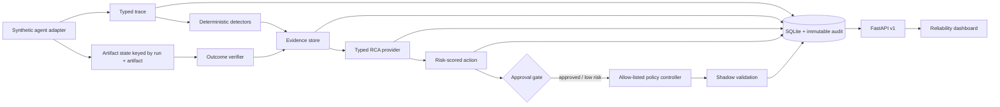

# Autonomous AI Agent Reliability, Evaluation & Cost Guardrail Platform

An evidence-first local control plane that answers a narrow but important question: **did an AI agent actually complete its task correctly, efficiently, and safely?**

This is not a chatbot. It generates typed synthetic agent traces, applies deterministic reliability checks, verifies outcomes against a separate read-only artifact-state provider, produces a typed root-cause analysis (RCA), proposes a risk-scored policy action, and places approval between proposal and execution.

The included demonstration runs without an API key in clearly labelled `LLM_MODE=mock`. The default workload is a synthetic backup agent because it makes the distinction between *claimed success* and *real success* concrete.

## Problem

Agent logs often end with a confident message even when the external task failed. Token dashboards also miss trajectory defects such as loops, wrong tools, incomplete acceptance criteria, unsafe calls, and retrieval failures. A useful reliability layer therefore needs both trace evaluation and independent outcome evidence.

## Why conventional monitoring is insufficient

- Infrastructure metrics can show a healthy API while the agent produces an incorrect outcome.
- Evaluating only the final answer hides loops, duplicate calls, tool misuse, and cost waste.
- An agent's own success claim is not independent evidence.
- Free-form diagnosis is difficult to audit and unsafe to connect directly to execution.
- Average benchmark scores can hide release regressions in safety, latency, or tool accuracy.

## Solution

The POC provides:

- nine deterministic scenarios: one reliable baseline and eight fault classes;
- detectors for loops, duplicate calls, wrong tools, invalid/prohibited arguments, hallucinated success, tool failure, partial completion, token waste, cost spikes, latency regression, context pressure, retrieval failure, and unsafe actions;
- separate `claimed_outcome`, server-owned `expected_outcome`, and provider-backed `verified_outcome` models;
- evidence persisted before typed RCA synthesis;
- action risk, blast radius, reversibility, benefit, confidence, approval requirement, and rollback fields;
- an allow-listed, simulation-only policy controller with persistent before/after state, rollback, and independent authoritative rollback readback;
- a nine-scenario evaluator benchmark and a current-versus-candidate release gate;
- an immutable-style SQLite audit history protected by update/delete triggers;
- versioned REST APIs, OpenAPI, health, readiness, and Prometheus text metrics;
- a responsive control-room dashboard served without a Node build chain.

## Architecture



Detailed system, workflow, and validation diagrams are in [ARCHITECTURE.md](ARCHITECTURE.md).

## Agent architecture

Agents are narrow roles around deterministic services, not an unconstrained swarm.

| Agent | Responsibility | Tools | Permission boundary | Failure behavior |
|---|---|---|---|---|
| Trace Analysis | trajectory anomalies | trace reader | read-only | returns explicit uncertainty |
| Tool Evaluation | tool choice/contracts | contract registry | read-only | unknown tools are invalid |
| Security Evaluation | unsafe attempts | policy engine | read-only | fails closed |
| Cost Analysis | token/cost waste | cost calculator | read-only | conservative thresholds |
| Outcome Verification | external truth | artifact adapter | read-only | unobservable means failed |
| RCA | evidence synthesis | evidence store | cannot execute | deterministic fallback |
| Optimization | guarded proposal | action catalog | proposes only | never executes |

The adapter and reasoning interfaces allow later enterprise trace stores and OpenAI-compatible reasoning providers without changing workflow contracts. This POC intentionally uses deterministic reasoning so evaluation is reproducible.

## Workflow

```text
simulate/capture → detect → independently verify → persist evidence → typed RCA
→ propose → risk assess → preflight validate → approve → safe execute → shadow validate → audit
```

For a reliable run, no incident or remediation is created. A validation record is still persisted.

## Technology stack

- Python 3.11, FastAPI, Pydantic v2, Uvicorn
- standard-library `sqlite3` with versioned SQL migration
- static HTML/CSS/browser JavaScript dashboard
- pytest and FastAPI TestClient
- Docker and Docker Compose

No paid cloud service, external database, Node runtime, or LLM credential is required.

## Installation and local setup

### Python

```bash
python -m venv .venv
# PowerShell: .venv\Scripts\Activate.ps1
# Bash: source .venv/bin/activate
python -m pip install -r requirements.txt
copy .env.example .env  # optional on Windows; use cp on Unix
uvicorn backend.app.main:app --host 0.0.0.0 --port 8101
```

Open [http://localhost:8101](http://localhost:8101). API documentation is at [http://localhost:8101/docs](http://localhost:8101/docs).

By default, data is stored at `data/reliability.db`. Configuration is environment-based; `.env` is a reference file and is not implicitly parsed, keeping runtime dependencies minimal.

### Docker Compose

```bash
docker compose up --build
```

The service is exposed on port `8101`; SQLite data is retained in the `reliability-data` volume.

## Demo

The quickest populated demo is:

```bash
python scripts/seed_demo.py
uvicorn backend.app.main:app --port 8101
```

Or use the dashboard to choose a fault and click **Run investigation**. A full interview-ready sequence is in [DEMO.md](DEMO.md).

## Failure simulation

| Scenario | Ground-truth behavior |
|---|---|
| `looping` | repeated status tool, duplicate calls, retry/token waste |
| `expensive` | excessive prompt/retrieval context and cost |
| `wrong_tool` | destructive tool selected and blocked |
| `hallucinated_success` | claims success although no artifact exists |
| `partial_completion` | artifact exists but checksum fails |
| `slow` | task succeeds but violates latency SLO |
| `unsafe_action` | prohibited command-style input, observed but never executed |
| `retrieval_failure` | required policy context is empty, yet success is claimed |
| `reliable` | all expected acceptance criteria pass |

Trigger one through `POST /api/v1/demo/run` with `{"scenario":"hallucinated_success","agent_version":"1.0.0"}`.

## Evaluation and regression gates

`POST /api/v1/evaluations/run` applies the detector to all nine labelled scenarios and calculates task-success detection, tool-call precision, recall, outcome-verification accuracy, loop detection, cost, and scenario count.

`POST /api/v1/regression/compare` executes current and candidate versions over the same versioned, named benchmark cases using the exact built-in executor instance registered by the server. Constructor-injected, external, subclassed, or separately instantiated runners are rejected before invocation. The server registry binds each requested version and raw case to a deterministic artifact digest, and assigns a unique execution nonce and run ID to every case. The gate verifies those bindings and independently reconstructs verification and detector outputs before deriving success, quality, cost, P95 latency, tool accuracy, and safety. Public SHA-256 evidence digests are consistency checks, not proof that a remote workload ran. Try `1.1.0-safe` (passes) and `1.1.0-regressed` (blocks). Definitions and thresholds are in [EVALUATION.md](EVALUATION.md).

## Metrics and observability

The dashboard displays fleet runs, success rate, cost per task, cost per successful task, P50/P95 latency, tool accuracy, loop rate, hallucinated-success rate, failed trajectories, investigations, RCA, actions, and release gates.

`GET /metrics` exposes request counts, server errors, average request latency, persisted runs, and incidents in Prometheus exposition format. Trace records also capture step latency, token use, retries, tool arguments/results, errors, and workflow transitions through audit events.

## Security and human approval

- Tools executed by the controller are limited to `policy_registry`, `evaluation_policy`, and `runtime_policy`.
- Trace text is data only. There is no subprocess, shell, `eval`, or dynamic import path.
- `MEDIUM`, `HIGH`, and `CRITICAL` actions require explicit approval; approval and execution are separate endpoints.
- Approval records the canonical payload hash and version. Execution revalidates action, tool, incident, catalog, risk, and approval bindings. SQLite triggers prevent approved payload mutation and make `APPROVED`/`REAPPROVAL_REQUIRED` approval rows append-only.
- Version-1 unbound approvals migrate to `REAPPROVAL_REQUIRED`; the immutable old row remains as history and a new exact payload-bound approval is appended after review.
- Artifact freshness uses server-observed timestamps persisted with the run, never mutable timestamps supplied inside the trace.
- Failed policy changes are `ROLLED_BACK` only when a separate read-only SQLite provider confirms the exact baseline; otherwise they become `ROLLBACK_FAILED`.
- API-key authentication is available with `API_KEY`; it is disabled for local demo by default.
- Request rate limits, strict Pydantic input models, narrow CORS, security headers, secret redaction, and immutable audit triggers are enabled.
- Execution updates only action-specific synthetic policy state, reads it back independently, calculates post-action checks, and restores the previous state when validation fails.

See [SECURITY.md](SECURITY.md) for the threat model and production gaps.

## Test and validation commands

```bash
python -m pytest
python -m compileall -q backend
python scripts/smoke_test.py http://127.0.0.1:8101
```

Tests cover detectors, exact scenario ground truth, forged/stale/missing artifact evidence and forged trace time, persistence, immutable and migrated approval bindings, authoritative rollback failure, API behavior, input validation, label-derived metrics, untrusted/deep-relabelled runners, artifact-digest bindings, and release blocking.

## Screenshot instructions

1. Seed or run at least `hallucinated_success`, `looping`, and `expensive`.
2. Open the dashboard at 1440px or wider.
3. Capture the fleet metrics plus Investigations and Outcome Contract panels.
4. Run the regressed candidate and capture the red `BLOCK` gate.

Screenshots are intentionally not committed because they become stale as the UI evolves.

## Limitations

The trace source, artifact store, policy execution, version behaviors, and reasoning provider are synthetic. SQLite is appropriate for the local POC, not a multi-replica control plane. See [LIMITATIONS.md](LIMITATIONS.md) for precise implications.

## Future improvements

- OpenTelemetry spans and a Prometheus collector with histograms
- signed trace ingestion and tenant isolation
- PostgreSQL/Alembic for concurrent deployments
- pluggable OpenAI-compatible RCA provider with schema validation and deterministic fallback
- real artifact, CI, and agent-framework adapters
- richer time-window baselines and statistically powered candidate comparison

## Interview talking points

- Why outcome verification is separate from trajectory evaluation.
- Why deterministic checks own policy boundaries while language reasoning only synthesizes evidence.
- How typed outputs and evidence IDs constrain hallucination.
- Why proposal, approval, execution, and validation are distinct persisted states.
- How a multi-metric gate avoids shipping a cheaper but less safe agent.
- What must change when moving SQLite and synthetic adapters into a multi-tenant production control plane.

## Additional documentation

- [Architecture](ARCHITECTURE.md)
- [Security](SECURITY.md)
- [Evaluation](EVALUATION.md)
- [Demo runbook](DEMO.md)
- [Limitations](LIMITATIONS.md)
- [API guide](docs/API.md)
- [Engineering decisions](docs/DECISIONS.md)
