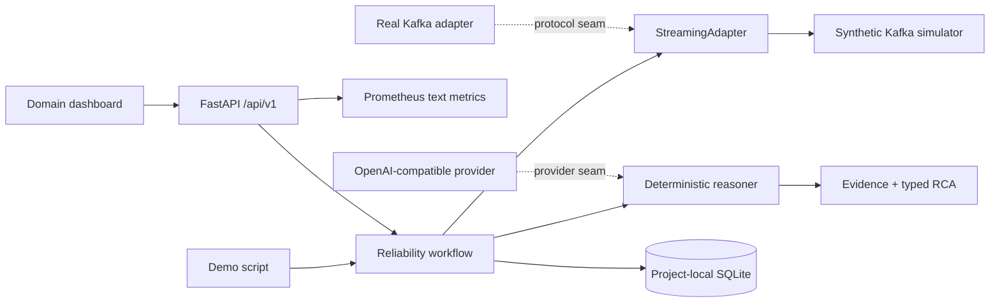
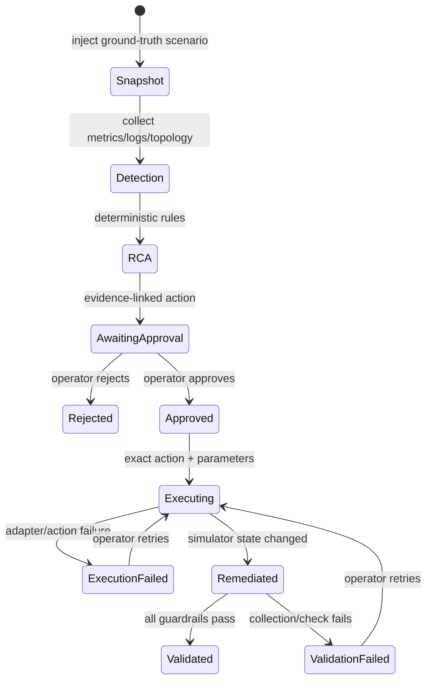
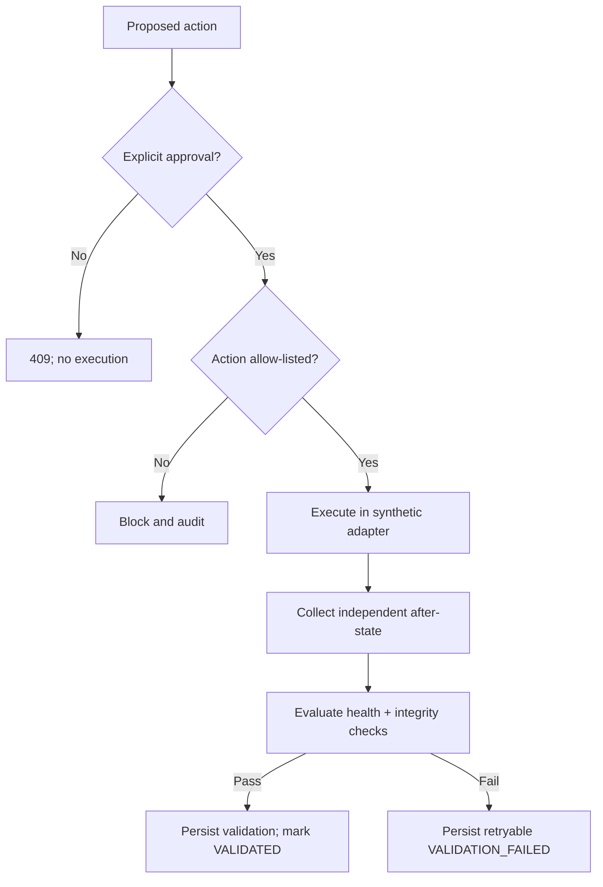

# Architecture

## System architecture

## Agent investigation workflow

## Validation workflow

## Persistence

`incidents` stores the current state plus immutable investigation inputs and RCA JSON. `approvals`, `executions`, `validations`, `evaluations`, and `audit_log` are insert-only during normal operation. This is immutable-style rather than cryptographically immutable. A production version should use database roles, append-only event storage, retention controls, and tamper-evident hashes.

## Substitution boundaries

- `StreamingAdapter`: replace `SyntheticKafkaAdapter` with a read-only Kafka Admin/Prometheus collector, and introduce a separate, more restricted execution adapter.
- `ReasoningProvider`: replace or augment `DeterministicReasoner` with structured OpenAI-compatible evidence synthesis. Deterministic detectors should remain authoritative for threshold rules.
- `Repository`: retain the workflow interface while moving from SQLite to PostgreSQL/Alembic.
