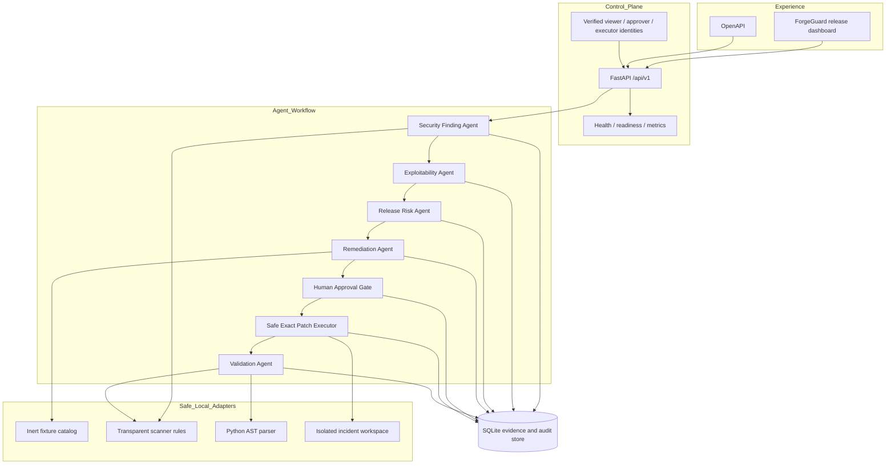
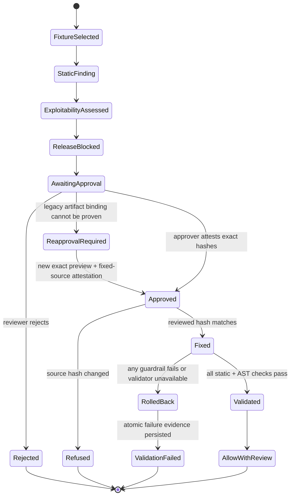

# Architecture

## System architecture



## Agent workflow



## Validation workflow

```mermaid
sequenceDiagram
  participant R as Remediation Agent
  participant H as Verified Approver
  participant X as Distinct Executor
  participant E as Exact Patch Executor
  participant A as AST Validator
  participant S as Static Scanner
  participant P as Release Policy
  R->>H: diff, risk, blast radius, rollback, source hash
  H->>E: immutable action + patch + fixed-source hash attestation
  X->>E: separately authenticated execution request
  E->>E: verify attestation + input + workspace hashes
  E->>E: select exact allow-listed fixed source
  E->>A: parse only; never import or execute
  A-->>E: exact canonical module/function/call/return AST
  E->>S: deterministic rescan
  S-->>E: original finding count 1→0
  E->>P: regression checks and evidence
  P-->>H: ALLOW_WITH_REVIEW or BLOCK + restore before-source
```

## Persistence and filesystem boundary

SQLite persists incident source snapshots, structured investigations, approvals,
validation results, evaluation ground truth, and audit events. Database triggers deny
audit updates and deletes. Each incident receives a generated-ID directory beneath the
configured workspace root. Resolved path containment and source-hash checks prevent a
caller from selecting another filesystem target.

The service never imports fixture or workspace modules. `ast.parse` constructs syntax
trees without running the source. The exact transformation catalog is the only source
of after-content.
