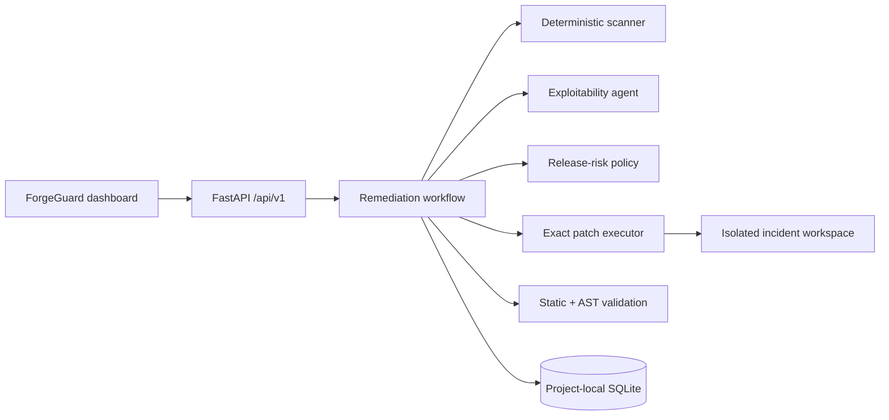

# ForgeGuard — Agentic DevSecOps Release Risk & Remediation Platform

ForgeGuard is a runnable local POC for investigating safe demonstration
vulnerabilities, determining exploitability, proposing an exact bounded remediation,
requiring human approval, and proving through static rescan and AST checks that the
finding is removed without an obvious security or public-contract regression.

It runs without cloud credentials, paid scanners, or a paid LLM. Mock mode is explicit
and deterministic.

## Problem

A vulnerability finding is not enough to decide whether a release should ship. Teams
also need to know whether the code is reachable, whether attacker-controlled input
reaches the sink, which change is appropriate, whether the change preserves the public
contract, and whether it introduces a new weakness. Unrestricted autonomous patching
would create an unacceptable production risk.

## Solution

This first vertical slice provides:

- Three safe, local failure scenarios: SQL injection, shell injection, and a
  nonfunctional hard-coded credential.
- Transparent deterministic scanning with typed evidence and source hashes.
- Evidence-backed exploitability classification and release-risk scoring.
- Exact allow-listed transformations only. Immutable approval attests the action ID,
  displayed patch SHA-256, and fixed-source SHA-256; execution verifies all three plus
  the reviewed input and workspace hashes.
- Explicit `AWAITING_APPROVAL → APPROVED → VALIDATED` workflow, with
  `VALIDATION_FAILED` recording an automatic restoration of before-source.
- Static rescan plus an exact canonical AST contract covering the complete module,
  function signature/body, imports, call count and arguments, and return semantics.
  Fixture code is never executed.
- SQLite persistence for incidents, approvals, validations, evaluations, and an
  append-only audit history protected by database triggers.
- Versioned FastAPI, OpenAPI, credential-derived roles with separate approver and
  executor identities, CORS, security headers, health/readiness, and metrics.
- A distinctive release-control dashboard showing risk, reachability, evidence,
  proposed diff, approval state, validation, and agent activity.

## Architecture



See [ARCHITECTURE.md](ARCHITECTURE.md) for the full agent and validation flows.

## Agent architecture

Five focused agents expose typed responsibilities and permission boundaries at
`GET /api/v1/agents`: security finding, exploitability, remediation, validation, and
release risk. Deterministic software handles known rules, hashes, AST parsing, and risk
math. The POC does not ask an LLM to execute or invent fixes.

## Workflow

```text
inert source → static finding → reachability context → exploitability
→ release BLOCK → exact patch proposal → human approval
→ source-hash recheck → allow-listed transformation → static/AST validation
→ finding rescan → regression guardrails → release decision → audit/evaluation
```

## Technology stack

- Python 3.11, FastAPI, Pydantic v2, Uvicorn
- SQLite via the standard library with idempotent migration tracking
- Python AST and deterministic source scanning
- Plain HTML/CSS/JavaScript dashboard; no frontend build tool required
- Pytest and FastAPI TestClient
- Docker and Docker Compose

## Local setup

```powershell
cd "D:\ai apps dump\codex apps\enterprise-agentic-ai-portfolio\05-devsecops-remediation-agent"
python -m venv .venv
.\.venv\Scripts\Activate.ps1
python -m pip install -r requirements.txt
python -m uvicorn backend.app.main:app --host 0.0.0.0 --port 8105 --no-server-header
```

Open [http://localhost:8105](http://localhost:8105). OpenAPI is at
[http://localhost:8105/docs](http://localhost:8105/docs).

Or:

```bash
docker compose up --build
```

## Demo

Use the dashboard to scan an inert fixture, review its evidence, exploitability,
release risk, and exact diff, approve the proposal, and apply/validate it. A scripted
SQL-injection demonstration is available:

```powershell
.\scripts\demo.ps1
```

See [DEMO.md](DEMO.md) for the complete presenter runbook.

## Failure simulation

`POST /api/v1/scenarios/{scenario}/scan` accepts:

- `sql_injection` — CWE-89, unauthenticated attacker input reaches constructed SQL.
- `command_injection` — CWE-78, authenticated attacker input reaches a shell.
- `hardcoded_secret` — CWE-798, a nonfunctional example token is stored in source.

Human-readable fixture mirrors end in `.py.txt` under `fixtures/inert` and are never
imported. The authoritative fixture contracts are immutable Python strings in the
simulator.

## Evaluation and metrics

Each investigation records finding validity, true and predicted exploitability,
whether remediation was attempted and successful, security regression, and test
regression. `/api/v1/evaluations/summary` reports aggregate validity, classification
accuracy, remediation success, and regressions. `/metrics` exposes Prometheus text.
See [EVALUATION.md](EVALUATION.md).

## Security and human approval

Remediation cannot run until the proposal is explicitly approved. Immediately before
writing, ForgeGuard rechecks the input, workspace, approved action ID, patch hash, and
fixed-source hash, including the exact persisted preview bytes shown to the reviewer.
Legacy attestations enter `REAPPROVAL_REQUIRED` and cannot execute until a new bound
review is recorded. It can only substitute the exact bound fixed source. Failed or
unavailable validation atomically records `VALIDATION_FAILED`, restores the original
workspace/source state, and keeps the release blocked.
No endpoint accepts source, patches, commands, paths, or scanner rules. Validation
parses but never executes generated code. See [SECURITY.md](SECURITY.md).

Default `AUTH_MODE=open` is explicitly local-demo-only: anonymous reads are allowed,
but approval and execution still require distinct built-in demo credentials. For
non-demo use, set `AUTH_MODE=api_key` with distinct `VIEWER_API_KEY`,
`APPROVER_API_KEY`, and `EXECUTOR_API_KEY` values. Identity and role are derived from
the verified credential; no caller-supplied role header is trusted.

## Tests

```bash
python -m pytest
```

Coverage includes all three finding/fix pairs, exact structural AST policy, extra SQL
and subprocess calls, environment exfiltration, preview/hash mutation, legacy
reapproval, rollback on failed/unavailable validation, approval gating, immutable
audit history, API validation, role checks, API-key mode, dashboard, OpenAPI, and metrics.

## Screenshot guidance

For a portfolio screenshot, scan SQL injection and capture the dashboard before
approval to show the risk score, evidence, exploitability, and diff. Capture a second
frame after validation to show zero remaining findings, the release-risk reduction,
green guardrails, and immutable activity trail.

## Limitations and future improvements

This is a deliberately bounded POC: rules and remediations cover authored fixtures,
execution is a file transformation in an isolated local workspace, and validation is
static. Production evolution would integrate Semgrep/Trivy/SCA/SBOM providers, Git
branches and pull requests, builds/tests in an isolated runner, OIDC/RBAC, signed
patches, sandboxing, OpenTelemetry, and post-merge release monitoring. See
[LIMITATIONS.md](LIMITATIONS.md).

## Interview talking points

- Why finding severity and contextual exploitability are separate decisions.
- Why known deterministic transforms are safer than unrestricted generated patches.
- How source hashes bind investigation, approval, and execution.
- How AST and static validation prove properties without executing untrusted code.
- Why a clean rescan is necessary but insufficient without regression checks.
- How persisted ground truth turns remediation quality into measurable evaluation.

## Documentation

- [Architecture](ARCHITECTURE.md)
- [Security](SECURITY.md)
- [Evaluation](EVALUATION.md)
- [Demo](DEMO.md)
- [Limitations](LIMITATIONS.md)
- [API guide](docs/API.md)
- [Agent contracts](docs/AGENT_CONTRACTS.md)
