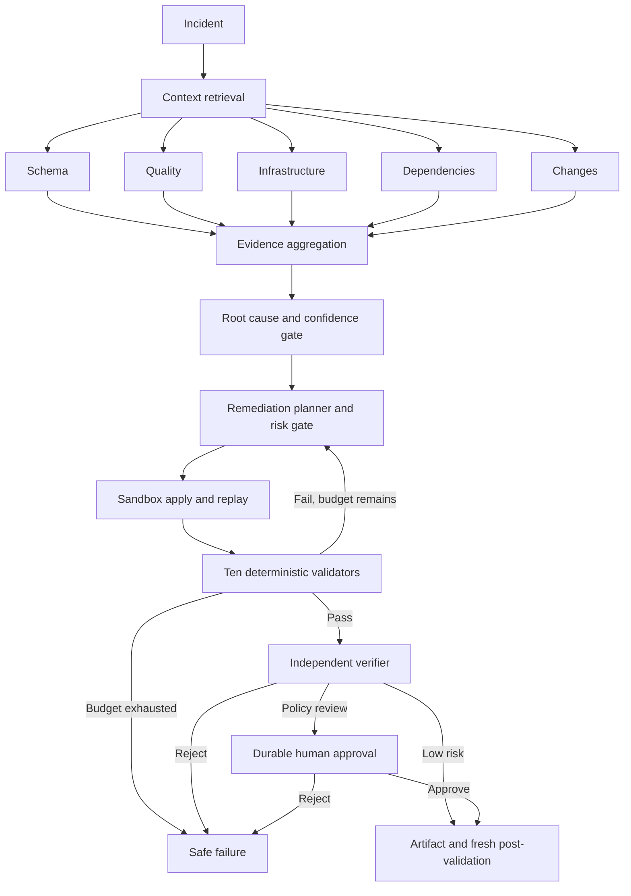
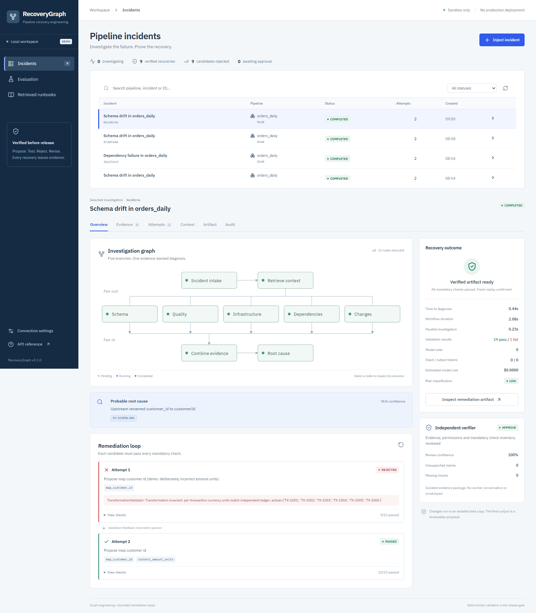
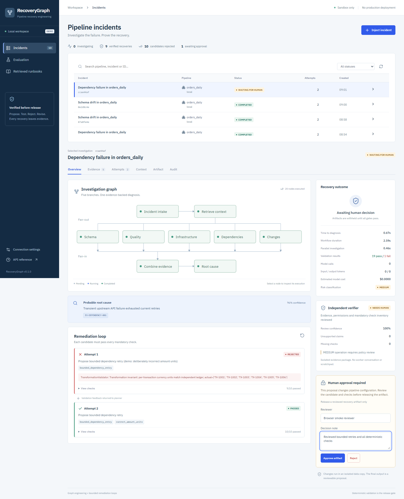

# RecoveryGraph

**Verified Autonomous Pipeline Recovery using Graph + Loop Engineering**

Monitoring tells teams something broke. RecoveryGraph investigates why and tests a recovery
proposal against actual fixture data before releasing a reviewable artifact. It never deploys
changes to a production system.

## What makes it different

- **Graph:** five LangGraph investigation branches run concurrently and converge into evidence.
- **Loop:** rejected candidates return deterministic feedback to the planner within an attempt budget.
- **Validation:** ten mandatory checks inspect replayed rows, totals and pipeline completion.
- **Verification:** a separate deterministic verifier receives an explicit evidence package, without
  worker scratchpads or golden labels.
- **Approval:** medium/high risk pauses in a durable checkpoint; approval releases an artifact.






## Quickstart without Docker or API keys

Requirements: Python 3.12, uv, and Node.js 22.12 or later in the 22 release line.
Run from the repository root:

```sh
uv sync --frozen
npm --prefix frontend ci
uv run uvicorn app.main:app --host 127.0.0.1 --port 8000
```

In a second terminal:

```sh
npm --prefix frontend run dev
```

Open http://127.0.0.1:5173. API documentation is at http://127.0.0.1:8000/docs.
SQLite databases and checkpoints are created under `.runtime/`. No `.env` is required for
the local deterministic provider. Copy `.env.example` to `.env` to override configuration.

## Demonstration

```sh
uv run python scripts/demo.py
uv run python -m evals.run --persist
```

`make demo` is an equivalent shortcut if Make is installed. The first command creates a schema
drift incident, forces an incorrect currency conversion, asserts rejection followed by a passing
second attempt, and prints the verifier outcome, artifact hash and measured metrics.
The evaluation command populates the console's Evaluation page; refresh the console afterward.

In the console choose **Inject incident**, retain **Demonstrate a rejected first fix**, and start
the investigation. Inspect Evidence, Attempts, Artifact and Audit. Choose **Dependency failure**
to demonstrate human approval. Reviewer approval does not deploy the artifact.

## Scenarios and results

| Scenario | Controlled recovery |
| --- | --- |
| Schema drift | Map upstream `customerId` into `customer_id` |
| Null spike | Restore identifiers from the fixture's trusted reference |
| Duplicate ingestion | Deduplicate transactions |
| Transformation regression | Correct currency unit conversion |
| Dependency failure | Apply bounded upstream retries; require approval |

The deterministic evaluation on 2026-09-22 contains 15 cases: ten complete, and five intentionally
exhaust their attempt budgets. Expected outcomes and top-1 root causes match all 15 labels.
Ten deliberately incorrect candidate probes produce **zero false acceptances**. Completion is
10/15 (66.7%), because safe exhaustion is an expected outcome. Average attempts are 1.33.
These small simulator results do not establish real-world model accuracy or business MTTR savings.
See [the measured report](evals/results/latest.json).

## Verification

```sh
uv run ruff check backend simulator evals
uv run mypy
uv run pytest -q
npm --prefix frontend run lint
npm --prefix frontend test
npm --prefix frontend run build
uv run playwright install chromium
uv run python scripts/browser_smoke.py
```

The browser command requires both native servers running. It checks rejected/passed attempts,
graph inspection, evidence, audit, artifact download, human approval and mobile overflow.
If Windows process startup causes a Vitest fork timeout, use
`npm --prefix frontend test -- --pool=threads --maxWorkers=1`.

## Docker and deployment

```sh
docker compose up --build -d
docker compose exec -T backend python scripts/postgres_smoke.py
uv run python scripts/browser_smoke.py --url http://127.0.0.1:8080
docker compose down
```

Compose runs PostgreSQL/pgvector, a single backend worker, and the Nginx console on port 8080.
The database is not exposed on a host port. The optional observability profile adds Jaeger.
See [deployment instructions](docs/deployment.md) for tracing and Kubernetes/AKS.
Container execution and Kubernetes deployment remain unverified on this workstation because
the Docker engine is unavailable; CI includes container build and Postgres/browser checks.

## Providers, boundaries and limitations

Set `LLM_PROVIDER=openai`, `LLM_MODEL`, `LLM_API_KEY`, and optionally `LLM_BASE_URL` for compatible
structured-output APIs. For Azure use `LLM_PROVIDER=azure`, a deployment name in `LLM_MODEL`,
`AZURE_OPENAI_ENDPOINT`, `AZURE_OPENAI_API_KEY` and a supported `AZURE_OPENAI_API_VERSION`.
`uv run python -m evals.run --online` explicitly enables paid evaluation.
Online calls have not been exercised with live credentials. Pricing is optional configuration;
unknown pricing displays as unpriced. Offline execution makes zero model calls.

Knowledge retrieval combines metadata filters, lexical matching and cosine similarity. Its
offline feature-hash vectors are a deterministic lexical baseline, not learned semantic embeddings.
Set `EMBEDDING_PROVIDER=openai` for compatible semantic embeddings. A separate verifier is
implemented as deterministic evidence/risk checks; it is not an additional LLM judge.

This is a portfolio implementation. It supports one backend process, bounded local concurrency,
simulator adapters, and optional shared bearer authentication. Production work requires identity
and reviewer authorization, distributed execution ownership, retention controls, operational
monitoring, provider evaluation and real integration tests. See [security](docs/security.md).

## Engineering guide

- [Architecture](ARCHITECTURE.md), [graph engineering](docs/graph-engineering.md),
  [loop engineering](docs/loop-engineering.md)
- [Architecture decisions](docs/adr/README.md), [deployment](docs/deployment.md)
- [Interview guide](docs/interview-guide.md), [resume bullets](docs/resume.md)
- [Progress and verification record](PROGRESS.md)
