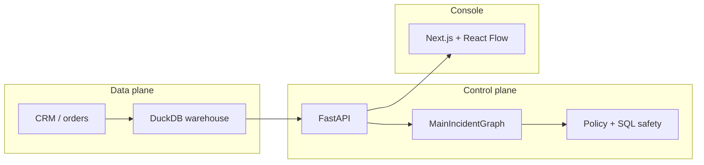

# DataSentinel AI

**A graph-based autonomous AI system that detects enterprise data pipeline failures and data quality issues, investigates root causes, generates and tests remediation strategies, validates recovery in a sandbox, and safely escalates high-risk changes to humans.**

This is not a chatbot. It is a **stateful cyclic LangGraph** with fan-out evidence collection, an RCA hypothesis loop, sandbox remediations, deterministic policies, and human-in-the-loop interrupts.

## Business problem

Modern companies run analytics, ML, fraud, and financial reporting on data pipelines that fail because of schema drift, nulls, duplicates, bad SQL, late data, expired credentials, and performance regressions. Engineers still do this by hand:

alert → logs → SQL → hypothesis → fix → rerun → hope.

DataSentinel automates investigation inside **deterministic safety bounds**.

## Architecture



See [docs/architecture.md](docs/architecture.md), [docs/graph-engineering.md](docs/graph-engineering.md), [docs/loop-engineering.md](docs/loop-engineering.md), [docs/safety.md](docs/safety.md).

## Graph engineering

LangGraph `StateGraph` with:

- typed `IncidentState` + reducers
- 30+ nodes
- conditional edges
- `Send` fan-out / deferred fan-in
- RCA, remediation, and recovery **cycles**
- subgraphs (`build_rca_subgraph`)
- `interrupt()` + checkpointer
- `Command` routing

## Loop engineering

RCA is hypothesis → experiment → evaluate → reflect → hypothesis, terminated by confidence, iteration, cost, time, or stagnation.

## Quick start (local, no API key)

```bash
python3 -m venv .venv && source .venv/bin/activate
pip install -r backend/requirements.txt
cd frontend && npm install && cd ..
cp .env.example .env
make seed
make demo
```

- API: http://localhost:8000/docs
- UI: http://localhost:3000/dashboard

`LLM_PROVIDER=mock` is the default. Demo mode does **not** require a paid key.

### Docker

```bash
docker compose up --build
```

### Tests and evaluation

```bash
make test
make eval
```

## Strongest demo

**Schema drift** on `customer_daily_etl`: upstream `customer_id` renamed to `customer_uuid`.

Expected path: fail → parallel evidence → weak hypothesis rejected → reflection → rename confirmed → mapping fix → sandbox PASS → quality PASS → **HIGH risk human approval** → resume → recover → close → report.

Open `/incidents`, run the schema-drift card, click **Investigate incident**.

## Technology

Python 3.12, FastAPI, LangGraph, Pydantic, SQLAlchemy, DuckDB, Next.js, Tailwind, React Flow, SpaceXAI/xAI (optional live LLM).

## What is simulated

- Warehouse is DuckDB, not Snowflake/BigQuery
- Pipeline runner is in-process, not Airflow
- Credentials/API timeouts are injected failures
- Mock LLM is evidence-aware but not a hosted model
- OpenTelemetry is in-process metrics (console-grade), not a full collector

None of the graph, policy, sandbox, or quality engines are “screenshots of a chatbot.”
