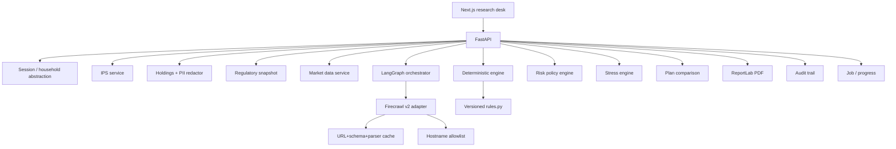
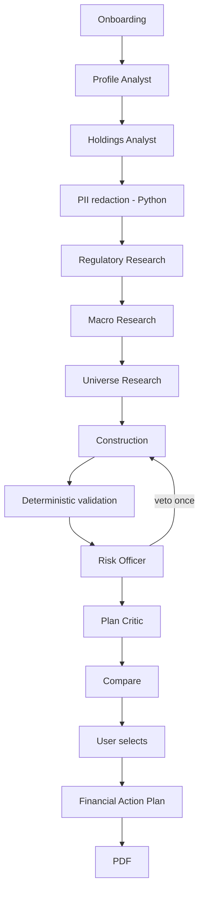

# Aegis Plan India — Architecture

Educational research and financial-planning simulator. Not a broker. Not a SEBI-registered adviser. No execution endpoints exist.

## Deterministic vs LLM

Python owns arithmetic, weights, caps, eligibility, tax thresholds after retrieval, loan math, emergency reserve, stress, vetoes, constraints, percentages, and source coverage.

The LLM owns summarization, explanation, research synthesis, and failure-mode narrative. It cannot override a veto or invent rates.

## LangGraph

## Provenance

Every numerical fact carries value, unit, source URL, tier, published/fetched/as-of, confidence, and verification. Freshness: market ≤ 24h preferred, bank/post-office rates ≤ 7 days, regulatory rules verified for current applicability. Stale, unverified, and conflicting states are labelled. Conflicts are never silently resolved.

## Regulatory snapshot

`app/regulatory/` builds a dated snapshot before tax- or NPS-sensitive output. Live mode should scrape allowlisted official pages via Firecrawl v2. Mock mode loads fixtures labelled MOCK/DEGRADED and still points at official homepages.

## Security

Scraped pages are untrusted. Prompt-injection phrases are detected and never treated as instructions. PII redaction is deterministic Python. Secrets stay in environment variables.
