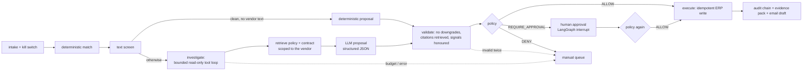

# InvoiceFlow

An Accounts Payable exception-resolution agent on Databricks. It has deterministic checks,
a policy engine that authorizes every action, human approval through a durable pause, an
idempotent SIMULATED ERP, and a tamper-evident audit trail.

> **All data is synthetic.** There are no real companies, vendors, GSTINs or bank details.
> The ERP is a **SIMULATED** sandbox. Nothing makes payments or sends emails.

## The problem

Every invoice should pass a **three-way match**: invoice vs purchase order (PO) vs goods
receipt (GRN). When it doesn't, an AP clerk investigates by hand. They check the PO,
receipts, vendor history, contract and AP policy, then approve, hold, request a credit note
or escalate. This is slow, error-prone and a fraud risk: a "new bank account" request in an
invoice note is a classic attack.

**Users (synthetic roles):** AP Clerk, AP Manager, Finance Controller, Auditor (read-only),
Platform Admin.

## How it works

**AI proposes → policy authorizes → a human approves when required → only the executor
writes → everything is recorded.**



Details are in [docs/ARCHITECTURE.md](docs/ARCHITECTURE.md).

## Status

Status words follow a fixed ladder: *planned → implemented → unit-tested → integration-tested
(local) → tested on Databricks → deployed (Azure) → verified end-to-end*.

| Component | Status | Evidence |
|---|---|---|
| Synthetic data generator (325 invoices, 25 adversarial) | unit-tested | [DATASET.md](docs/DATASET.md) |
| Deterministic core (matcher, tolerance, GSTIN, GST, duplicates) | unit-tested (98% coverage with policy) | `tests/unit/core` |
| Policy v1 (Python) | unit-tested | [CONTROL_MATRIX.md](docs/CONTROL_MATRIX.md) |
| Policy v2 (OPA/Rego) | unit-tested; 6,496-case parity with v1 | [ADR 0011](docs/adr/0011-policy-python-and-opa.md) |
| Local Postgres backend | integration-tested in CI (5/5 in a pgvector service container); not run on this laptop | [CI run 40176340860](https://github.com/manojastro/invoiceflow/actions/runs/40176340860) |
| Databricks data layer and UC functions | tested on Databricks (parity: 0 mismatches) | [parity log](docs/evidence/databricks/parity-2026-10-25.log) |
| Retrieval (local hybrid; AI Search) | tested on Databricks (AI Search recall@5 1.000) | [AI Search report](docs/RETRIEVAL_REPORT_AISEARCH.md) |
| Agent (LangGraph) | tested on Databricks backend (196 dev invoices, live model) | [EVAL_REPORT_LIVE_FULL.md](docs/EVAL_REPORT_LIVE_FULL.md) |
| SIMULATED ERP (idempotency, outbox) | unit-tested | [ADR 0009](docs/adr/0009-sandbox-erp.md) |
| Approval service (dev tokens, Entra ID OIDC) | unit-tested; no Entra tenant configured | [ENTRA_SETUP.md](docs/ENTRA_SETUP.md) |
| Audit hash chain and evidence packs | unit-tested (detects tampering) | [ADR 0010](docs/adr/0010-audit-hash-chain.md) |
| Evaluation harness and CI gate | implemented; gate passing locally | [EVAL_REPORT.md](docs/EVAL_REPORT.md) |
| Azure deployment (Phase 7) | planned | — |

## Results

Every number comes from a recorded run, with its command, date, commit and dataset version
in the linked report.

- [docs/BASELINE_REPORT.md](docs/BASELINE_REPORT.md): rule-only baseline on 196 dev invoices.
- [docs/EVAL_REPORT.md](docs/EVAL_REPORT.md): the agent with the **deterministic stub model**
  vs the baseline, on the dev split. This measures the harness, not an LLM.
- [docs/EVAL_REPORT_HELDOUT.md](docs/EVAL_REPORT_HELDOUT.md): the same, on the held-out split.
- [docs/EVAL_REPORT_LIVE_FULL.md](docs/EVAL_REPORT_LIVE_FULL.md): the agent **fully on
  Databricks** (Unity Catalog data, AI Search, `databricks-gpt-oss-120b`) on all 196 dev
  invoices. Exception, action and approver were each 196/196, with 0 unsafe outcomes and 0
  executed policy violations; the baseline scored 194 / 190 / 194 with 2 unsafe outcomes.
  Read the caveats in PROGRESS.md.
- [docs/EVAL_REPORT_LIVE.md](docs/EVAL_REPORT_LIVE.md): an earlier live run on the 22 hardest
  dev invoices, with local data.
- [docs/RETRIEVAL_REPORT_AISEARCH.md](docs/RETRIEVAL_REPORT_AISEARCH.md): AI Search retrieval
  on the live index.
- [docs/RETRIEVAL_REPORT.md](docs/RETRIEVAL_REPORT.md): retrieval recall@k, abstention and
  access control.

Synthetic labels and the deterministic checks follow the same written rules, so high scores
show consistency with the spec, not real-world accuracy. See
[docs/LIMITATIONS.md](docs/LIMITATIONS.md).

## Run it locally (about 5 minutes)

Prerequisites: [uv](https://docs.astral.sh/uv/) and git. Docker is optional (only for
Postgres).

```bash
uv sync
```

```bash
uv run invoiceflow data generate
```

```bash
uv run pytest
```

```bash
uv run invoiceflow baseline
```

```bash
uv run invoiceflow eval agent --split dev
```

Run one case end to end, then approve it:

```bash
uv run invoiceflow agent run INV-00042
```

```bash
uv run invoiceflow agent approve INV-00042 --approver-id u-manager-1 --role AP_MANAGER
```

```bash
uv run invoiceflow audit verify
```

The approval inbox (dev tokens from `uv run invoiceflow approvals dev-tokens`):

```bash
uv run uvicorn invoiceflow.services.approvals.app:build --factory --port 8080
```

Local Postgres (copy `.env.example` to `.env` and set `POSTGRES_PASSWORD`):

```bash
docker compose up -d --wait
```

```bash
uv run invoiceflow data load
```

```bash
uv run pytest -m integration
```

## Run with Databricks

Free Edition works. First run `databricks auth login --profile invoiceflow`, then set the
`DATABRICKS_*`, `LLM_*` and `AI_SEARCH_*` values in `.env` (see `.env.example`).

```bash
uv run invoiceflow databricks setup
```

```bash
uv run invoiceflow databricks parity
```

```bash
uv run invoiceflow databricks index
```

Set `INVOICEFLOW_BACKEND=databricks` (in `.env` or the shell) so the agent reads Unity
Catalog data and queries AI Search. Leave it unset to run the live model on local data.

```bash
uv run invoiceflow eval agent --split dev --provider databricks
```

## Documentation

| Doc | What it covers |
|---|---|
| [docs/SPEC.md](docs/SPEC.md) | The full build specification |
| [docs/ARCHITECTURE.md](docs/ARCHITECTURE.md) | Components, data flow, trust boundaries, AI vs deterministic |
| [docs/THREAT_MODEL.md](docs/THREAT_MODEL.md) | STRIDE, prompt injection, invoice fraud |
| [docs/CONTROL_MATRIX.md](docs/CONTROL_MATRIX.md) | The policy rules and their interpretations |
| [docs/DATASET.md](docs/DATASET.md) | How the synthetic data and labels are made |
| [docs/adr/](docs/adr/README.md) | 11 architecture decision records |
| [docs/CASE_STUDY.md](docs/CASE_STUDY.md) | What broke during the build and what changed |
| [docs/INTERVIEW_NOTES.md](docs/INTERVIEW_NOTES.md) | Walkthrough scripts and likely questions |
| [docs/LIMITATIONS.md](docs/LIMITATIONS.md) | What is not done or not proven |
| [PROGRESS.md](PROGRESS.md) | Phase-by-phase reports with evidence |
