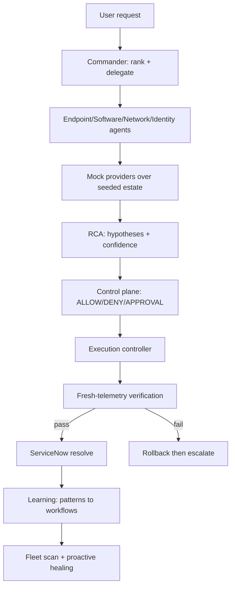

# Digital Workplace Autopilot

Policy-governed, self-learning, multi-agent digital workplace operations on
Cognizant Neuro SAN Studio. Not a chatbot: specialized agents gather evidence,
argue competing hypotheses, and act only through a deterministic control plane.

Principle: **AI THINKS → TOOLS OBSERVE → AGENTS COLLABORATE → POLICY
AUTHORIZES → TOOLS EXECUTE → AI VERIFIES → SYSTEM LEARNS → FLEET HEALS.**

## Problem statement

Employees lose hours to slow laptops, dead VPNs, and frozen apps while support
queues grow linearly with headcount. Ticket-by-ticket firefighting fixes one
machine and learns nothing; the next 26 users with the same bad update file
the same ticket.

## Why normal support automation is insufficient

Runbook bots map symptoms to scripts (`slow → clear cache`). They cannot
correlate across systems, reject red herrings, abstain on weak evidence, prove
recovery with fresh telemetry, or stop the next 26 tickets. This platform does
all five — and every automated action passes policy, approval, and audit.

## 10-agent architecture

One Neuro SAN network (`registries/digital_workplace_autopilot/commander.hocon`,
front man `commander` + 9 specialists, 54 coded tools). Commander ranks
specialists per inquiry and delegates only where useful — never a fixed chain.

| Agent | Domain | Key tools |
|---|---|---|
| commander | orchestration | route_request, get_user_context, get_case_context, search_known_workflows |
| endpoint_agent | Nexthink/Tanium | query_device_health, query_processes, query_disk_health … |
| software_agent | Intune | query_software_inventory, query_recent_changes, query_patch_history … |
| network_agent | Zscaler/Cloudflare | query_vpn_state, query_zscaler, query_dns … |
| identity_agent | Entra ID | query_signin_history, query_account_state, query_mfa_state … |
| rca_agent | fusion | generate_hypotheses, score_hypothesis, build_causal_graph … |
| knowledge_agent | HR/Finance/IT… | search_enterprise_knowledge (role-filtered), cite_knowledge_source |
| security_agent | advisor only | check_device_compliance, check_privileged_action_requirements |
| learning_agent | patterns | record_resolution_pattern, create_workflow_candidate … |
| servicenow_agent | ITSM | create/get/search/update/resolve/escalate incident, problem, link |

## Tool-calling architecture

Round-1 probes come from ranked routing; every later call is a pure function
of accumulated evidence (`orchestration/investigate.py`, budget 8, dedupe,
confidence ≥ 90 stops, bounded RCA follow-up). Same text + different telemetry
→ different tool sequences; healthy devices abstain after 2 calls.

## Control-plane architecture

Deterministic and LLM-free (`control_plane/`): propose → RBAC → policy-as-code
→ compliance → approved registry → hash check → deny-list → risk → autonomy →
approval → execution → verification → rollback → audit. Output is exactly
`ALLOW`, `DENY`, or `REQUIRE_APPROVAL`. The engine imports no agent code
(boundary-tested); agents can propose `action_id` only, never authorize.

## Integration architecture

All enterprise systems hide behind `integrations/ports.py` protocols. Real
ServiceNow Table API client ships (`integrations/servicenow/`); everything
else runs on a seeded 500-device simulator behind the same interfaces, so
swapping mocks for real connectors changes no caller. `ns run` serves the
network; `AGENT_TOOL_PATH=./coded_tools` resolves the tools.

## Gemini configuration

Server-side only: copy `.env.example` → `.env`, set `GOOGLE_API_KEY` (Google
AI Studio). Single model `gemini-3-flash`, `temperature: 1.0` (required for
Gemini 3) in `config/llm_config.hocon`. Never committed, logged, or prompted.

## ServiceNow configuration

`SERVICENOW_INSTANCE_URL`, `SERVICENOW_USER`, `SERVICENOW_PWD` in `.env`
(aliases `SERVICENOW_INSTANCE/USERNAME/PASSWORD` accepted). Standard Table
API only — no Scripted REST. Without creds the factory transparently uses a
deterministic simulated ITSM; set creds and the real adapter takes over.

## Simulation explanation

`simulator/estate.py` builds 500 aliased devices (`DEVICE_001`, `USER_001`)
from a seed: telemetry, software, changes, patches, network/identity overlays.
Seed 42 pins the demo cases (Teams 3.8.4 cohort of 27; VPN stale-token device)
plus honest background noise. Providers are read-only except `actions.py
transitions used by the execution controller.

## Security architecture

Allowlist-first everywhere: tool writes, script primitives, KB visibility
(deny by default). Import boundary keeps `control_plane/` free of agent code.
Refused executions touch nothing and write no runs. Approval gates pause L2;
DENY is terminal; tampered hashes refuse.

## Zero-secret model

Aliases natively (`USER_014`, never real names); secrets live in env only;
`sanitize_for_llm` deep-redacts; `SecureContext` resolves server-side;
`PIIMiddleware` pattern set mirrored in code. Proof: `docs/ZERO_SECRET_PROOF.md`
(113 prompts inspected, all counts 0, PASS).

## Approved script registry

8 governed scripts (`control_plane/registry.py` seed): SCR-018 Clear Teams
Cache 3.2 LOW L3 (98.9%), VPN-reconnect, install, restart, temp, disk cleanup
(L2/L3), firewall HIGH L1, disable-protection CRITICAL L0 deny-listed. Hashes
recompute from the row; tampering fails closed. AI-proposed scripts survive a
7-stage gauntlet + human review before registering (`control_plane/script_intake.py).

## Autonomy levels

L0 observe · L1 recommend · L2 human approval · L3 auto-execute approved ·
L4 execute+verify+rollback. Earned deterministically: L1→L2 on 2 approvals,
L2→L3 on 10+ runs ≥95%, L3→L4 on 50+ ≥98% with rollback; ≥3/10 failures
demote to L2. The engine reads live metrics; stored levels change only via
explicit promotion passes.

## Learning workflow

Resolutions snapshot to `resolution_patterns` (never chat history). Repeated
human-touched successes become `WF-CANDIDATE-*` → scratch simulation →
security/policy/tests → human approval → registry at L1. Replays match
signatures, re-check policy per device, execute per autonomy, verify, and
update metrics. AI never self-promotes.

## Fleet healing

Confirmed root cause → signature → 500-device scan (AFFECTED/EARLY/AT_RISK
bands) → per-device policy buckets (auto/approval/blocked) → gated execution
+ verification per device → Problem record with linked incident. Seed-42 demo:
27 matching, 27 healed verified, 26 future tickets prevented (originator
excluded), PRB filed. Counts are always computed (`metrics/compute.py`).

## Causal RCA

Competing hypotheses with supporting/refuting evidence, 90/70 thresholds,
conflict escalation, missing-evidence gaps, temporal change→symptom links,
Mermaid causal graphs from evidence nodes only. Adversarial benchmark:
`docs/EVALUATION_REPORT.md` — 30/30 scenarios, 0.0 unsafe-action rate.

## Setup / run / reset / demo

```bash
pip install -r requirements.txt
Copy-Item .env.example .env   # set GOOGLE_API_KEY (+ optional SERVICENOW_*)
python -m pytest -q                                # 150+ tests
python -m evaluation.run_benchmark                 # 30 scenarios + report
python -m demo.demo --scenario laptop_teams_memory --seed 42
python -m demo.demo --scenario vpn_stale_token --seed 42
python -m demo.demo --scenario learning_loop --seed 42
python -m demo.demo --scenario knowledge_security --seed 42
python -m demo.reset_demo                          # clear runtime DBs
ns run                                             # Neuro SAN server :8080 + nsflow :4173
```

## Architecture diagram



## Known limitations

- Enterprise telemetry is simulated (real connectors are future work; ServiceNow client is real and tested).
- No live-LLM loop in this environment (agents run via Neuro SAN with `GOOGLE_API_KEY`; the deterministic runner proves the decision logic).
- Keyword retrieval/overlap matching (no vectors; fine for the current corpus scale).
- Approval UX is data rows, not a ticketing inbox (nsflow chat is the UI).
- Timestamps mix ISO variants (parsed centrally); business hours fixed UTC.

## Future real-integration path

Implement `EndpointProvider` etc. against vendor APIs in `integrations/<system>/`,
flip the factory to real when creds exist. Migrate ServiceNow Basic → OAuth via
`bearer_token`. Replace keyword search with embeddings behind the same tool
signatures. Nothing above the ports layer changes.

## Production hardening

Rate-limit mass healing, retry with backoff on transports, localize business
hours, unify timestamps, version workflow definitions on change, expire
approvals on a sweeper, promote `ns check-config` + benchmark into CI.
