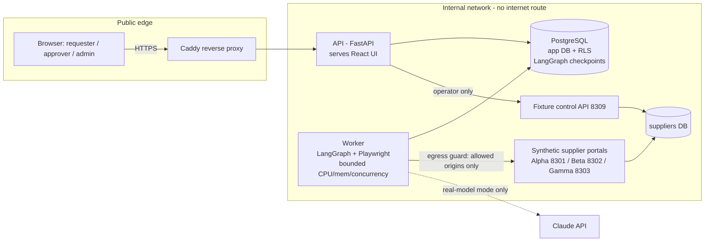
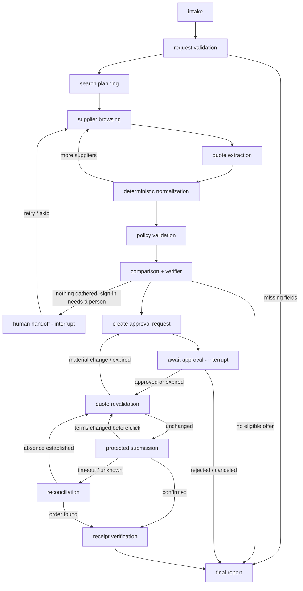

# Architecture

Procurement Navigator is a bounded browser agent for one procurement flow: gather comparable supplier
offers through rendered supplier portals, verify them with deterministic code, obtain a human approval
bound to one exact purchase, and complete a **simulated** purchase with receipt verification.

## Services

| Service | Responsibility | Notes |
|---|---|---|
| `api` | Auth, sessions, CSRF, requests, runs, approvals, orders, evidence downloads, exports, SSE events | Non-owner DB role; tenant from server session only |
| `worker` | Claims jobs, holds the per-run advisory lock, runs the LangGraph workflow, drives Chromium | Max 2 concurrent runs; job leases + heartbeats |
| `mock-suppliers` | Three independently styled portals plus private control API | Persistent inventory and orders; idempotent PO-token submission |
| `db` | PostgreSQL 17: `procnav` (app, RLS) and `suppliers` (fixture) databases | Separate roles: `procnav_owner` (migrations), `procnav_app` (runtime, RLS enforced), `suppliers` |

## Backend modules (`backend/procnav`)

| Module | Contents |
|---|---|
| `api` | Routes, serializers, error envelope, idempotency keys, CSV/PDF exports |
| `auth` | Argon2 password hashing, server-side sessions, CSRF, role dependencies, Entra ID OIDC seam |
| `agents` | LangGraph state machine (`graph.py`), model adapters (fixture + Claude), role prompts, run context |
| `browser` | Egress guard, DOM/accessibility observation, typed tools over isolated Playwright contexts |
| `suppliers` | Credential resolution by reference |
| `policies` | Default policy, deterministic rule engine, ranking, material-change detection |
| `quotes` | Extraction schemas, deterministic normalization (Decimal), fingerprints |
| `approvals` | Fingerprint-bound approval requests and authenticated decisions |
| `orders` | Order ledger (row-locked transitions, attempts) |
| `evidence` | Redacted evidence storage with integrity hashes and retention |
| `workers` | Postgres job queue (SKIP LOCKED leases), runner, worker process |
| `evals` | Benchmark harness, fixed-selector baseline, safety gates |
| `core` | Settings validation, DB sessions with tenant context, models, RLS/trigger SQL, redaction, audit |

## Procurement workflow (LangGraph)

Each node is checkpointed in PostgreSQL (`langgraph-checkpoint-postgres`, thread id `tenant:run`).
Approval waiting is a LangGraph `interrupt`; the worker exits and a new job resumes the graph after
an authenticated decision. Resume payloads are never trusted for authorization: the node re-reads
the approval row.

### Why graph persistence does not make a purchase safe to replay

A checkpoint records that a node *started* or *finished*; it cannot know whether a click that was in
flight when a worker died reached the supplier. Replaying the `submit` node from a checkpoint could
therefore buy twice. Safety comes from the **order ledger** instead:

1. The approval is consumed and the order intent created in one transaction (`unique(approval_request_id)`).
2. The intent moves `approved → submitting` under a row lock before any click; a partial unique index
   allows only one in-flight intent per run, and a per-run advisory lock stops two workers running the
   same graph.
3. A resumed `submit` reads the ledger first: `submitting`, `unknown` or `cancellation_requested`
   always route to reconciliation, never to another click.
4. The supplier receives the intent key as an idempotency token and the reviewed quote reference;
   it validates both atomically, so even a duplicate click returns the original order.
5. Reconciliation reads order history for the token within a bounded window. Absence leads to a fresh
   approval, not an automatic retry.

For future real portals, local locks cannot guarantee exactly-once execution or prevent last-moment
external price changes; see [supplier-adapter.md](supplier-adapter.md).

## Data model

Tenant-scoped tables (all with `tenant_id` and an RLS policy): suppliers, supplier_credentials_metadata,
browser_session_states, policy_versions, policy_exceptions, procurement_requests, request_items,
procurement_runs, browser_steps, quotes, quote_lines, policy_decisions, approval_requests, approvals,
order_intents, order_attempts, supplier_orders, evidence_artifacts, run_events, audit_events,
idempotency_keys, eval_runs. Global tables: tenants, users, memberships, auth_sessions, jobs,
worker_heartbeats, LangGraph checkpoint tables.

Database-enforced invariants (migration `0001`, `procnav/core/security_sql.py`):

* RLS `tenant_isolation` on every tenant-scoped table, `FORCE`d, keyed on `app.tenant_id`.
* Order-intent transition trigger (see [state-machines.md](state-machines.md)) and immutable binding fields.
* Approval-request transition trigger and immutable fingerprint.
* Append-only triggers on audit_events, quotes, quote_lines, policy_decisions, approvals; the runtime
  role also lacks UPDATE/DELETE grants on them.
* Partial unique indexes: one active run per request; one in-flight order intent per run.

## Model modes

* **Fixture mode** (default): deterministic decisions with the same tool contracts, validation, graph,
  and database. Every decision is stored as a `decide:*` step labelled `simulated`, and the UI shows
  "simulated model decisions" on runs, comparisons, approvals and PDFs.
* **Real mode**: `ClaudeModel` (Anthropic SDK, `claude-opus-5-5` by default) with structured outputs,
  low effort, server-side refusal fallback, and optional screenshot input for recovery. Page content is
  wrapped as untrusted data; every proposal is validated against the current observation.
