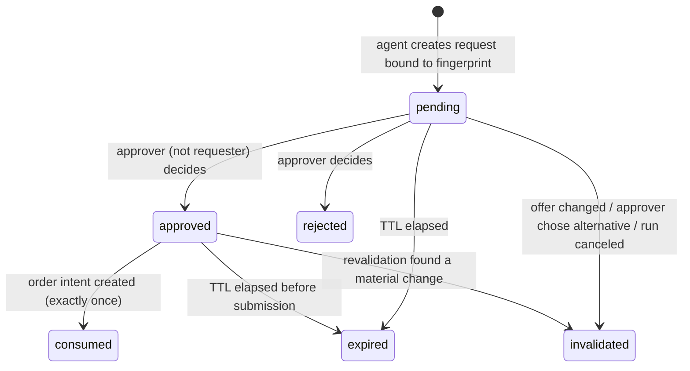
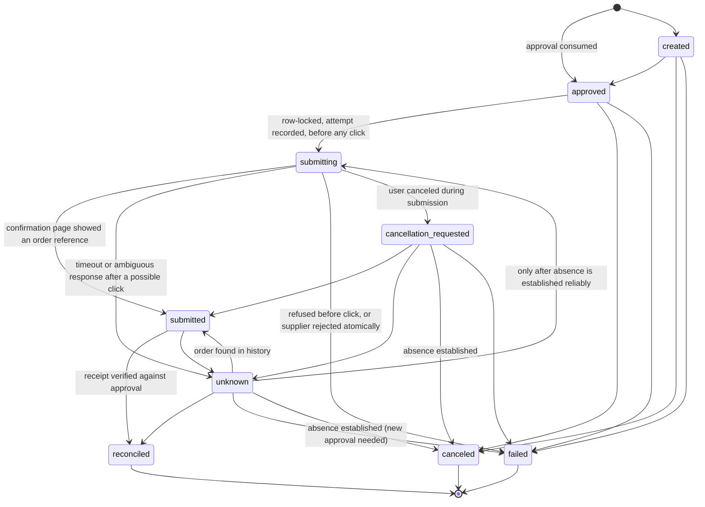

# Approval and order-ledger state machines

Both are enforced by PostgreSQL triggers (`procnav/core/security_sql.py`), not only by application code.

## Approval requests

The fingerprint is `sha256` of the canonical binding: request id and version, supplier, quote id and
canonical hash, cart view (SKU, quantity, unit price, discount, tax, shipping, total, currency,
delivery date, destination, supplier quote reference), maximum amount, delivery deadline, destination
reference, and policy version. The decision API also requires the approver to echo the fingerprint they
reviewed (`acknowledged_fingerprint`); a mismatch returns `409 CONFLICT`.

Decisions are idempotent (one `approvals` row per request; same approver + same decision returns the
stored record) and audited with the reason, fingerprint and policy evaluation.

## Order intents (ledger)

Rules:

* `intent_key`, `approved_fingerprint`, `max_amount` and `approval_request_id` are immutable.
* At most one intent per run may be in `created/approved/submitting/submitted/unknown/cancellation_requested`.
* Closing a browser or canceling a run never marks an order canceled; only an established supplier
  outcome does.
