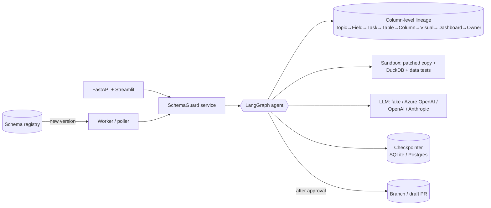
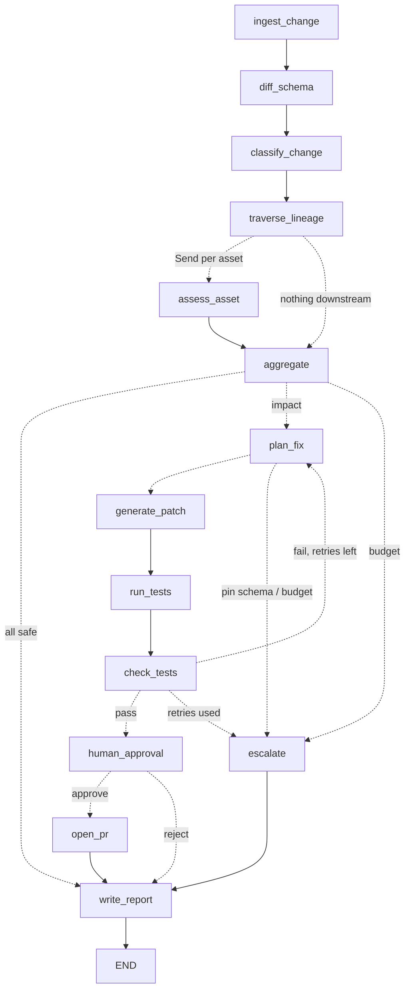

# SchemaGuard

**When an upstream team renames, drops or retypes a field on a Kafka topic, a revenue dashboard can
silently break days later.** SchemaGuard catches the schema change, traces it column by column to
every table, dashboard and owner it affects, proposes a fix that passes the data tests under the new
schema, and waits for a human to approve before opening a branch or draft PR.

> All data in this repository is synthetic: an invented web shop with generated orders, payments and customers. No real company data, credentials or customers are used.

## Architecture



Agent graph (exported from the compiled graph; full version in [docs/ARCHITECTURE.md](docs/ARCHITECTURE.md)):



Deterministic code does the diff, the compatibility classification, the lineage traversal, the
per-asset verdicts, the build-impact analysis and the routing. The LLM only explains the change,
plans the fix, writes file edits and the business summary ([ADR-001](docs/DECISIONS.md)).

## Quick start

Requires Python 3.12 and [uv](https://docs.astral.sh/uv/). No Docker, no API keys.

```bash
git clone <this repo> schemaguard && cd schemaguard
uv sync --all-extras
uv run schemaguard demo-setup                # synthetic data, file registry, pipeline + data tests, lineage
uv run pytest -q                             # 82 tests
uv run python eval/run_eval.py --llm fake    # writes eval/results/summary.md
uv run schemaguard api                       # terminal 1 → http://localhost:8000/docs
uv run schemaguard ui                        # terminal 2 → http://localhost:8501
```

Optional services (Kafka, Schema Registry, Postgres, Airflow, Neo4j): `docker compose --profile core up -d` (see the status table).

## Demo script: the rename scenario

1. **The change.** The checkout team renames `orders.v1.amount` to `total_amount`.
   UI sidebar → *Rename orders.amount → total_amount* → **Submit change**, or:
   ```bash
   uv run schemaguard change --topic orders.v1 --ops '[{"op":"rename_field","field":"amount","to":"total_amount"}]'
   ```
2. **Diff and classification.** One `renamed` change with evidence (same type, name similarity, same position). Class `breaking`: SQL reads fields by name.
3. **Impact.** Lineage gives three paths, for example
   `orders.v1.amount → stg_orders.amount → fct_orders.amount → daily_revenue.revenue → Sales Overview / Revenue by Day`.
   11 assets are breaking (columns, visuals, data tests) across *Sales Overview*, *Customer Health* and *Finance Reconciliation*, with owners
   `sales-analytics`, `customer-success`, `finance` and `analytics-engineering`. Build impact: `stg.stg_orders` fails, so three marts go stale.
   `Orders by Status` is correctly *not* affected (column-level, not table-level).
4. **Fix.** Strategy `update_sql_transform`; the patch changes one line in `sql/staging/stg_orders.sql`:
   `cast(total_amount as decimal(12, 2)) as amount`.
5. **Proof.** Sandbox under the new schema: without the fix, 1/11 data tests pass and `stg_orders` fails with a Binder Error. With the fix, 11/11 pass.
6. **Approval.** The run pauses (`interrupt()`), and survives an API restart. Approve in the UI or with `uv run schemaguard runs approve <run_id> --reviewer you`.
7. **Output.** A branch `schemaguard/<run>-orders-v1` with one commit in `.schemaguard/target_repo`, `fix.patch`, and a business-readable `report.md` under `.schemaguard/artifacts/<run_id>/`.

**Recording a demo GIF (planned):** run the API and UI, start a screen recorder (e.g. ScreenToGif on Windows), and do steps 1 → 6 in the UI: sidebar submit, then the *Impact graph*, *Verdicts*, *Patch* and *Tests* tabs, then **Approve**, then the *Report* tab. About 60 seconds.

## Status

`planned` = not built · `built` = code exists, not covered by automated tests or not run · `tested` = automated tests pass on the build machine · `deployed` = running in a cloud. **Nothing is deployed.**

| Feature | Status | Notes |
|---|---|---|
| Synthetic pipeline (Avro, producers, DAGs, SQL, dashboards, data tests) | tested | runs end to end on DuckDB |
| Avro diff + compatibility/severity classifier | tested | every change kind |
| Lineage extractors (Avro, Airflow AST, sqlglot SQL, dashboards, data tests) | tested | |
| Graph queries (`downstream`, `upstream`, `impact_paths`, `blast_radius_summary`) | tested | |
| Lineage store: SQLite / Postgres / Neo4j | tested / built / built | Postgres and Neo4j not run (no Docker) |
| LangGraph agent, `Send` fan-out, deterministic verdicts, build impact | tested | |
| Fix loop: plan → patch → sandbox → retry (max 3) → escalate | tested | |
| Human approval (`interrupt`) with SQLite checkpointer, survives restart | tested | |
| Postgres checkpointer | built | approved LGPL extra; not run |
| `open_pr`: local branch + commit / GitHub draft PR | tested / built | draft PR needs a token; not run |
| Impact report (Markdown) | tested | |
| Idempotency, per-run budget, prompt-injection handling, patch guardrails | tested | |
| JSON logs + OpenTelemetry spans per node | tested | console exporter; LangSmith via env vars (not run) |
| FastAPI | tested | in-process TestClient |
| Streamlit UI | built | full rename flow clicked through by hand on 2026-11-15; no automated UI tests |
| Registry poller with file registry / Confluent REST client | tested / built | |
| Kafka producer path | built | not run |
| Evaluation suite (25 scenarios + DuckDB oracle) | tested | numbers below |
| Real LLM providers (Azure OpenAI, OpenAI, Anthropic) | built | not run; needs keys and your approval |
| Databricks / Snowflake read-only warehouse adapters | planned | |
| Azure Schema Registry adapter | planned | Event Hubs has no Confluent-API registry |
| docker-compose (`core`, `app`, `airflow`, `neo4j` profiles) | built | not verified: Docker not installed |
| Dockerfile (api / worker / ui targets) | built | not built locally |
| Bicep (Container Apps, Postgres, Event Hubs, Key Vault, ACR, identity) | built | not validated yet: Bicep CLI not installed |
| GitHub Actions `ci.yml` / `deploy.yml` (manual + environment approval) | built | not run |
| Azure deployment | planned | steps for you in [docs/DEPLOY.md](docs/DEPLOY.md) |

## Evaluation results

From [eval/results/summary.md](eval/results/summary.md), generated **2026-11-15 15:05 UTC** at commit `e6f1183` by
`uv run python eval/run_eval.py --llm fake`, over 25 hand-labelled scenarios in `eval/scenarios/`.

| Metric | Value |
|---|---|
| Impact precision / recall (graph traversal) | 100.0% / 100.0% (214 TP, 0 FP, 0 FN) |
| Verdict accuracy | 100.0% over 183 labelled assets |
| Route accuracy (report / approval / escalate) | 100.0% |
| Fix test-pass rate | 100.0% (14/14 fixable scenarios) |
| Avg retries in fix loop | 0.12 over 16 runs |
| Escalation accuracy | 100.0% |
| **Oracle (DuckDB):** failing builds predicted correctly | 100.0% of scenarios |
| **Oracle (DuckDB):** breaking data tests precision / recall | 100.0% / 100.0% (101 / 101) |
| Latency to decision p50 / p95 | 3.06 s / 3.70 s |
| Tokens per run (mean), cost per run | 3,918 (character-based estimate), $0.00 |

**How to read these numbers.** They come from the deterministic `fake` LLM, a scripted fixer, so they
measure SchemaGuard's pipeline (lineage, verdict rules, sandbox, loop control) and not model quality.
The scenario labels were written by the same author as the verdict rules, so the label-based rows
show consistency with that specification, not independent accuracy. The **oracle** rows are the
independent check: they run the unchanged pipeline on the new schema in DuckDB and compare.
The first oracle run found a real gap, breaking-test recall of **29.7%**: column lineage missed
tests on tables that go stale when an upstream build fails. That led to the build-impact analysis
([ADR-006](docs/DECISIONS.md)), after which recall is 100% on these 25 scenarios.
No real-LLM eval has been run yet.

## Limitations

* One synthetic pipeline, 25 scenarios, labels by the author: good for regression, weak as evidence of generalisation.
* SQL lineage covers single-SELECT transforms in DuckDB dialect; CTE-heavy dbt projects, macros, Python transforms and `SELECT *` expansion are untested.
* Verdict rules model common SQL usage (cast, aggregate, function, join, filter, coalesce); exotic expressions fall back to conservative defaults.
* The sandbox is process-level isolation (subprocess, timeout, Python socket guard); it relies on the patch guardrails as the primary control.
* Reviewer identity is self-declared; the API key is optional. Real deployments need Entra ID auth.
* Postgres, Kafka, Confluent Schema Registry, Airflow, Neo4j, Docker and Bicep paths are written but were not run on the build machine.
* The fake LLM's fixes are heuristics; real-LLM fix quality is unmeasured.

## Next steps

1. Run the eval with Azure OpenAI and record the cost (needs your approval and keys).
2. Postgres + Kafka integration tests in CI with service containers.
3. dbt `manifest.json` extractor; Databricks/Snowflake `information_schema` adapters (read-only).
4. Azure Schema Registry adapter; VNet + Entra auth in Bicep.
5. Have someone other than the rule author label an extra scenario set.

## Repository map

```
src/schemaguard/   config · schemas/ (avro, diff, classify, evolve, registry) · lineage/ (extractors, model, store)
                   agent/ (state, graph, nodes/, assess, guardrails, prompts/) · sandbox/ · llm/ · api/ · ui/ · service · worker · cli
demo_pipeline/     avro/ · producers/ · dags/ · sql/{staging,marts} · dashboards.yaml · tests/data_tests.yaml
eval/              scenarios/ (25 YAML) · run_eval.py · results/summary.md
infra/bicep/       main.bicep · main.parameters.json        .github/workflows/  ci.yml · deploy.yml
docs/              ARCHITECTURE · DECISIONS · LEARNING · RUNBOOK · DEPLOY
```
