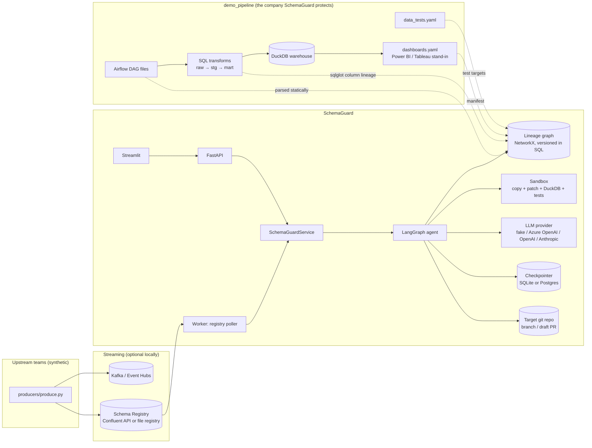
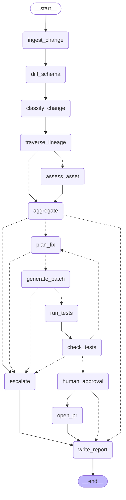

# Architecture

## System

Only the agent's `open_pr` node writes outside SchemaGuard's own state, and it runs only after a
human approves via `interrupt()`. Everything else reads: the pipeline directory is never modified
(fixes are tested in a sandbox copy).

## Lineage graph

| Node | Example id |
|---|---|
| Topic | `topic:orders.v1` |
| Field | `field:orders.v1.amount` |
| Dag / Task | `dag:build_staging`, `task:build_staging.stg_orders` |
| Table / Column | `table:stg.stg_orders`, `column:stg.stg_orders.amount` |
| Dashboard / Visual | `dashboard:Sales Overview`, `visual:Sales Overview/Revenue by Day` |
| Owner | `owner:finance` |
| DataTest (extension) | `test:revenue_reconciles_with_staging` |

Edges: `HAS_FIELD`, `CONSUMED_BY`, `WRITES`, `HAS_COLUMN`, `DERIVES_FROM` (child → parent, with
`via` = ingest | value | join | filter | group and the SQL file/line/expression and transform),
`USED_BY`, `PART_OF`, `OWNED_BY`, `TESTED_BY`.

Extractors (each unit-tested): Avro schemas → topics/fields; Airflow DAG files parsed with `ast`
(no scheduler) → DAGs/tasks/raw columns; SQL files → column lineage via `sqlglot.lineage` for
projections plus join/filter/group references via `sqlglot.optimizer.qualify`; `dashboards.yaml`
→ dashboards/visuals; `data_tests.yaml` → tests.

Each build is hashed; identical builds reuse their version, so a run records exactly which graph
it used (`lineage_version`).

## Agent graph (compiled, exported from code)

Regenerate with `uv run schemaguard export-mermaid`.

<!-- AGENT_GRAPH_START -->

<!-- AGENT_GRAPH_END -->

| Node | Deterministic / LLM | What it does |
|---|---|---|
| ingest_change | code | validate both schemas (fastavro), scan docs for instruction-like text, init budget |
| diff_schema | code | added / removed / renamed (with evidence) / type / enum / nullability / default / doc |
| classify_change | code + LLM | Avro compatibility + downstream severity in code; LLM writes a short explanation and may suggest renames, which code re-checks |
| traverse_lineage | code | `downstream()` for every changed field |
| assess_asset | code (fan-out with `Send`) | one task per impacted column / visual / data test: breaking, degraded or safe, with reason, SQL file:line, path |
| aggregate | code | dashboard and table roll-up, owners, blast radius, impact paths, build impact (failing / stale tables, blocked tests) |
| plan_fix | LLM | strategy + rationale; code rejects unknown strategies and files outside the edit targets |
| generate_patch | LLM + code | LLM returns full file contents; code builds the unified diff and enforces guardrails |
| run_tests | code | baseline run (new schema, old code) + patched run, each in a fresh sandbox |
| check_tests | code | pass → approval; fail → retry (max 3 attempts) → escalate |
| human_approval | `interrupt()` | waits durably in the checkpointer; resumed by API / UI / CLI |
| open_pr | code | local branch + commit in the target repo; GitHub draft PR only with a token |
| escalate | code | analysis without a patch |
| write_report | code + LLM | Markdown report; LLM writes only the business summary paragraph |

## State and storage

* Agent state: `AgentState` (TypedDict of JSON values) checkpointed per step, thread id = run id.
  SQLite (`.schemaguard/checkpoints.db`) by default; `PostgresSaver` when `SCHEMAGUARD_DATABASE_URL` is set.
* Run index: `runs` table (status, idempotency key = sha256(topic + canonical new schema)).
* Lineage: `lineage_builds`, `lineage_nodes`, `lineage_edges` (versioned).
* Artifacts: `.schemaguard/artifacts/<run_id>/{report.md, fix.patch}`; sandboxes under `.schemaguard/sandbox/<run_id>/`.

## Verdict semantics

* **breaking**: the SQL that builds the asset will error, or a data test will fail.
* **degraded**: the asset still builds but its values or meaning change (type change through a cast, NULLs appearing,
  new enum values passing a filter, a filter referencing a removed value).
* **safe**: reached by lineage but unaffected.

Column-level verdicts are complemented by **build impact**: when a build fails, every downstream
table is not refreshed, so dashboards show stale data and tests on those tables cannot pass even if
their columns are not in the changed field's lineage.
