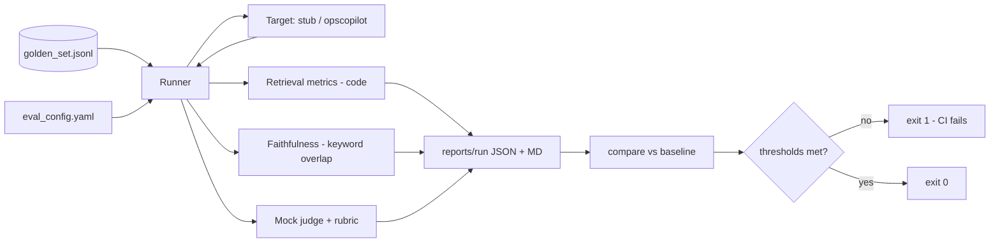

# AgentJudge — eval harness + CI quality gate (mock-first slice)

Tests any AI endpoint against a **frozen 50-question golden set**, scores
retrieval + generation + a calibrated judge, writes a report, and **fails the
build if quality drops**. First target: OpsCopilot (`OpsCopilotTarget`);
`StubTarget` runs offline so CI needs no API keys. All data is synthetic
(Acme Retail Ltd).



## Run in 1 command

```bash
uv sync --group dev
uv run agentjudge run --target stub --set golden_set.jsonl --subset all --repeat 3
```

More CLI:

```bash
uv run agentjudge run --target stub --set golden_set.jsonl --subset smoke
uv run agentjudge compare reports/run_stub_all_<date>.json reports/baseline.json
uv run agentjudge gate reports/run_stub_all_<date>.json --baseline reports/baseline.json
uv run agentjudge calibrate --human labels/human_20.jsonl --judge reports/run_stub_all_<date>.json
uv run python scripts/check_balance.py
```

## Measured results (from `reports/run_stub_all_2026-09-19.json`, mock target)

| metric | value |
|---|---|
| hit_rate@5 | 1.000 |
| recall@5 | 0.970 |
| MRR | 0.860 |
| context precision / recall | 1.000 / 0.970 |
| faithfulness (mock keyword overlap) | 0.847 |
| judge correctness (mean, 1–5) | 4.680 |
| refusal accuracy | 1.000 |
| citation validity | 1.000 |
| p50 / p95 latency | 6ms / 8ms |
| Cohen's kappa vs 20 human labels | 0.455 |
| cost per full run | $0.00 |

`--repeat 3` spread: min = max on every metric (deterministic mock, so zero
variance). With a live LLM target expect spread; deltas < 0.02 are noise.

## How much can you trust these numbers?

Mock slice: retrieval/faithfulness/judge are deterministic code, so repeats
are identical — the numbers prove the harness works, not that a model is
good. Swap in a real target + LLM judge and re-run `--repeat 3`; only then
do spread and kappa describe model quality.

## Failure demos

- **Ungrounded answer:** every 9th stub record emits generic filler;
  faithfulness for those rows is ≈0.0 (worked example: `docs/faithfulness_example.md`).
- **Gate blocks regression:** `tests/test_cli.py` proves a degraded run
  (faithfulness 0.9 → 0.1) exits 1.
- **Subset noise:** smoke vs full baseline shows faithfulness −0.024 —
  compare like-for-like only.

## Trade-offs / limits

- Mock judge ≈ keyword overlap, not real judgement (kappa 0.455 vs humans
  is moderate, not good). RAGAS/DeepEval + LLM judge come with the live slice.
- Thresholds in `eval_config.yaml` are mock-baseline placeholders; reset
  from a real baseline before enforcing on a live target.
- Synthetic data only; `targets/incident_commander.py` and
  `suites/redteam/` are P4/P5 placeholders.

## What I'd do next

Live OpsCopilot target run, RAGAS faithfulness/answer-relevance, LLM judge
with re-calibration, per-category thresholds, nightly full runs.
