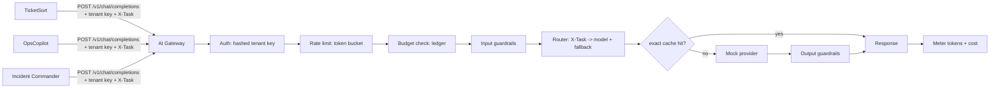

# P5 — Secure AI Gateway (mock-first slice)

One gateway that every AI app calls instead of calling model providers
directly: tenant keys, rate limits, budgets, routing + fallback, cache,
guardrails, audit. **Offline, synthetic data only** (Acme Retail Ltd).
No provider network calls — the provider layer is mocked.



## Run

```powershell
cd ai-gateway
uv sync --group dev
uv run uvicorn gateway.app:app --host 0.0.0.0 --port 8000
```

Create a tenant (key shown **once**), then call:

```powershell
$admin = "admin-dev-key-change-me"  # dev default; set ADMIN_API_KEY in .env
$body = @{name="ticketsort"; monthly_budget_usd=10; rpm=60; tpm=20000;
  allowed_models=@("triage-cheap","general-default","rca-strong");
  guardrail_profile="standard"} | ConvertTo-Json
$created = Invoke-RestMethod -Method Post http://localhost:8000/admin/tenants `
  -Headers @{"X-Admin-Key"=$admin} -Body $body -ContentType "application/json"
$key = $created.api_key
$chat = @{model="triage-cheap";
  messages=@(@{role="user"; content="vpn down for acme store 12"})} | ConvertTo-Json -Depth 5
Invoke-RestMethod -Method Post http://localhost:8000/v1/chat/completions `
  -Headers @{Authorization="Bearer $key"; "X-Task"="triage"} `
  -Body $chat -ContentType "application/json"
```

Point TicketSort at it: set its provider base URL env to
`http://localhost:8000/v1` and its model key to the tenant key above
(see "TicketSort wiring" below).

## Tenants

| Item | Rule |
|---|---|
| Key | `sk-gw-...` shown once, stored as SHA-256 hash |
| Verify | constant-time (`hmac.compare_digest`) |
| Models | per-tenant `allowed_models`; others -> 403 `model_not_allowed` |
| Wrong / deleted key | 401 |

## Routing (`config/routing_policy.yaml`)

| X-Task | Primary | Fallback | Why |
|---|---|---|---|
| triage | triage-cheap | general-default | cheap is enough for classification |
| rca | rca-strong | general-default | RCA needs strongest reasoning |
| rag_answer | general-default | triage-cheap | balanced quality/cost |
| general | general-default | triage-cheap | safe default |

Primary failure (mock marker `[FAIL:<model>]`, e.g. `[FAIL:triage-cheap]`) -> fallback, logged as
`provider_fallback` in `audit_log`, response has `fallback_used: true`.
Exact-match cache (temperature 0 only) is keyed per tenant — never shared.

## Guardrails (`config/guardrail_profiles.yaml`)

| Layer | standard | strict |
|---|---|---|
| Max input chars | 8000 | 4000 |
| Injection block | high only | medium + high |
| PII redact (email/phone/Aadhaar/PAN, synthetic) | yes | yes |
| Output secrets check | yes | yes |
| Output JSON-schema check | on request | on request |

Every block is stored in `usage_ledger` with `blocked=1` and a `reason`.

## Red-team results (`reports/redteam.json`, strict profile)

| Metric | Value |
|---|---|
| Attacks blocked | 14 / 20 (70.0%) |
| Benign false positives | 0 / 20 (0.0%) |
| Guardrail overhead p95 | 0.08 ms (in-process heuristic; p50 0.049 ms) |

Misses are honest gaps: disclosure/output-secret attacks that carry no
injection pattern pass the *input* layer and rely on the output layer
(PII-leak / secrets checks), which this input-only eval does not exercise.
See `suites/redteam/` for the 20 + 20 synthetic prompts.

## KV-cache math

`kv_cache_bytes(32, 8, 128, 1, 8192, fp16) = 1,073,741,824 bytes = 1 GiB`
(see `docs/serving-math.md`, `src/gateway/capacity.py`).

## TicketSort wiring

TicketSort calls an OpenAI-compatible endpoint. Point it at the gateway:

```powershell
# in ticketsort .env (values synthetic/dev-only)
LLM_BASE_URL=http://localhost:8000/v1
LLM_API_KEY=<tenant key created above for tenant "ticketsort">
LLM_MODEL=triage-cheap   # must be in the tenant's allowed_models
```

Then run TicketSort unchanged — its chat calls flow through auth, rate
limit, budget, guardrails, routing and metering. Prove it: check
`GET /admin/usage` (admin key) shows the ticketsort rows.

## Failure demos

- Wrong key -> 401; deleted tenant key -> 401; disallowed model -> 403.
- rpm burst -> 429 with `Retry-After`.
- Budget at 100% -> 402 `budget_exceeded` (soft warning at 80%).
- `[FAIL:triage-cheap]` in prompt -> fallback reply + `fallback_used: true`.
- "Ignore all previous instructions" -> 400 `injection_high`, logged.

## Limits / next steps

- SQLite + in-memory Redis stub (compose brings real redis + postgres stub;
  set `REDIS_URL=redis://redis:6379/0`).
- Mock provider only; next slice wires LiteLLM + real Postgres/Redis.
- Load numbers: `reports/load.json` is a placeholder until a locust run.
- Cloud: **NOT deployed**. Skeletons in `docs/deploy-azure.md` /
  `docs/deploy-aws.md`; teardown stubs in `scripts/deploy/`.

## Teardown

```powershell
docker compose down -v   # local stack (nothing cloud-side exists)
# cloud (when deployed): scripts/deploy/teardown_azure.sh | teardown_aws.sh
```
