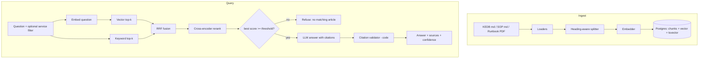

# P1 — OpsCopilot: RAG over KEDB, SOPs and Runbooks

> Paste this whole file into OpenCode (plan agent first). AGENTS.md must be in the repo root.
> **Ownership level:** I write ~35%. You write ~65%.
> **Needs from P0:** nothing required. Reuse the P0 `llm/client.py` pattern (copy and adapt, don't import across repos).

---

## 0. Before you start (agent)

1. Read `AGENTS.md`. Read my P0 `LEARNING_LOG.md` if I paste it, so you know what I already understand.
2. Ask me (max 5 questions), then wait:
   - Embeddings: hosted (same provider as the LLM) or local (`sentence-transformers`)? Does my laptop have 16 GB RAM or more?
   - Reranker: local cross-encoder (needs more RAM/CPU) or skip for now with a config flag?
   - Where will I deploy the live demo (Render, Railway, a VM, or a cloud)? The host must support Postgres with **pgvector** — verify this for the chosen host before we rely on it.
   - Explanations "short" or "detailed"?
3. Show me the milestone table (M1–M12). Wait for `go`.

---

## 1. Mission

Build **OpsCopilot**: an engineer asks "Outlook keeps asking for password after MFA reset, what's the fix?" and gets a short answer **with citations** to the exact KEDB article or SOP section — or an honest "I don't know, no matching article" when the documents don't cover it.

## 2. What I will learn

| Skill | Bucket | Where |
|---|---|---|
| The RAG lifecycle: Load → Split → Embed → Store → Ask → Embed → Retrieve → Re-rank → Augment → Generate | Must | Whole project |
| Document loading (Markdown + PDF) and chunking strategies | Must | M1–M2 |
| Embeddings and cosine similarity | Must | M4 |
| Postgres + **pgvector**, HNSW index, metadata filters | Must | M4 |
| **LangChain** (loaders, splitters, vector store, retriever, chains) | Must | M3 |
| Hybrid search: keyword (full-text / BM25) + vector, fused with **RRF** | Must | M5 |
| Re-ranking with a cross-encoder | Must | M6 |
| Grounded generation with citations + refusal | Must | M6 |
| Vector index trade-offs: Flat vs HNSW vs IVF-PQ (FAISS) | Must (interview) | M8 |
| Basic tracing with Langfuse | Useful | M10 |
| Deploying a DB-backed app | Useful | M11 |

## 3. Hiring signal it proves

"This person can build a real RAG system — hybrid retrieval, re-ranking, citations, refusal — not a toy demo." RAG is one of the most requested skills in GenAI JDs, and an ITSM copilot is the project my research ranked as the best first build.

## 4. Architecture

### Database table `chunks`
`id`, `doc_id` (e.g. `KB0012`, `SOP-VPN-03`), `doc_type` (kedb/sop/runbook), `title`, `section`, `service`, `status` (active/retired), `updated_at`, `content`, `embedding vector(<dim>)`, `content_tsv tsvector`, `content_hash`. Indexes: HNSW on embedding (cosine), GIN on `content_tsv`, btree on `service`, `status`.

### Endpoints
| Method | Path | Purpose |
|---|---|---|
| GET | `/health` | Liveness + DB check + chunk count |
| POST | `/v1/ask` | `{question, service?, top_k?}` → `{answer, citations[], confidence, refused, retrieval_debug?}` |
| POST | `/v1/ask/stream` | Same, streamed |
| GET | `/v1/sources/{doc_id}` | Show the source document |
| POST | `/v1/search` | Retrieval only (no LLM) — used by evals in P2 and by the MCP server in P3 |
| GET | `/` | One simple HTML page (vanilla JS) to ask questions and click citations |

**Note:** `/v1/search` and `/v1/ask` are a **stable contract** — P2, P3 and P4 will call them. Document the request/response schemas in `docs/api-contract.md`.

---

## 5. Milestones

### M1 — Synthetic knowledge base + loaders
**Build:** `scripts/generate_corpus.py` creates for Acme Retail Ltd: **80 KEDB articles** (Markdown with front-matter: `kb_id`, `service`, `symptoms`, `cause`, `workaround`, `permanent_fix`, `status`, `updated_at`), **20 SOPs** (Markdown, with headings), **10 runbooks as PDFs** (make them with `reportlab`). Build in **traps on purpose**: 3 pairs of conflicting articles, 3 retired/outdated articles, 5 near-duplicates, 2 very long SOPs. All marked synthetic. Loaders for Markdown (with front-matter) and PDF.
**Learner task:** write **5 KEDB articles by hand** from my own experience (anonymised). Real-feeling articles make better tests.
**Teach me:** why metadata (service, status, date) matters as much as the text; what PDF parsing loses (tables, headers, page breaks).

### M2 — Chunking experiments
**Build:** three splitters: fixed-size (with overlap), recursive character, and **heading-aware** (keeps section title with the text). `scripts/chunk_report.py` prints chunk count, average/min/max length, and 3 sample chunks for each.
**Learner task:** implement the heading-aware Markdown splitter: each chunk carries `title > section` as a prefix; split long sections at paragraph boundaries under a max token size.
**Teach me:** why chunk size matters (too small = lost context, too big = noisy retrieval and higher cost), what overlap is for.
**Break it:** set chunk size to 50 tokens and then 3000. Predict what happens to answer quality. Keep the result for M9.

### M3 — The LangChain way (learn the framework)
**Build:** the full ingest + retrieve + answer pipeline using **LangChain** components: document loaders, text splitter, embeddings, the PGVector vector store, a retriever, and a simple chain (prompt → LLM → output parser). Check the current LangChain package names and APIs before writing code (they change often) and tell me what you checked.
**Learner task:** write the RAG prompt template (system + context + question) with rules: answer only from context, cite `[doc_id §section]`, say "No matching article" if the context doesn't answer it.
**Teach me:** what LangChain gives you (speed, integrations) and what it hides (the SQL, the scoring, the prompt). Show me the actual SQL the vector store runs.

### M4 — Own the storage layer (pgvector by hand)
**Build:** replace the LangChain vector store with our own repository class using `psycopg` (async) + SQL. Schema + migrations (plain SQL files are fine). Idempotent ingest: skip chunks whose `content_hash` hasn't changed. HNSW index (cosine).
**Learner task:** write the SQL for "top-k by cosine similarity, filtered by `service` and `status='active'`" and the Python function that runs it.
**Teach me:** what an embedding is (meaning as a list of numbers), cosine similarity, what an HNSW index does (simple picture: a multi-level map of shortcuts), why filters + ANN indexes can be tricky.

### M5 — Hybrid retrieval with RRF
**Build:** keyword search using Postgres full-text (`tsvector`, `ts_rank_cd`) — note to me that this is BM25-*like*, not true BM25. Run vector and keyword search in parallel. Fuse with RRF. Return a `retrieval_debug` block showing each list and fused ranks.
**Learner task:** implement `rrf_fuse(rankings: list[list[str]], k: int = 60) -> list[tuple[str, float]]` where `RRF(d) = Σ 1/(k + rank(d))`, ranks start at 1. Tests: a document in both lists beats one in only one list; ties handled; empty lists handled. Then work out one example by hand in `docs/rrf-worked-example.md`.
**Teach me:** why keyword search wins on error codes and ticket IDs (like `0x80070005`, `KB0012`) while vector search wins on meaning ("can't log in" ≈ "authentication failure"). Why RRF uses ranks, not scores.
**Break it:** ask for an exact error code with vector-only search, then hybrid. Predict first.

### M6 — Rerank, generate, cite, refuse
**Build:** cross-encoder reranker (config flag to disable). Refusal if the best rerank score is below a threshold (in config). Answer generation with citations. A **deterministic citation validator**: every cited `doc_id` must be in the retrieved set; if not, strip it and lower confidence. Prefer `active` over `retired` docs; when two active docs conflict, say so and cite both.
**Learner task:** implement `validate_citations(answer: str, retrieved_ids: set[str]) -> CitationCheck` (parse `[KB0012 §Workaround]` patterns, report valid / invalid / missing).
**Teach me:** re-ranking (bi-encoder vs cross-encoder, in simple words), why refusal is a feature, how hallucinated citations happen.
**Break it:** (a) ask something not in the KB; (b) ask about a conflicting-pair topic; (c) ask about a retired article's topic.

### M7 — API, streaming, simple UI
**Build:** endpoints above, streaming, and one HTML page (vanilla JS, no framework): question box, service filter dropdown, answer, clickable citations, a "show retrieval debug" toggle. CLI: `uv run opscopilot ingest ./data`.
**Learner task:** write the JS `fetch` + stream-reading code for the page (I'm learning JavaScript — explain each line).

### M8 — Index experiment: Flat vs HNSW vs IVF-PQ (interview math)
**Build:** `scripts/index_experiment.py` using **FAISS**: build Flat (exact), HNSW, and IVF-PQ indexes over (a) our real chunk embeddings and (b) a scaled set of ~100k synthetic vectors of the same dimension. Measure recall@10 against Flat, query latency p50/p95, build time, and memory. Try 2–3 settings each (HNSW `M`/`efSearch`; IVF `nlist`/`nprobe`, PQ `m`). Write `reports/index_experiment.json` and a chart.
**Learner task:** write the `recall_at_k(approx_ids, exact_ids, k)` function, and write the README section "What I learned about vector indexes" **in my own words**.
**Teach me:** HNSW = graph of shortcuts (fast, accurate, memory-hungry); IVF = split into buckets and search only a few (`nprobe`); PQ = compress vectors (much less memory, some accuracy lost). When would I pick each?

### M9 — Quick evaluation (full evals come in P2)
**Build:** `data/smoke_questions.jsonl` with 15 questions (answerable, unanswerable, conflicting, exact-code). `scripts/smoke_eval.py`: hit rate@5 (is the right `doc_id` retrieved?), refusal correctness, citation validity rate, p95 latency, cost per question → `reports/smoke_<date>.json`. Compare chunking strategies from M2 and vector-only vs hybrid vs hybrid+rerank.
**Learner task:** write the 15 questions and their expected `doc_id`s myself.

### M10 — Tracing with Langfuse (intro)
**Build:** add Langfuse tracing (self-hosted via compose, or their cloud free tier — ask me). One trace per `/v1/ask` with spans: embed, vector search, keyword search, fuse, rerank, generate, validate. Tokens and cost on the generate span.
**Teach me:** a trace is like an incident timeline — every step, how long it took, what went in and out.
**Break it:** make the DB slow (add `pg_sleep` in a test path). Find the slow span in the trace.

### M11 — Docker, CI, deploy
**Build:** compose with app + Postgres/pgvector (+ Langfuse if self-hosted). CI: lint, types, unit tests, and an integration test with a Postgres service container. Deploy to the host I chose; seed the synthetic corpus on deploy. Add basic protection (a shared demo key or rate limit) so strangers can't burn my LLM budget.
**Learner task:** write the deploy steps into `docs/deploy.md` as I do them — the agent checks them.

### M12 — Ship it
README (Mermaid, one-command run, live URL, metrics from `reports/`, index experiment chart, failure demos, trade-offs, limits), ADRs (pgvector over a hosted vector DB; hybrid + RRF; heading-aware chunks; refusal threshold), `DEMO.md`, `INTERVIEW.md` (I write), `/interview`, public repo.

---

## 6. Definition of done

- [ ] Hybrid + rerank retrieval with citations and refusal, behind a stable `/v1/search` and `/v1/ask` contract
- [ ] `reports/` has: chunking comparison, retrieval-mode comparison, index experiment, smoke eval
- [ ] Traps handled and documented: unanswerable, conflicting, retired, exact error code
- [ ] Live URL with spend protection; public repo; CI green
- [ ] LEARNING_LOG (M1–M12), INTERVIEW (15 by me), DEMO complete

## 7. Interview questions I must be able to answer

1. Walk me through your RAG pipeline end to end.
2. Why hybrid search? Explain RRF with the formula and a worked example.
3. HNSW vs IVF-PQ — when would you use each? Show me your numbers.
4. How do you stop the model from inventing citations?
5. How do you handle conflicting or outdated documents?
6. Why pgvector and not Pinecone / Qdrant / Azure AI Search?
7. How would you add permissions so a user only sees documents they're allowed to see?
8. How would you scale this to 10 million chunks?

## 8. Resume bullet template (fill ONLY from reports/)

> Built OpsCopilot, a RAG assistant over `<<n>>` synthetic KEDB/SOP documents using Postgres + pgvector, hybrid keyword+vector retrieval with RRF and cross-encoder re-ranking; improved hit rate@5 from `<<vector-only>>`% to `<<hybrid+rerank>>`% with a `<<p95>>` ms p95 and citation-validated answers.
