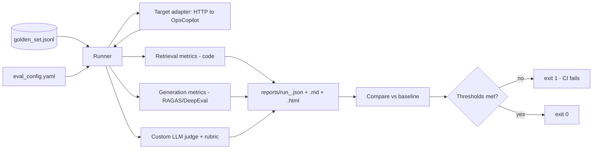

# P2 — AgentJudge: Evaluation Harness + CI Quality Gate

> Paste this whole file into OpenCode (plan agent first). AGENTS.md must be in the repo root.
> **Ownership level:** I write ~45%. You write ~55%.
> **Needs from P1:** OpsCopilot running locally (or deployed) with `/v1/search` and `/v1/ask`. Stub mode must exist so tests run without it.

---

## 0. Before you start (agent)

1. Read `AGENTS.md`, and OpsCopilot's `docs/api-contract.md` (I'll paste it).
2. Ask me (max 5), then wait:
   - Which eval library: **RAGAS** or **DeepEval**? (Default: RAGAS. Check its current API and metric names before writing code — they change.)
   - Which model should be the **judge**? (Should ideally differ from the model being tested, or at least be noted as a limitation.)
   - Monthly eval budget in USD?
   - OpsCopilot URL (local or live)?
3. Show the milestone table (M1–M10). Wait for `go`.

---

## 1. Mission

Build **AgentJudge**, a reusable tool that tests any AI endpoint against a **golden set** of questions, scores it, writes a report, compares runs, and **fails a GitHub Actions build** if quality drops. First target: OpsCopilot. Later targets: Incident Commander (P4), the Gateway red-team suite (P5), and ChangeGuard (P6).

**Why:** "No evals" is one of the most common reasons AI engineering candidates get rejected. Evals turn "it seems to work" into numbers.

## 2. What I will learn

| Skill | Bucket | Where |
|---|---|---|
| Golden sets: design, categories, labelling | Must | M2 |
| Retrieval metrics: hit rate@k, recall@k, MRR, context precision/recall | Must | M3 |
| Generation metrics: faithfulness, answer relevance (P-R-F-A set) | Must | M4 |
| LLM-as-judge: rubrics, bias, calibration against human labels | Must | M5 |
| Agreement stats: Cohen's kappa | Useful | M5 |
| Regression testing and run comparison | Must | M6 |
| CI/CD quality gates in GitHub Actions | Useful | M7 |
| Cost + latency reporting | Must | M6 |

## 3. Hiring signal it proves

"This person measures AI quality with numbers and blocks bad releases automatically — the same way a change gate blocks a risky deployment."

## 4. Architecture



### Golden set record (`golden_set.jsonl`)
`id`, `question`, `service` (optional filter), `category` (answerable / unanswerable / conflicting / exact_code / multi_hop / outdated), `expected_doc_ids`, `reference_answer`, `must_refuse` (bool), `notes`, `author` (human / llm_draft_reviewed).

### CLI
```
agentjudge run --target opscopilot --set golden_set.jsonl --config eval_config.yaml
agentjudge run --subset smoke          # 15-question subset for CI
agentjudge compare reports/run_A.json reports/run_B.json
agentjudge gate reports/run_X.json --baseline reports/baseline.json
agentjudge calibrate --human labels/human_20.jsonl --judge reports/run_X.json
```

---

## 5. Milestones

### M1 — Skeleton + target adapter
**Build:** package with Typer CLI, `Target` protocol (`search()`, `ask()`), `OpsCopilotTarget` (httpx), `StubTarget` (returns canned answers for tests). Config loading. Cost cap.
**Learner task:** write the `Target` protocol (typing `Protocol`) and the `StubTarget`.
**Teach me:** why an adapter/protocol lets one harness test many systems.

### M2 — The golden set (the most important milestone)
**Build:** schema validation for records, a `scripts/draft_questions.py` that asks an LLM to *draft* 30 questions from the corpus (each marked `llm_draft_reviewed` only after I review it). Category balance check.
**Learner task:** write **20 questions by hand** + review/fix all 30 drafts → **50 total**, covering every category (at least 6 unanswerable, 5 conflicting, 5 exact_code). Also mark 15 as the `smoke` subset for CI.
**Teach me:** why human-written questions matter, why a set must include "should refuse" cases, why we freeze a set once we start comparing runs.
**Note:** my research files disagreed on golden-set size (15 vs 50 vs 50–200). We use **50 full + 15 smoke**. Record this choice in an ADR.

### M3 — Retrieval metrics (pure code, no LLM)
**Build:** metrics module + tests.
**Learner task:** implement `hit_rate_at_k`, `recall_at_k`, `mrr` (mean reciprocal rank), and ID-based `context_precision` / `context_recall` (share of retrieved IDs that are relevant / share of relevant IDs that were retrieved). Tests with hand-made examples.
**Teach me:** each metric in one line and one IT analogy (e.g. recall = "of all the KB articles that could fix this, how many did the engineer find?").

### M4 — Generation metrics
**Build:** integrate RAGAS (or DeepEval) for **faithfulness** and **answer relevance**, plus its context precision/recall if available. Add **refusal accuracy** (for `must_refuse` rows) and **citation validity** (from OpsCopilot's response) in code.
**Teach me:** `Faithfulness = grounded claims ÷ total claims in the answer`. Walk through one real example from my data claim by claim.
**Break it:** make OpsCopilot answer without context (a debug flag) and watch faithfulness drop.

### M5 — Custom LLM judge + calibration
**Build:** our own judge with a written **rubric** (1–5 for correctness, completeness, safety; with examples per score), JSON output, temperature 0, reasoning before score. `calibrate` command.
**Learner task 1:** write the rubric.
**Learner task 2:** label 20 answers by hand in `labels/human_20.jsonl`; implement `cohens_kappa(a, b)` and compute agreement between me and the judge.
**Teach me:** judge biases (prefers long answers, prefers its own model family, position bias), why we calibrate, what kappa means in plain words.

### M6 — Reports, cost, latency, comparison
**Build:** each run writes JSON (machine), Markdown (README-ready), and one HTML page with charts. Include per-category scores, worst 5 questions with details, p50/p95 latency, tokens, cost. `compare` shows deltas with arrows and flags regressions.
**Learner task:** implement `detect_regressions(current, baseline, tolerance) -> list[Regression]`.

### M7 — CI quality gate
**Build:** `gate` command with thresholds in config (start: faithfulness ≥ 0.85, hit rate@5 ≥ `<<set from my baseline>>`, refusal accuracy ≥ `<<set>>`, p95 ≤ `<<set>>`). A reusable GitHub Actions workflow that OpsCopilot's repo calls: on pull request, run the **smoke** subset; full set on manual trigger or nightly. Secrets via GitHub Actions secrets. Upload the report as a build artifact and post a summary in the PR.
**Learner task:** set the thresholds from my real baseline run and justify each in an ADR (too strict = noisy failures; too loose = useless gate).
**Teach me:** this is exactly a change gate / CAB check, but automatic.
**Break it:** open a PR in OpsCopilot that sets `top_k=1`. Watch the gate fail. Revert.

### M8 — Variance and trust
**Build:** run the full set 3 times; report the spread of each metric. Add a `--seed`/`--repeat` option.
**Teach me:** why AI evals are noisy, why a 1-point change may mean nothing.
**Learner task:** write the README section "How much can you trust these numbers?"

### M9 — Make it reusable
**Build:** generic target config so later projects plug in: a `rubric` per target, custom metrics via a simple plugin interface. Add an empty `targets/incident_commander.py` and `suites/redteam/` folder for P4/P5.

### M10 — Ship it
README (what, why, diagram, how to add a target, metrics explained simply, example report, limits: synthetic data, judge bias), ADRs, `DEMO.md`, `INTERVIEW.md` (I write), `/interview`, public repo. Link from OpsCopilot's README ("quality gate powered by AgentJudge").

---

## 6. Definition of done

- [ ] 50-question golden set (20 by me) + 15 smoke subset, frozen and versioned
- [ ] Retrieval + generation + custom judge metrics, judge calibrated with kappa reported
- [ ] OpsCopilot PRs gated in CI; one documented failed-gate demo
- [ ] Variance report; public repo; LEARNING_LOG, INTERVIEW, DEMO complete

## 7. Interview questions I must be able to answer

1. How did you build your golden set? How do you stop it from being biased?
2. Explain faithfulness vs answer relevance vs context precision vs context recall.
3. Can you trust an LLM judge? How did you check?
4. What thresholds did you set and why?
5. Your eval scores vary between runs — how do you handle that?
6. How much does a full eval run cost? How do you keep CI cheap?

## 8. Resume bullet template (fill ONLY from reports/)

> Built AgentJudge, an evaluation harness with a 50-question human-reviewed golden set, RAGAS metrics and a calibrated LLM judge (kappa `<<value>>` vs human labels); wired it as a GitHub Actions quality gate that blocks releases when faithfulness falls below `<<threshold>>`, at `$<<cost>>` per smoke run.
