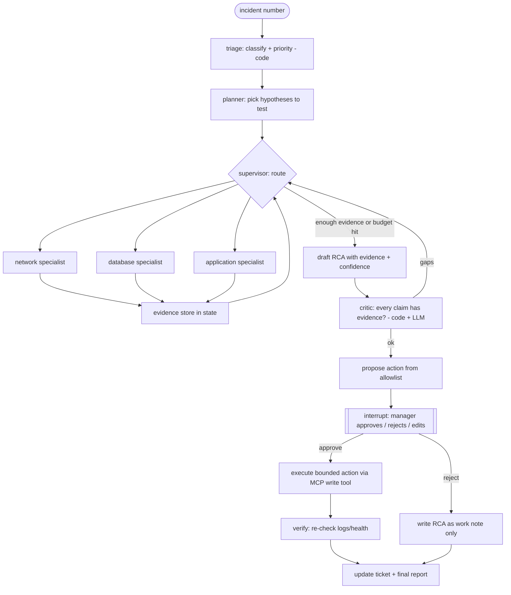

# P4 — Incident Commander: LangGraph RCA Agent with Human Approval

> Paste this whole file into OpenCode (plan agent first). AGENTS.md must be in the repo root.
> **Ownership level:** I write ~55%. You write ~45%.
> **Needs:** P3 (mock-itsm + ops-mcp, with the 5 scenarios), P1 (via the `search_kedb` tool), P2 (AgentJudge for evals). P0 triage logic can be copied in.

---

## 0. Before you start (agent)

1. Read `AGENTS.md`, P3's scenario files, and P3's tool list (I'll paste them).
2. **Check the current LangGraph docs before coding:** state definition, conditional edges, `interrupt` / human-in-the-loop, checkpointers (Postgres), subgraphs, and the current way to load MCP tools into LangGraph (e.g. an MCP adapters package). Tell me the versions and APIs you confirmed.
3. Ask me (max 5), then wait:
   - Langfuse: self-hosted or cloud (same as P1)?
   - Which model for planning/RCA vs cheaper model for simple steps?
   - Max budget per incident run (USD) and max steps?
4. Show the milestone table (M1–M12). Wait for `go`.

---

## 1. Mission

Build **Incident Commander**: given an incident number, an agent **triages** it, **investigates** with tools (logs, recent changes, CMDB blast radius, KEDB), drafts an **evidence-backed RCA** with confidence labels, **pauses for a human manager to approve** any action, runs only **allow-listed bounded actions**, **verifies** the result, and writes back to the ticket. Every run is fully traced.

This single project covers three of my original portfolio ideas: the AI coding/tool-calling agent, the deep research (RCA) agent, and the multi-agent system.

## 2. What I will learn

| Skill | Bucket | Where |
|---|---|---|
| LangGraph: state, nodes, edges, conditional routing | Must | M2–M4 |
| Tool calling with MCP tools | Must | M3 |
| Human-in-the-loop with `interrupt` + checkpoints (pause/resume) | Must | M6 |
| Multi-agent: supervisor + specialist subgraphs | Must | M5 |
| Guards: step limits, budget caps, timeouts, allowlists | Must | M4, M7 |
| Workflow vs agent — when to use which | Must (interview) | M9 |
| Observability: OpenTelemetry + Langfuse traces | Useful | M8 |
| Agent evaluation: RCA correctness, evidence coverage, cost, time | Must | M10 |

## 3. Hiring signal it proves

"This person builds agents that are safe in production: they gather evidence, ask a human before risky actions, stop when stuck, and are measured." The approval gate is change control in AI language — my strongest story.

## 4. Architecture

### State (Pydantic / TypedDict)
`incident`, `triage`, `hypotheses[]` (text, status: open/supported/rejected), `evidence[]` (id, source tool, summary, raw ref, confidence HIGH/MEDIUM/LOW, timestamp), `rca` (root cause, contributing factors, timeline, claims[] each linked to evidence ids), `proposed_action`, `approval` (who, decision, comment, time), `action_result`, `verification`, `budget` (steps, tokens, usd, started_at), `errors[]`.

### Action allowlist (the only things the agent may do)
`add_work_note`, `update_incident_state`, and simulated `restart_service(service)` / `rollback_change(change_id)` on mock-itsm (they only change mock data). Anything else = refused by code.

### API + UI
| Method | Path | Purpose |
|---|---|---|
| POST | `/runs` | `{incident_number}` → start a run, returns `run_id` |
| GET | `/runs/{id}` | State, timeline, current step |
| GET | `/runs/{id}/stream` | Live events (SSE) |
| POST | `/runs/{id}/approve` / `/reject` | Human decision (issues the P3 approval token on approve) |
| GET | `/` | Simple page: start a run, watch the timeline, approve/reject with a comment |

---

## 5. Milestones

### M1 — Workflow vs agent (no code yet)
Explain with diagrams: a fixed workflow, a single tool-calling agent (ReAct loop), and a graph (LangGraph). When each is right. IT analogy: SOP (workflow) vs experienced L2 engineer (agent) vs a major-incident process with defined roles and a bridge manager (graph).
**Learner task:** write `docs/design.md` — for each of my 5 scenarios, which steps must be deterministic and which need LLM reasoning. The agent reviews it.

### M2 — Hello LangGraph: state and a straight line
**Build:** the state model, a 3-node linear graph (triage → planner → report) with mocked LLM, a runner, tests.
**Learner task:** define the state model myself (fields above) with types and validators.
**Teach me:** what a state graph is, how state flows through nodes, reducers for lists (append vs replace).

### M3 — Tools via MCP
**Build:** load the P3 MCP tools into LangGraph (use the current adapter approach you confirmed). One tool-calling "investigator" node. Tool results become `evidence[]` entries with a source and a confidence label. Output size limits.
**Learner task:** write `to_evidence(tool_name, result) -> Evidence` including the confidence rule (e.g. direct log error at the incident time = HIGH; a change on a related CI within 60 min = MEDIUM; KEDB similarity only = LOW). I design the rule from my RCA experience.
**Break it:** make `get_logs` time out. What does the agent do?

### M4 — Routing and guards
**Build:** conditional edges; the supervisor decides next specialist or stop. Hard guards **in code**: max steps, max USD, wall-clock timeout, repeated-identical-tool-call detection (loop breaker). When a guard trips → stop and escalate to a human with what we know so far.
**Learner task:** write the router function `route_next(state) -> Literal["network","database","application","draft_rca","escalate"]` — guards checked first, then routing logic.
**Break it:** force the LLM to always ask for the same tool. Predict how many steps before the loop breaker fires.

### M5 — Specialists as subgraphs (multi-agent)
**Build:** network, database, application specialists — each a small subgraph with its own prompt and a limited tool set (least privilege: the network specialist can't read DB tools it doesn't need). The supervisor merges findings.
**Learner task:** write the database specialist's prompt and pick its tool subset.
**Teach me:** why multi-agent can help (focus, smaller prompts) and hurt (more cost, more failure points). This trade-off is a common interview question.

### M6 — Human-in-the-loop with checkpoints
**Build:** Postgres checkpointer. `interrupt` before any action. Approve/reject/edit through the API and page. On approve, the API gets a single-use approval token from P3 and resumes the graph. The run survives a server restart while waiting.
**Learner task:** implement the resume handler: validate the decision, record who/when/comment in state, map edits to a new `proposed_action` (must still be on the allowlist).
**Teach me:** checkpoints = saving the incident bridge notes so anyone can pick up where it stopped.
**Break it:** restart the server while a run is waiting for approval. Resume it.

### M7 — Critic, RCA and verification
**Build:** RCA drafter (timeline + root cause + contributing factors + claims linked to evidence ids). A critic: **code** checks every claim has at least one evidence id and no LOW-only root cause is stated as certain; an **LLM** check looks for contradictions. Verification node re-checks logs after the action.
**Learner task:** implement `check_claims_grounded(rca, evidence) -> list[Gap]`.
**Break it:** scenario 2's red-herring deploy. Does the agent blame it? Scenario 5 (no related change) — does it invent one?

### M8 — Observability
**Build:** OpenTelemetry for FastAPI + custom spans per node and tool call; Langfuse traces for LLM calls with tokens/cost; a run timeline export (`reports/runs/<id>.md`) that reads like a major-incident timeline.
**Learner task:** add span attributes that matter to an SRE (incident number, node, tool, step, cumulative cost).
**Teach me:** traces vs logs vs metrics in simple words.

### M9 — Baseline: fixed workflow vs agent
**Build:** a **fixed workflow** version (same tools, fixed order, no LLM routing) as a baseline.
**Learner task:** write the ADR comparing them after M10's numbers are in.

### M10 — Evaluation with AgentJudge
**Build:** AgentJudge target adapter for Incident Commander. For each of the 5 scenarios × 3 runs: RCA correct (vs ground truth; judge + my rubric), evidence coverage (did it collect the key evidence ids?), red-herring avoided, steps, tool calls, time to RCA, cost, human approvals requested. Same for the workflow baseline. Reports in `reports/`.
**Learner task:** write the RCA rubric (what counts as "correct", "partly correct", "wrong") from my real RCA experience.

### M11 — Docker, CI, deploy
Compose: agent API + Postgres (checkpoints) + Langfuse (if self-hosted), talking to P3's stack. CI with mocked LLM and a scripted run of scenario 1. Deploy with spend protection (demo key + per-day budget).

### M12 — Ship it
README (diagram, the 5 scenarios, metrics agent vs workflow from `reports/`, trace screenshot, failure demos: loop, timeout, rejection, red herring, restart-resume), ADRs, `DEMO.md` (scenario 1 end to end including an approval), `INTERVIEW.md` (I write), `/interview`, public repo.

---

## 6. Definition of done

- [ ] Graph with supervisor + 3 specialists, MCP tools, guards, critic, HITL, verification
- [ ] Runs survive restart while waiting for approval
- [ ] Agent vs workflow comparison on 5 scenarios × 3 runs in `reports/`
- [ ] Traces in Langfuse + exported timelines
- [ ] 5 failure demos documented; live URL with spend protection; public repo; docs complete

## 7. Interview questions I must be able to answer

1. Walk me through your graph. Why these nodes?
2. Workflow or agent — which won on your scenarios, and why?
3. How do you stop an agent looping or overspending?
4. How does human approval work technically? What happens if the server restarts?
5. How do you know the RCA is right? Show me your eval.
6. Did the agent fall for the red herring? What did you change?
7. When is multi-agent worth the extra cost?

## 8. Resume bullet template (fill ONLY from reports/)

> Built Incident Commander, a LangGraph multi-agent RCA system using MCP tools with checkpointed human approval before any action; on `<<n>>` synthetic incident scenarios it reached `<<x>>`% correct root cause at `$<<cost>>` and `<<time>>` per run versus `<<y>>`% for a fixed-workflow baseline, fully traced with OpenTelemetry and Langfuse.
