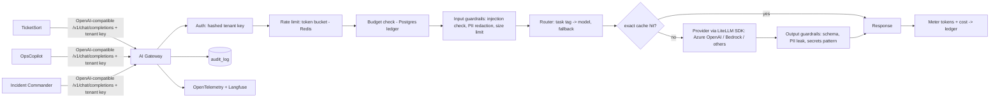

# P5 — Secure AI Gateway + Cloud Deploy

> Paste this whole file into OpenCode (plan agent first). AGENTS.md must be in the repo root.
> **Ownership level:** I write ~60%. You write ~40%.
> **Needs:** P0, P1, P4 (they will send their LLM calls through this gateway). P2 (red-team suite).

---

## 0. Before you start (agent)

1. Read `AGENTS.md`.
2. **Cloud decision:** this is still open for me (Azure vs AWS). Ask me which one. Default: **Azure** (Azure OpenAI / AI Foundry, Container Apps, Azure Database for PostgreSQL, Key Vault). Alternative: AWS (Bedrock, ECS Fargate or App Runner, RDS Postgres, Secrets Manager). **Check current service names, pgvector support on the managed Postgres, pricing pages and free-tier limits before planning.** Tell me what you verified.
3. **Check before coding:** the current OWASP Top 10 for LLM Applications edition, the LiteLLM SDK API (we use it as a library for provider calls), and the PII library you propose (e.g. Microsoft Presidio). Tell me versions.
4. Ask me (max 5), then wait:
   - Cloud: Azure or AWS? Monthly cloud budget (USD)? Budget alert set up?
   - Redis locally via compose — OK?
   - How many "tenants" to demo (suggest 3: `opscopilot`, `incident-commander`, `ticketsort`)?
5. Show the milestone table (M1–M12). Wait for `go`.

---

## 1. Mission

Build **one gateway** that every one of my AI apps calls instead of calling model providers directly. It handles: who is calling (tenant keys), how much they may use (quotas, rate limits), which model to use (routing), how much it cost (metering), what is allowed in and out (guardrails), and what happened (audit + traces). Then deploy the **whole portfolio stack** to the cloud.

This is the "AI SaaS" idea from my list, focused on the platform and security parts that Cloud AI, AI Security and Solutions roles ask about.

## 2. What I will learn

| Skill | Bucket | Where |
|---|---|---|
| API gateway design, OpenAI-compatible API shape | Useful | M2 |
| Multi-tenancy: API keys (hashed), per-tenant config | Useful | M3 |
| Rate limiting: token bucket (Redis) | Useful | M4 |
| Token metering + cost ledger + budgets | Must | M5 |
| Model routing + fallback | Useful | M6 |
| Guardrails: prompt injection, PII redaction, output checks | Must (AI security) | M7 |
| Red-teaming with OWASP LLM Top 10 | Useful | M8 |
| Caching | Optional | M6 |
| Cloud deploy: containers, managed Postgres, secrets, networking | Must (Cloud AI) | M10 |
| KV-cache math (interview) | Useful | M9 |

## 3. Hiring signal it proves

"This person thinks like a platform and security engineer: cost control, tenant isolation, guardrails, audit, and a real cloud deployment." It covers keywords from Cloud AI, AI Security and Solutions Engineer job descriptions.

## 4. Architecture

### Endpoints
| Method | Path | Purpose |
|---|---|---|
| POST | `/v1/chat/completions` | OpenAI-compatible; header `X-Task` (e.g. `triage`, `rag_answer`, `rca`) drives routing |
| GET | `/v1/usage` | This tenant's usage and remaining budget |
| POST | `/admin/tenants` | Create tenant (admin key); returns the API key **once** |
| GET | `/admin/usage` | All tenants, by day and model |
| GET | `/health` | |

### Data
`tenants` (id, name, key_hash, monthly_budget_usd, rpm, tpm, allowed_models, guardrail_profile), `usage_ledger` (tenant, request_id, model, tokens_in, tokens_out, cost_usd, cache_hit, blocked, reason, ts), `audit_log`, `routing_policy.yaml`, `guardrail_profiles.yaml`.

---

## 5. Milestones

### M1 — Why a gateway? (no code)
Explain: the problems when every app calls providers directly (keys everywhere, no cost view, no shared guardrails). IT analogy: a central service desk front door vs everyone calling engineers directly.
**Learner task:** write `docs/requirements.md` — functional and non-functional requirements (latency overhead budget, availability, data retention) in my words.

### M2 — Pass-through proxy
**Build:** FastAPI `/v1/chat/completions` that forwards to the provider through the LiteLLM SDK, streaming supported, request IDs, timeouts, clean errors. Point TicketSort at it via its base URL env and prove it works unchanged.
**Learner task:** write the streaming pass-through test.
**Teach me:** why "OpenAI-compatible" became the common shape; what a proxy adds to latency.

### M3 — Tenants and keys
**Build:** tenant table, admin endpoint, keys shown once and stored as a hash, key check as a FastAPI dependency. Per-tenant allowed models.
**Learner task:** implement key generation + hashing + constant-time verification.
**Break it:** call with a wrong key, a deleted tenant's key, and a model the tenant isn't allowed.

### M4 — Rate limiting
**Build:** requests-per-minute and tokens-per-minute limits per tenant in Redis. 429 with `Retry-After`.
**Learner task:** implement the **token bucket** (`capacity`, `refill_rate`, `allow(cost) -> (bool, retry_after)`) — first in pure Python with tests, then atomically in Redis (Lua script or a transaction; the agent explains which and why).
**Teach me:** token bucket vs fixed window; why atomic operations matter when many requests arrive at once.
**Break it:** fire 100 concurrent requests. Predict how many pass.

### M5 — Metering, cost ledger, budgets
**Build:** record tokens and cost per request (prices from `config/prices.yaml`, marked "verify on provider site"); monthly budget check before the call; soft alert at 80%, hard stop at 100%; `/v1/usage` and `/admin/usage`.
**Learner task:** implement `estimate_cost(model, tokens_in, tokens_out)` and the budget-check function.
**Teach me:** why you estimate before and settle after; why streaming makes counting harder.

### M6 — Routing, fallback, cache
**Build:** `routing_policy.yaml` maps `X-Task` → primary model + fallback model. On provider error or timeout → fallback (logged). Exact-match cache for deterministic requests (temperature 0) with a TTL, per tenant (never share cache across tenants).
**Learner task:** write the routing policy for my apps with a one-line reason for each choice (cheap model for triage, strong model for RCA).
**Break it:** make the primary provider fail. Show fallback in the trace.

### M7 — Guardrails
**Build:** input: size limits, an injection check (heuristic patterns + an optional small LLM classifier call — configurable per profile), PII detection and redaction (emails, phone numbers, Indian ID-number patterns — synthetic test data only). Output: JSON-schema check when the tenant asks for it, PII-leak check, secrets-pattern check (API keys, passwords). Each block records a reason in the ledger. Profiles per tenant: `strict`, `standard`.
**Learner task:** write the redaction function and its tests (with tricky cases: emails inside URLs, numbers that look like phones but aren't).
**Teach me:** why guardrails are layered and why they create false positives. Why this doesn't replace the system-level controls from P3/P4.

### M8 — Red-team suite (in AgentJudge)
**Build:** in P2's `suites/redteam/`: attack prompts mapped to the current OWASP LLM Top 10 categories that apply (prompt injection, sensitive data disclosure, improper output handling, excessive agency, unbounded consumption, etc.) + a **benign set** of normal IT questions. Metrics: block rate on attacks, false-positive rate on benign, latency overhead of guardrails.
**Learner task:** write 20 attacks and 20 benign prompts myself (synthetic, no real data).
**Teach me:** the security trade-off in numbers: blocking more attacks usually blocks more good requests too.

### M9 — KV-cache and serving math (interview)
**Build:** `src/gateway/capacity.py` + `docs/serving-math.md`.
**Learner task:** implement `kv_cache_bytes(layers, kv_heads, d_head, batch, seq_len, bytes_per_value=2)` = `2 × bytes × layers × kv_heads × d_head × batch × seq_len`. Test: 32 layers, 8 KV heads, d_head 128, batch 1, 8,192 tokens, fp16 → about 1 GiB. Then write, in my words, why long context and big batches cost more memory, and why models that share KV heads (GQA) use less.
**Teach me:** tokens in vs out pricing, time-to-first-token vs tokens-per-second, why output tokens are slower.

### M10 — Cloud deploy (whole stack)
**Build:** deploy gateway + Redis + Postgres + OpsCopilot + mock-itsm/ops-mcp + Incident Commander to the chosen cloud. Secrets in the cloud secret store (not env files). Private networking between services where the free/cheap tier allows; only the UIs and gateway public. Scripted deploy (`scripts/deploy_<cloud>.sh` using the cloud CLI) and **`scripts/teardown_<cloud>.sh`**. Budget alert. Scale-to-zero where possible to save money.
**Learner task:** run every deploy command myself and write `docs/deploy-<cloud>.md` as I go. The agent checks it. Explain every cloud resource I create and what it costs (from the pricing page, marked with the date checked).
**Teach me:** container app vs VM vs Kubernetes (and why we are not using Kubernetes yet); managed identity / IAM roles vs keys.

### M11 — Tests, CI, load test
CI: unit + integration (Redis + Postgres service containers), mocked providers. A small load test (e.g. Locust) to measure the gateway's own latency overhead p50/p95 → `reports/`.

### M12 — Ship it
README (diagram, tenant/routing/guardrail tables, red-team results, overhead numbers, cost dashboard screenshot, cloud architecture diagram, teardown instructions), ADRs (build vs buy gateway; token bucket; guardrail layering; cloud choice), `DEMO.md`, `INTERVIEW.md` (I write), `/interview`, public repo.

---

## 6. Definition of done

- [ ] All my apps call models only through the gateway
- [ ] Tenant keys, rate limits, budgets, routing + fallback, cache, guardrails — each tested
- [ ] Red-team report: attack block rate + benign false-positive rate
- [ ] Whole stack deployed with secrets in a vault, budget alert, and a working teardown script
- [ ] Load-test overhead in `reports/`; public repo; docs complete

## 7. Interview questions I must be able to answer

1. Why put a gateway in front of LLMs? What does it cost in latency?
2. How do you isolate tenants (keys, cache, budgets, data)?
3. Explain the token bucket. Why Redis? Why atomic?
4. What guardrails did you build? What's your false-positive rate?
5. Walk me through the OWASP LLM Top 10 items you tested.
6. How much KV-cache memory does an 8k context need for this model? Show the math.
7. Draw your cloud architecture. How are secrets handled? What does it cost per month?

## 8. Resume bullet template (fill ONLY from reports/)

> Built a multi-tenant AI gateway (FastAPI, Redis, Postgres, LiteLLM) with hashed tenant keys, token-bucket rate limits, per-tenant budgets, model routing with fallback and layered guardrails; blocked `<<x>>`% of `<<n>>` OWASP-mapped attacks at `<<y>>`% false positives with `<<ms>>` ms p95 overhead, and deployed the full portfolio stack on `<<Azure/AWS>>`.
