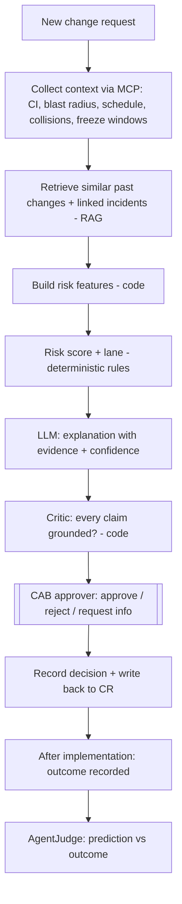

# P6 — ChangeGuard (Capstone): Change-Risk Investigator and Release Gate

> Paste this whole file into OpenCode (plan agent first). AGENTS.md must be in the repo root.
> **Ownership level: CAPSTONE MODE — I write ~70%.** The agent mostly plans, reviews, explains, and writes boilerplate. For every core module, the agent writes the interface + tests, and **I** write the implementation.
> **Needs:** P1 (retrieval), P2 (evals), P3 (MCP tools + mock-itsm), P4 (graph patterns), P5 (gateway). Reuse patterns; copy code only where needed and say where it came from.

---

## 0. Before you start (agent)

1. Read `AGENTS.md`. Read the `LEARNING_LOG.md` files from P0–P5 if I paste them, and tell me which concepts I seem weak on — we'll put extra practice there.
2. Background reading: I have saved research on change failure (including a DORA report and an industry case study). **Ask me to paste the parts I want to use.** Do not invent their findings, numbers, or quotes. Anything not from my pasted sources is labelled "assumption".
3. Ask me (max 5), then wait:
   - Which parts of the CAB process from my real experience should the risk rules copy (without real company details)?
   - Do I want a Slack/Teams-style approval message mock, or just the web page?
   - Deploy target (same cloud as P5)?
4. Show the milestone table (M1–M11). Wait for `go`.

---

## 1. Mission

When a new **change request** (CR) is raised, ChangeGuard investigates it like an experienced CAB reviewer: what does it touch (CMDB blast radius), what went wrong with similar changes before (RAG over past changes and incidents), does it collide with other changes or a freeze window, is there test/rollback evidence? A **deterministic risk score** decides the lane (standard / needs CAB / reject-back). The LLM writes the explanation with evidence and confidence. A **human CAB approver** makes the final call. After the change, a **post-implementation review** compares the prediction with what really happened — and that feeds the evals.

## 2. What I will prove I can do (no new tools — integration and judgement)

| Skill | Where |
|---|---|
| Designing a system from requirements, with ADRs | M1–M2 |
| Deterministic scoring + LLM explanation split | M4–M5 |
| RAG over structured history (past changes + incidents) | M3 |
| Reusing MCP tools and LangGraph HITL patterns | M6 |
| Classification evals: precision, recall, cost of false negatives | M8 |
| Calling everything through the gateway | M6 |
| Production readiness: SLOs, runbook for my own system | M10 |

## 3. Hiring signal it proves

"This person can design and ship a complete AI system in a domain they deeply understand — with measured risk predictions, human control, and honest limits." This is my flagship: it connects my 8.5 years of change and incident work to AI engineering in one demo.

## 4. Architecture (I design it; this is the starting sketch)

---

## 5. Milestones

### M1 — Requirements and design (I lead)
**Learner task:** write `docs/requirements.md` and `docs/design.md`: users, the CAB process I'm modelling (anonymised), inputs/outputs, what's deterministic vs LLM, what needs human approval, non-goals, SLOs (e.g. assessment under N seconds, cost under $X per CR — I choose and justify).
**Agent:** review like a principal engineer. Ask hard questions. Don't rewrite it.

### M2 — Data: synthetic change history with outcomes
**Build (agent):** generator for ~400 historical changes in Acme's world, linked to P3's CMDB, with outcomes: success / failed / caused incident / rolled back. Outcome depends on **hidden rules** I define (e.g. large blast radius + no rollback plan + weekend + touches `orders-db` → higher failure chance) plus noise, so the problem isn't trivially easy. Train/test split by **time** (older → tune, newer → test).
**Learner task:** write the hidden outcome rules from my experience, and write 20 changes by hand (anonymised).
**Teach me:** why splitting by time matters (no peeking at the future).

### M3 — Retrieval over change history
**Learner task:** build the "similar past changes" retriever by reusing my P1 knowledge: what to embed (description + CI + change type), what to filter (same CI or dependent CIs), hybrid + RRF. Return linked incidents.
**Agent:** writes interfaces, tests, and reviews.

### M4 — Risk features (code)
**Learner task:** implement feature functions: blast-radius size, CI criticality, collision count within ±2h, freeze-window flag, rollback-plan present and tested, past failure rate for similar changes, change-window risk (off-hours staffing), requester's recent failure history (anonymised synthetic), test evidence present.
**Agent:** tests first; explain any stats I need in simple English.

### M5 — Risk score, lanes, and explanation
**Learner task:** implement `score(features) -> RiskAssessment` (weighted rules, lane thresholds) — and write an ADR explaining why rules rather than an ML model for v1 (explainability, auditability, little data).
**Build (agent):** LLM explanation prompt through the P5 gateway: lane, top risk drivers with evidence ids, confidence labels, suggested mitigations (e.g. "add a tested rollback", "move out of freeze window"). Critic checks grounding in code.

### M6 — Graph + human approval + write-back
**Learner task:** build the LangGraph flow myself using my P4 patterns: collect → retrieve → features → score → explain → critic → interrupt for CAB → record. Add MCP tools needed on the P3 server (`get_change`, `list_change_collisions`, `add_change_note` [write, approval-gated]).
**Agent:** review, and help only on framework details.

### M7 — UI for the CAB approver
**Build (agent, I review):** one page: CR details, lane and score breakdown, evidence with links, similar past changes, mitigations, approve/reject/request-info with comment. (If I want, build it in Next.js + TypeScript to practise my frontend skills — ask me.)

### M8 — Evaluation: prediction vs outcome
**Learner task:** in AgentJudge, add a ChangeGuard target and implement: precision, recall and F1 for "high risk" vs actual bad outcome on the **time-based test set**; a confusion matrix; the cost view ("a missed risky change costs far more than a false alarm" — I set the relative costs and justify them); explanation grounding rate; cost and latency per CR. Compare against a **simple baseline** (e.g. "flag every change touching a critical CI").
**Teach me:** why recall on risky changes matters more here; how to pick a threshold from the costs.

### M9 — Failure demos
**Learner task:** design and run at least 5: missing CMDB data, conflicting history, a change that looks risky but isn't, an LLM explanation that invents a reason (critic must catch it), gateway budget exhausted mid-assessment.

### M10 — Production readiness
**Learner task:** write `docs/runbook.md` for ChangeGuard itself (alerts, what to do when it's down, how to roll back a bad prompt/rules release), SLO dashboard from traces, and a data-retention note.
**Build (agent):** CI with eval gate from P2 (rules or prompt changes must not drop recall below my threshold); deploy on the P5 cloud setup behind the gateway.

### M11 — Ship the flagship
README as a **case study**: problem (in CAB language), design, what's deterministic vs AI and why, results vs baseline (from `reports/`), failure demos, limits (synthetic data, rules not validated on real changes), what I'd do with real data. `DEMO.md` (2-minute version for interviews), `INTERVIEW.md` (I write all answers), `/interview` twice (once technical, once as a hiring manager), and a portfolio summary page linking P0–P6.

---

## 6. Definition of done

- [ ] Requirements, design, and ADRs written by me
- [ ] End-to-end: CR in → evidence → score → explanation → human decision → write-back → outcome → eval
- [ ] Beats the simple baseline on the time-based test set (or honestly reports that it doesn't, and why)
- [ ] 5+ failure demos; runbook; eval gate in CI; deployed behind the gateway
- [ ] Case-study README; public repo; portfolio page linking all 7 projects

## 7. Interview questions I must be able to answer

1. Why rules for the score and an LLM for the explanation?
2. How did you evaluate a risk predictor? Why precision/recall and not accuracy?
3. How did you choose the threshold? What does a false negative cost?
4. How is this different from a normal CAB checklist?
5. What would change with real data? What would you worry about (bias, gaming, stale CMDB)?
6. How does this reuse your other six projects?

## 8. Resume bullet template (fill ONLY from reports/)

> Designed and built ChangeGuard, an AI change-risk investigator combining CMDB blast-radius analysis via MCP, RAG over change history and a deterministic risk score with LLM evidence-linked explanations and human CAB approval; on a time-split synthetic test set of `<<n>>` changes it reached `<<recall>>`% recall on risky changes at `<<precision>>`% precision versus `<<baseline>>`% for a rule-of-thumb baseline, at `$<<cost>>` per assessment.
