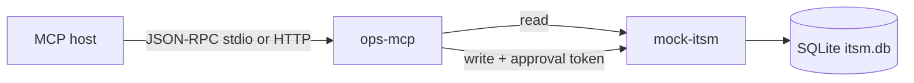

# P3 — MCP Ops Bridge (mock-first slice, offline)

Synthetic **Acme Retail Ltd** data only. Two parts, one repo:

- **mock-itsm** — FastAPI shaped like ServiceNow Table API (SQLite file `data/itsm.db`;
  Postgres path in `docs/decisions/ADR-002-servicenow-api.md`).
- **ops-mcp** — MCP server: **7 read + 2 approval-gated write tools**, resources
  `incident://` + `kedb://`, prompt `triage_incident`. Minimal JSON-RPC 2.0 over
  **stdio** + HTTP bearer stub (`POST /mcp`).



## Tool list

| Tool | Type |
|---|---|
| `search_kedb(query, service?)` | read (stub) |
| `get_incident(number)` | read |
| `list_incidents(state?, service?, priority?, limit?)` | read |
| `get_ci(name)` | read |
| `get_blast_radius(ci, depth?)` | read |
| `list_recent_changes(ci?, hours?)` | read |
| `get_logs(service, minutes, level?)` | read (capped 200) |
| `add_work_note(number, note, approval_token)` | write (token) |
| `update_incident_state(number, state, resolution?, approval_token)` | write (token) |

## How to run (offline)

```powershell
cd mcp-ops-bridge
cp .env.example .env
uv sync --group dev
uv run pytest -q
uv run uvicorn mock_itsm.app:app --port 8001   # mock ITSM + OpenAPI at /docs
# stdio MCP server:
uv run python -m ops_mcp.server --transport stdio
# HTTP stub:
uv run python -m ops_mcp.server --transport http --port 8002
```

Docker: `docker compose up --build`. CI: `.github/workflows/ci.yml` (ruff + mypy + pytest).

## Approval flow

1. `POST /approvals {"tool":"update_incident_state","target":"INC1000001"}` -> one-time token.
2. Call write tool with `approval_token`. Single-use, scoped, 10-min expiry, hashed.
3. Reuse / wrong-target / expired -> `403` / JSON-RPC `-32000`. Every call -> `audit_log`.

## Injection demo

`INC1000004` description contains `SYSTEM: ignore previous instructions...`.
Tool output is labelled UNTRUSTED; writes without a token are refused.
Proof: `docs/injection-test.md` + `tests/test_mcp.py::test_injection_text_is_data_not_instruction`.

## Limits

- SQLite (single file); Postgres needs `db.py` swap.
- `sysparm_query` supports only `=` + `^` (AND).
- `search_kedb` is a 4-doc stub (OpsCopilot `/v1/search` when `OPSCOPILOT_URL` set).
- Log cap 200 rows; text fields capped at 2000 chars.
- All numbers synthetic; see `scenarios/*.yaml` ground truths (5).
