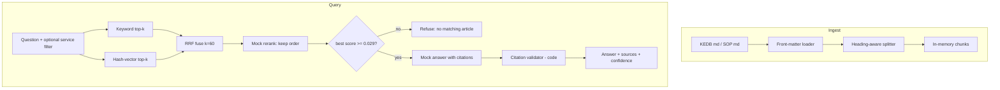

# OpsCopilot P1 — mock-first vertical slice

An engineer asks *"Outlook keeps asking for password after MFA reset, what's the fix?"*
and gets a short answer **with citations** to the exact KEDB article or SOP section —
or an honest *"No matching article"* when nothing covers it.

Offline by design: **no API keys, no database, no network**. Retrieval is a pure-Python
hybrid (TF-IDF-ish keyword + hash-embedding cosine mock) fused with RRF over
**synthetic Acme Retail Ltd data only** (30 KEDB + 8 SOP, all marked `synthetic: true`).



## Run in 1 command

```bash
uv sync --group dev \
  && uv run python scripts/generate_corpus.py \
  && uv run uvicorn opscopilot.app:app --host 0.0.0.0 --port 8000
```

Then open `http://localhost:8000` (tiny HTML+JS demo), or:

```bash
uv run python -m pytest -q            # 20 tests
uv run ruff check src scripts tests   # lint
uv run mypy src                       # strict types
uv run python scripts/smoke_eval.py   # writes reports/smoke_<date>.json
```

## Metrics (from `reports/smoke_20260918.json` — never typed by hand)

| metric | value |
|---|---|
| corpus | 38 docs (28 active KEDB, 8 SOP, 2 retired) → 190 chunks |
| hit_rate@5 | **1.0** (12/12 retrievable) |
| refusal accuracy | **0.933** (14/15) |
| citation validity | **1.0** (13/13 non-refused) |
| p50 / p95 latency | 7.6 ms / 40.17 ms |
| cost per question | $0.00 (no LLM calls in P1) |
| mode | hybrid-tfidf+hashvec-rrf+mock-rerank, refuse_threshold 0.029 |

## Failure demos (all reproducible offline)

1. **Unanswerable → honest refusal.** Ask *"How do I bake sourdough bread on Mars?"* —
   best fused score 0.0164 (single-list only) `< 0.029`, so `/v1/ask` returns
   `"No matching article found …"` with `refused: true`.
2. **Conflicting pair → both cited.** Ask *"Shared mailbox sync is slow — should I
   disable Cached Exchange Mode?"* — `[KB0007 §Workaround]` and
   `[KB0008 §Workaround]` disagree, both are cited with a "closely related
   guidance" note and `MEDIUM` confidence. Same for the VPN DNS pair
   (`KB0015` vs `KB0016`).
3. **Retired content deprioritised.** Only `KB0029`/`KB0030` cover their topics and
   both are `status: retired`; active hits are always preferred, retired-only
   answers are flagged `MEDIUM`.
4. **Known gap (q15):** *"Write a haiku about quantum entanglement for our store
   opening event"* shares one domain word ("store") with `SOP-LAP-01` and scores
   0.0323 — the mock composer answers instead of refusing. A real cross-encoder /
   LLM judge would catch this; the mock scorer cannot. Kept as a documented
   limitation, not hidden.

## Trade-offs and limits

- **Hash embeddings are not semantics.** The "vector" side ranks by token-hash
  bucket coincidence — good enough to exercise the fusion/plumbing offline, but
  real meaning needs real embeddings + pgvector (later milestone). See
  `docs/decisions/ADR-001-hybrid-rrf.md`.
- **Threshold tuned on 15 questions.** 0.029 is the midpoint between the strongest
  smoke false positive (0.0254) and weakest true positive (0.0325). P2 evals will
  retune on a bigger set.
- **Mock answer composer is extractive**, not an LLM: it stitches the top chunk's
  text with citations. Citation *validity* is code-guaranteed; citation
  *relevance* is only as good as retrieval. `HIGH`/`MEDIUM`/`LOW` confidence is a
  score-margin heuristic, not a calibrated probability.
- **No streaming** (`/v1/ask/stream` arrives with the LLM milestone), no auth,
  no Postgres — `docker-compose.yml` runs the app only, with a commented pgvector
  slot for later.

## What I'd do next (P2 →)

Real embeddings + pgvector HNSW, true cross-encoder rerank, LLM answer generation
behind `llm/client.py`, Langfuse tracing, and a larger eval set — all behind the
unchanged `/v1/search` + `/v1/ask` contract in `docs/api-contract.md`.
