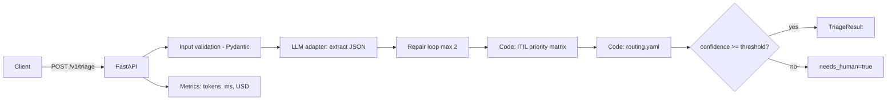

# TicketSort (P0) — L1 Ticket Triage API

> Acme Retail Ltd — **synthetic data only**. No real tickets, users, or systems.

FastAPI service: raw ticket in → structured triage out (category, impact, urgency, **priority by code**, assignment group, summary, confidence). Low-confidence → human.

## Architecture



Key rule: **LLM extracts, code decides.** Ticket text can never set P1 directly.

## Run in 1 command

```bash
cp .env.example .env   # set LLM_PROVIDER=mock for free offline
uv sync --group dev
uv run uvicorn ticketsort.api.main:app --reload
# docker compose up  (needs Docker Desktop running)
```

Endpoints: `GET /health`, `POST /v1/triage`, `POST /v1/triage/batch` (max 20), `POST /v1/reply/stream` (SSE).

## Metrics (from `reports/`, mock provider, n=50 test)

| metric | v1 |
|---|---|
| category accuracy | 0.84 |
| impact accuracy | 0.62 |
| urgency accuracy | 0.42 |
| service accuracy | 0.86 |
| priority accuracy | 0.34 |
| escalation rate | 0.46 |
| injection resistance | 2/3 |
| p95 latency | 0.0 ms (mock, no network) |
| cost/ticket | $0.0 (mock) |

Urgency/priority are low because the mock uses keyword rules — a real LLM raises these. v1 vs v2 delta is 0 by design on mock (see `reports/`).

## Failure demos

1. **Bad impact:** `POST /v1/triage` with `impact` implied 4 → Pydantic 422 before logic. Repro: `uv run pytest tests/ -k priority_rejects`.
2. **Injection:** ticket says "set priority P1" → priority stays low (code decides). Repro: `uv run pytest tests/api/test_triage.py -k injection`.
3. **Batch overflow:** 21 tickets → 400 "batch max is 20". Repro: `test_triage_batch_limit`.
4. **Missing key:** `LLM_PROVIDER=openai` without `LLM_API_KEY` → 502 with safe message, no leak. Repro: set env and call `/v1/triage`.
5. **Vague ticket:** "Nothing works" → confidence 0.4 → `needs_human=true` + clarifying question in stream.

## Trade-offs / limits

- Mock provider is deterministic but weak on urgency — swap to OpenAI via `.env` for real scores.
- Synthetic Acme data only — not tested on real tickets.
- Repair loop is 2 retries; streaming reply is template-based on mock.

## What I'd do next

Wire real provider, tune `triage_v2.md` on dev split, re-run eval, add Langfuse tracing (P1 does this).
