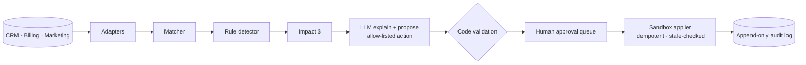

# TruthKeeper

**An agent that finds contradictions between a CRM, a billing system and a marketing tool,
estimates what they cost, and proposes fixes that a human approves before anything changes.**

Companies run on several SaaS tools that drift out of sync. The CRM says a customer cancelled but
billing keeps charging them, or billing shows an upgrade the CRM never heard of, or marketing keeps
emailing a churned customer. Each mismatch costs money or goodwill, and nobody notices until someone
complains.

> Demo GIF: _placeholder, to be recorded._

All data is synthetic (`.example` domains). Fixes only ever touch sandbox copies.

## How it works



- **Rules detect, the LLM explains.** Six deterministic rules decide whether a conflict exists. The
  LLM only explains it and picks one fix from a fixed allow-list.
- **Code has the last word on the LLM.** Output goes through a Pydantic schema, an allow-list Enum,
  a per-type compatibility table, and a check that every id appears in the evidence. A failing reply
  is retried at most twice, then marked FAILED. It is never silently accepted.
- **Humans approve.** No fix is applied without an approval record. Applies are idempotent, and they
  re-check the data first: if it changed since approval, the fix is marked STALE.
- **Everything is measured and traced.** Precision and recall come from planted ground truth.
  Failures become regression tests. Every LLM call is an OpenTelemetry span (Phoenix).

Details: [docs/architecture.md](docs/architecture.md) · [docs/decisions.md](docs/decisions.md) (18 decisions).

## Run it

Needs Python 3.11+. Everything below runs offline in MOCK mode at zero cost.

```bash
python -m venv .venv
.venv/Scripts/pip install -r requirements.txt        # Linux/macOS: .venv/bin/pip
.venv/Scripts/python -m app.cli seed                  # generate data + sandbox copy
.venv/Scripts/python -m uvicorn app.api.main:create_app --factory --port 8000
```

Open http://localhost:8000, click **Run detection + proposals**, open a proposal, approve it, then
apply it. The conflict turns RESOLVED and the audit trail shows the before and after values.

With Docker (not verified yet: Docker was not installed on the build machine):

```bash
docker compose up --build        # app on :8000, Phoenix traces on :6006
```

### Tests and evals

```bash
pytest -q                                             # 87 tests, offline, MOCK mode
ruff check .
python -m evals.detection_eval                        # detector vs ground truth
python -m evals.run_all                               # all evals, both datasets, prompts v1+v2
python -m evals.run_all --profile noisy               # mock with injected faults
python -m evals.detection_eval --strategy name_only   # debugging exercise: name-only matching
```

### Real LLM runs (when you add a key)

```bash
cp .env.example .env      # set ANTHROPIC_API_KEY, then LLM_MODE=real
python -m evals.proposal_eval --limit 50 --yes
python -m evals.run_all --limit 50 --yes
LLM_MODE=real RUN_REAL_TESTS=1 pytest tests/test_regressions.py -k real
```

Default model: `claude-opus-5-5` (`LLM_MODEL`), with structured JSON output, `LLM_EFFORT=medium`,
and the server-side refusal fallback on (`LLM_USE_FALLBACKS`). Real runs refuse to start without
`--yes`, and `app.cli run` requires `--limit` in real mode, so spend is always bounded.

**Expected cost of a 50-conflict real run (estimate, not measured).** The prompt is about 420 input
tokens for v1 and about 620 for v2, plus roughly 90 output tokens. That estimate comes from the
mock's chars/4 count on the real prompts. At $4 / $20 per million input/output tokens that is about
$0.003 per proposal, so roughly **$0.15–0.30 for 50 conflicts** including retries. Adaptive thinking
tokens are billed as output and are not in this estimate, so the real cost can be higher. The
measured cost is written to the results file after a run.

## Metrics

Measured on 2026-11-16. Commands: `python -m evals.run_all --tag mock-clean` and
`--profile noisy --tag mock-noisy`. Raw files are in [evals/results/](evals/results/).

### Detection (rule-based, no LLM): measured

| dataset | planted conflicts | precision | recall | F1 | money at risk found (USD/month) |
|---|---|---|---|---|---|
| default, seed 42, n=500 | 120 | 1.000 | 1.000 | 1.000 | 38,036.41 |
| hard, seed 7, n=500 (new noise patterns) | 120 | 1.000 | 1.000 | 1.000 | 46,257.01 |
| default, **name-only matching** (debugging exercise) | 120 | 0.286 | 0.758 | 0.415 | 108,640.46 (inflated by false positives) |

Per type, precision and recall are 1.000 for all six types on both datasets. With name-only
matching, precision drops to 0.117 on EMAIL_MISMATCH and 0.121 on DUPLICATE_CUSTOMER, because people
with the same name at different companies get linked.

Honest caveat: the generator and the detector were written by the same author, so perfect scores
mean the rules handle the noise patterns *we know about*. The hard dataset adds new noise (accents,
"LAST, First" names, `+tag` emails, upper-case domains, plan aliases, a 30-day boundary, 40% billing
without a CRM reference) and the numbers held. Real-world data will have patterns neither dataset has.

### Proposals: MOCK only, real model not measured yet

| run | action accuracy | params accuracy | schema-valid (1st try) | failure rate | mean attempts |
|---|---|---|---|---|---|
| real model (v1 / v2) | **not measured** | not measured | not measured | not measured | not measured |
| mock-clean, both datasets, v1 & v2 | 1.0 | 1.0 | 1.0 | 0.0 | 1.0 |
| mock-noisy, default, v1 & v2 | 0.925 | 0.925 | 0.792 | 0.0 | 1.217 |
| mock-noisy, hard, v1 & v2 | 0.925 | 0.925 | 0.75 | 0.0 | 1.258 |

Mock numbers test the pipeline, not a model. The clean mock is a fixture that follows the v2 policy,
so 1.0 only shows the plumbing works end to end. The noisy mock injects bad JSON, disallowed actions,
invented ids, long explanations and wrong-but-allowed actions. Retries recovered every invalid reply
(failure rate 0.0). The 7.5% wrong-but-valid actions pass validation and were caught only by the
eval, which is why the human approval gate exists. The mock does not read the prompt, so v1 and v2
score the same here. **A real v1 vs v2 comparison is not measured yet** (needs an API key).

| metric | target | status |
|---|---|---|
| Detection recall | ≥ 0.95 | 1.000 (both datasets) |
| Proposal action accuracy | ≥ 0.90 | not measured (real model) |
| Schema-valid rate | ≥ 0.98 | not measured (real model) |
| Failure rate | < 2% | not measured (real model) |
| Cost per conflict | report | not measured (real model); mock = $0 |
| Latency p50 / p95 | report | not measured (real model); mock < 1 ms |
| Money at risk found | report | $38,036.41/month (default dataset) |

## Progress

| stage | status |
|---|---|
| 1. Synthetic data + ground truth | BUILT, TESTED: deterministic (byte-identical files per seed), 120 planted conflicts at 3–5% per type, noise documented in `ground_truth.json` |
| 2. Detector + impact estimator | BUILT, TESTED: 6 rules, evidence with source values, documented impact formulas, P/R/F1 eval |
| 3. LLM explainer + fix proposer | BUILT, TESTED in MOCK: allow-list, compatibility table, id checks, retries then FAILED, prompt version stored. **Real-model run NOT DONE** (waiting for API key) |
| 4. Approval queue, audit log, applier | BUILT, TESTED: API + UI, approve/reject/apply, idempotent, STALE check, append-only audit (code + DB triggers), sandbox-only writes; detector re-run shows fixed conflicts gone; UI flow checked manually in a browser |
| 5. Tracing, evals, failure-to-test loop | BUILT, TESTED: OTel spans on every step and LLM call, `run_all` writes dated results, 25 regression cases replayed in tests, prompt v2 written, hard seed-7 dataset. **Phoenix UI not checked** (needs Docker); real v1 vs v2 comparison NOT DONE |
| 6. Package + docs | BUILT: Dockerfile, compose (app + Phoenix + seed step), CI (ruff + pytest + determinism check), docs, [deployment plan](docs/deployment_plan.md). **`docker compose up` NOT VERIFIED** (no Docker on this machine). CI not run (no remote). **Not deployed, not pushed.** |

## Noise patterns (generated on purpose, must NOT be flagged)

Default dataset: billing records without a CRM reference (73), email case/space differences (203),
plan-name case/space (59), trial accounts with no billing (30), past-due under 30 days (8), cancelled
customers with no marketing contact (22). The hard dataset adds accented names (104), "LAST, First"
billing names (43), `+tag` emails (110), upper-case domains (144), plan alias "Professional" (7) and
past-due exactly 30 days (2). Full counts are in each `ground_truth.json`.

## Limitations

- Synthetic data, written by the same author as the rules (see the caveat above).
- SQLite files stand in for SaaS APIs: no rate limits, pagination, webhooks or eventual consistency.
- The impact formulas are simple, documented assumptions. FX uses a static table.
- The UI has no authentication: the reviewer name is typed in, not verified.
- One conflict per type per customer. If a customer has two billing records with different problems,
  they are grouped into one conflict.

## What I would do next

- Real connectors through vendor sandboxes (Salesforce, Stripe test mode, HubSpot developer accounts)
  or their MCP servers, behind the same adapter interface.
- Run the real-model evals, compare v1 and v2, and tune prompts with the regression set.
- Scheduled runs, alerting on new high-impact conflicts, SSO and role-based approval (for example,
  finance approves billing actions).
- Postgres for state, and per-action approval policies (auto-approve low-risk unsubscribes, two-person
  rule for cancellations).
