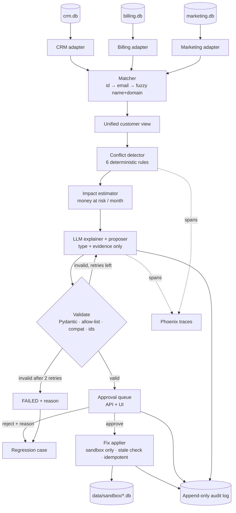

# Architecture

Data flows one way: adapters -> matcher -> detector -> impact -> LLM proposer -> approval -> applier.



## Components

| Component | File | Deterministic or LLM |
|---|---|---|
| Synthetic data generator | `data/generator/generate.py` | Deterministic (seeded) |
| Adapters | `app/adapters/{crm,billing,marketing}.py` | Deterministic |
| Normalisation | `app/core/normalize.py` | Deterministic |
| Matcher | `app/core/matcher.py` | Deterministic |
| Conflict detector | `app/core/detector.py` | Deterministic |
| Impact estimator | `app/core/impact.py` | Deterministic |
| Allow-list + param rules | `app/core/actions.py` | Deterministic |
| Explainer / proposer | `app/core/proposer.py` + `app/llm/` | LLM, validated by code |
| Approval service | `app/approval/store.py` | Human + code |
| Audit log | `app/audit/log.py` + DB triggers | Deterministic |
| Fix applier | `app/applier/applier.py` | Deterministic |
| Pipeline | `app/core/pipeline.py` | Orchestration |
| API + UI | `app/api/main.py`, `templates/` | - |
| Evals + regressions | `evals/` | Deterministic scoring |

## State

- `data/generated/` - the generated originals. Read-only for the app.
- `data/sandbox/` - a copy of them that approved fixes are written to. `POST /sandbox/reset` restores it.
- `data/state.db` - conflicts, proposals, approvals, audit log.

## Proposal lifecycle

```
            ┌──────── FAILED (validation failed after retries)
created ────┤
            └──────── PENDING_REVIEW ──approve──> APPROVED ──apply──> APPLIED
                             │                        │
                             └──reject──> REJECTED    └──precondition fails──> STALE
```

A conflict whose last proposal is FAILED or STALE gets a fresh proposal on the next pipeline run.
A REJECTED one does not: a human already said no.

## API

| Method | Path | Purpose |
|---|---|---|
| GET | `/conflicts?type=&status=&min_impact=&proposal_status=` | Queue, sorted by money at risk |
| GET | `/proposals/{id}` | Proposal + evidence + approvals + audit trail + LLM attempts |
| POST | `/proposals/{id}/approve` | `{reviewer, note}` |
| POST | `/proposals/{id}/reject` | `{reviewer, reason}` (reason required) |
| POST | `/proposals/{id}/apply` | `{actor}` - sandbox only, idempotent, stale-checked |
| POST | `/pipeline/run` | Detect + propose on the sandbox |
| POST | `/sandbox/reset` | Restore the sandbox from the originals |
| GET | `/audit`, `/stats`, `/health` | Inspection |
